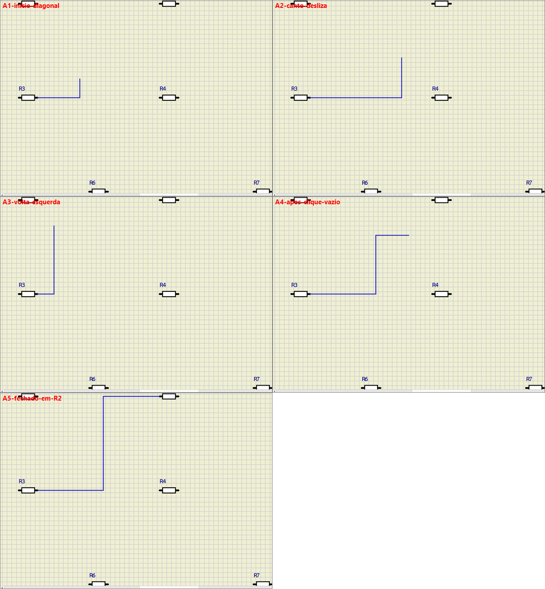
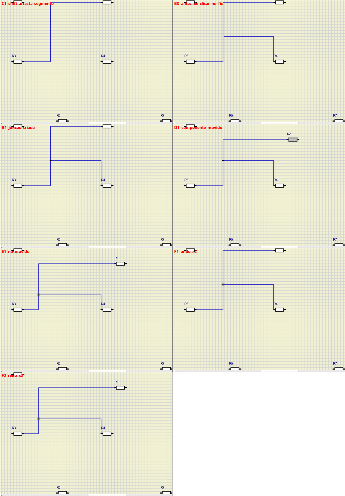
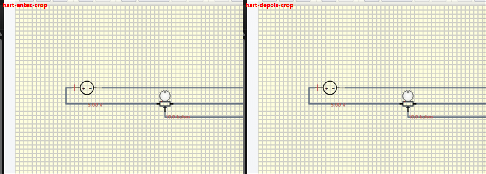
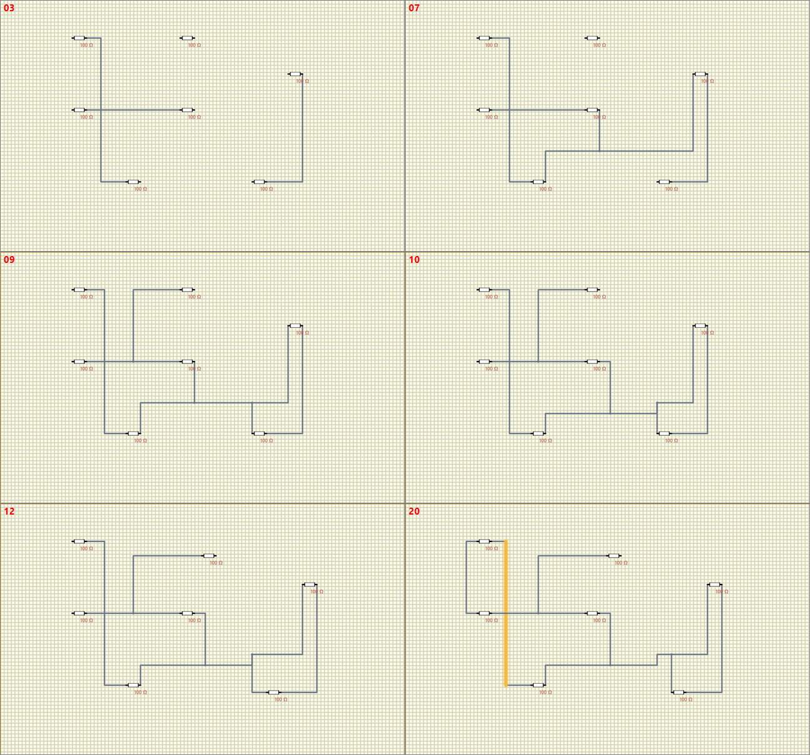

# 48 — Reengenharia do sistema de conexões com base no SimulIDE (2026-10-13)

Estado: implementado na árvore de trabalho, **sem commit**. Referências usadas:
`C:\SourceCode\SimulIDE_2-R260501_Sources\simulide_2` (código) e
`C:\SourceCode\SimulIDE_2-R260501_Win64\simulide.exe` (programa, operado por automação de mouse e
teclado reais).

## Resumo

| | Antes (commit `1b4455237`) | Depois |
|---|---|---|
| Roteiro dos 20 cenários (`run-wire-scenarios-e2e.cjs`) | 6 de 20 | 20 de 20 |
| Tempo entre o clique final e o fio aparecer | 523–651 ms | 2–16 ms |
| Viradas do cotovelo numa varredura diagonal do mouse | 2 | 0 |
| Fio final igual à pré-visualização | não | sim |
| Mudanças de estrutura da rota ao arrastar um componente | 2 | 0 |
| Ctrl+Z logo após editar fios | sem efeito | desfaz um passo por tecla |
| Mensagens de estado inteiro devolvidas pelo Host por edição | 1 | 0 |

Os números vêm de `measure-wire-interaction.cjs` e do roteiro de cenários, executados no VS Code
1.128 real com entrada de mouse/teclado via CDP, nas duas versões, com a mesma bancada
(`wire-lab.cjs`). O "antes" é o `extension/` do commit `1b4455237` exportado e compilado à parte.

A causa estrutural da sensação de "truncado" não era o renderizador. Eram quatro decisões de
arquitetura, descritas na seção B: a rota não era um dado (era recalculada), o cotovelo era
redecidido a cada movimento, toda conexão dependia de uma ida e volta ao Host, e o Host devolvia o
estado inteiro depois de cada edição.

---

## A. Como funciona no SimulIDE

### A.1 Classes e arquivos

| Arquivo | Classe | Papel |
|---|---|---|
| `src/gui/circuitwidget/circuit.cpp` | `Circuit` (QGraphicsScene) | Dono do fio em criação (`m_newConnector`, `m_conStarted`); eventos de mouse/teclado da cena; undo |
| `src/gui/circuitwidget/connector.cpp` | `Connector` | Um fio: pino inicial, pino final, lista ordenada de `ConnectorLine`. Algoritmo de rota em `updateConRoute` |
| `src/gui/circuitwidget/connectorline.cpp` | `ConnectorLine` (QGraphicsItem) | Um segmento. Hit-test (`shape`), arrasto de segmento, e `connectToWire` (junção) |
| `src/components/node.cpp` | `Node` (Component) | Junção: 3 pinos na mesma posição. `checkRemove`/`joinConns` desfazem o nó |
| `src/gui/circuitwidget/pin.cpp` | `Pin` | Inicia/fecha fio no `mousePressEvent`; `isMoved()` avisa o fio quando o componente anda |
| `src/components/component.cpp` | `Component` | Arrasto de componentes e de linhas selecionadas (`mouseMoveEvent`) |
| `src/gui/circuitwidget/circuitview.cpp` | `CircuitView` | Zoom, pan, botão do meio, cancelamento por botão direito |
| `src/utils.cpp` | `toGrid` | Encaixe na grade (4 px nesta versão) |

### A.2 Modelo

Um `Connector` liga exatamente dois `Pin`. Não existe fio com três pontas: uma derivação é um
`Node`, que é um componente com três pinos, e cada ramo é um `Connector` próprio. A geometria é a
lista de segmentos, persistida como `pointList`. Não há roteador automático nem desvio de
obstáculos: **a rota é o que o usuário desenhou**.

### A.3 Máquina de estados da criação

```
OCIOSO ──press em Pin livre──────────────► DESENHANDO   Circuit::newconnector
OCIOSO ──press em ConnectorLine──────────► DESENHANDO   connectToWire: cria Node, divide o fio
DESENHANDO ──mouse move──────────────────► DESENHANDO   Connector::updateConRoute(nullptr, pos)
DESENHANDO ──release no vazio────────────► DESENHANDO   Connector::incActLine (fixa o canto)
DESENHANDO ──press em Pin livre──────────► OCIOSO       Circuit::closeconnector
DESENHANDO ──press em ConnectorLine──────► OCIOSO       connectToWire + closeconnector(node pin)
DESENHANDO ──Esc / botão direito─────────► OCIOSO       Circuit::deleteNewConnector
```

Enquanto `m_conStarted` é verdadeiro, desfazer, colar, apagar e carregar ficam bloqueados.

### A.4 Algoritmo de rota (`Connector::updateConRoute`)

O fio em criação tem um índice `m_actLine`: o segmento "ativo". Tudo antes dele está congelado.

1. A ponta do último segmento vai para o cursor (na grade).
2. Se o último segmento ficou nulo, é removido.
3. Se ficou diagonal:
   - **último é o ativo** → nasce um canto. A primeira perna segue o eixo dominante
     (`fabs(dx) > fabs(dy)` → horizontal).
   - **último vem depois do ativo** → o canto existente *desliza* ao longo do eixo do segmento
     anterior. A orientação não muda.
4. `remNullLines` funde segmentos nulos ou alinhados.

Consequência observável: o "L" entre o último ponto fixo e o cursor tem memória. O eixo é escolhido
quando o cursor sai do alinhamento e fica travado até realinhar. Um clique no vazio
(`incActLine`) congela o canto e o trecho seguinte passa a ser elástico a partir dele.

A mesma função trata o movimento de um pino (`Pin::isMoved`): só o primeiro ou o último segmento
muda, e o canto vizinho desliza ao longo do segmento seguinte. O resto do fio fica onde está.

### A.5 Junção (`ConnectorLine::connectToWire`)

- Ponto a menos de 8 px (no eixo do segmento) de um canto interno → usa o próprio canto.
- Senão, o segmento é dividido no ponto projetado.
- Cria `Node`, e `Connector::splitCon` reparte os segmentos em dois fios novos.
- O fio em criação fecha no terceiro pino do nó.

Ao remover um ramo, `Node::checkRemove` conta os fios restantes: com dois, `joinConns` os funde num
só e o nó some; com um, o toco é removido junto.

### A.6 Edição

- **Segmento:** Shift+arrasto ou botão do meio. Move só no eixo perpendicular; os vizinhos esticam.
  Primeiro e último segmento ganham um segmento nulo antes de mover, para o pino continuar preso.
- **Canto:** Shift+arrasto exatamente sobre o canto move o canto livremente (pode gerar diagonal).
- **Clique simples num fio:** começa uma derivação. Não seleciona nem move.
- **Componente e nó:** arrasto em passos de grade; cada pino chama `updateConRoute`.

### A.7 Verificação na operação real

Capturas em `docs/assets/48-conexoes/`.



| Quadro | Operação | O que confirma |
|---|---|---|
| A1 | Clique no pino de R3, cursor para cima-direita | L com primeira perna horizontal |
| A2, A3 | Cursor atravessa a diagonal e volta | O canto desliza, o cotovelo não vira |
| A4 | Clique no vazio, depois mover | Canto anterior fixado; nova perna a partir dele |
| A5 | Clique no pino de R2 | Fio fecha com a rota que estava na tela |



| Quadro | Operação | O que confirma |
|---|---|---|
| C1 | Shift+arrasto do segmento vertical | Segmento anda; vizinhos esticam |
| B0, B1 | Fio de R4 terminando no meio de outro fio | Nó criado no ponto clicado |
| D1 | Arrastar R2 | Só o último trecho muda |
| E1 | Arrastar o nó | Os três fios acompanham sem ganhar dobras |
| F1, F2 | Ctrl+Z duas vezes, Ctrl+Y duas vezes | Cada tecla desfaz/refaz uma operação |

Não verificado na operação real, só pela leitura do código: iniciar uma derivação clicando num
fio e cancelar com Esc; cancelar com o botão direito; excluir um ramo. A sessão de área de trabalho
remota ficou sem tela ativa durante esses ensaios e a entrada sintética deixou de chegar ao
programa (ver seção F).

---

## B. Como funcionava no LasecSimul

O modelo topológico já era bom e foi mantido: nós de junção como entidades próprias, com qualquer
número de fios (sem o limite de três do SimulIDE), e funções puras em `wireTopology.ts`. Os
problemas estavam na geometria e no fluxo de interação.

| # | Causa estrutural | Efeito percebido | Onde |
|---|---|---|---|
| 1 | A rota de um fio sem dobra manual não era gravada. Era recalculada por um roteador com desvio de obstáculos a cada render | O fio final não era o da pré-visualização; mover um componente redesenhava o fio inteiro | `wireTopology.ts::wirePolylinePoints` |
| 2 | O cotovelo da pré-visualização era redecidido a cada `pointermove` pelo eixo dominante | O cotovelo virava no meio do movimento; uma derivação podia correr por cima do fio de destino | `wireGeometry.ts::orthogonalSegmentPoints` |
| 3 | Concluir um fio mandava um pedido ao Host, que só publicava depois de o Core confirmar | 523–651 ms entre o clique e o fio aparecer | `extension.ts`, caso `requestConnectEndpoints` |
| 4 | Depois de cada edição o Host devolvia o estado inteiro (catálogo incluso) | Estado mais novo sobrescrito por eco atrasado; redesenho completo fora de hora | `extension.ts`, caso `projectChanged` |
| 5 | A mensagem `simulationStatus`, reenviada a cada sincronização, redesenhava o canvas sem condição | Um arrasto em andamento perdia a captura do ponteiro e parava | `main.ts`, handler de `simulationStatus` |
| 6 | Desfazer aplicava o snapshot por referência; o eco do item 4 mascarava o defeito | Histórico corrompido depois do primeiro Ctrl+Z | `main.ts::applyUndoSnapshot` |
| 7 | A revisão da topologia fazia parte da chave de desfazer | Entradas de desfazer sem efeito visível | `main.ts::undoContentKey` |
| 8 | Arrastar de um pino só conectava se soltasse sobre outro pino; soltar em fio ou no vazio descartava | Ações repetidas para ligar a um fio | `main.ts::startPinConnectionDrag` |
| 9 | Iniciar um fio selecionava o componente e redesenhava tudo | O painel de propriedades abria sobre o canvas | `main.ts::handleWireGestureClick` |
| 10 | Componente arrastava em posição livre | Pinos quase alinhados, degraus de poucos pixels nos fios | `main.ts`, arrasto de componente |

Classificação pedida na missão: 1, 2 e 10 são de geometria; 3, 4 e 7 de arquitetura; 5 e 8 de
eventos; 6 de estado; 9 de usabilidade. Nenhum era do renderizador: o custo dos handlers de
`pointermove` já era de 1–3 ms no circuito de 72 componentes.

---

## C. Diferenças identificadas

| Aspecto | SimulIDE | LasecSimul antes | LasecSimul depois |
|---|---|---|---|
| Rota | Lista de segmentos gravada | Derivada por roteador a cada render | Cantos gravados em `wire.points` |
| Cotovelo durante o desenho | Eixo travado até realinhar | Redecidido a cada movimento | Eixo travado até realinhar |
| Clique no vazio | Fixa o canto | Cria ponto no cursor | Fixa o canto; em trecho reto, cria ponto de passagem |
| Fim sobre um fio | Clique na linha cria nó | Clique na alça; ida e volta ao Host | Clique ou solte; marca verde mostra o ponto; local |
| Arrastar do pino e soltar | Solte fixa canto, desenho continua | Só conectava em pino | Conecta em pino, nó ou fio; no vazio fixa canto e continua |
| Mover componente | Só a ponta do fio se ajusta | Rota recalculada | Só a ponta se ajusta |
| Dois componentes ligados, movidos juntos | Cada ponta desliza | Rota recalculada | O fio translada rígido |
| Nó | 3 pinos, no máximo 3 fios | N fios | N fios |
| Mover segmento | Shift+arrasto ou botão do meio | Arrasto simples | Arrasto simples |
| Cancelar | Esc ou botão direito | Esc; botão direito recuava uma dobra | Esc; botão direito ou Backspace recuam um canto e cancelam quando não há mais |
| Confirmação do fio | Imediata, em processo | Depois do Host e do Core | Imediata na Webview |
| Passo de movimento | Grade | Livre | Grade no circuito; Alt libera |
| Desvio de obstáculos | Não existe | Sempre, implícito | Ação explícita no menu do fio |

---

## D. Mudanças implementadas

### D.1 Arquitetura

```
wireRouting.ts      geometria pura: rascunho, rota resolvida, simplificação     (novo)
wireTopology.ts     topologia pura: nós, divisão, fusão, conexão                (alterado)
connectionEngine.ts roteador com desvio de obstáculos, só sob comando           (inalterado)
main.ts             eventos, estado transitório do gesto, DOM                   (alterado)
extension.ts        Host: persistência e sincronização com o Core               (alterado)
```

- **Modelo lógico:** `state.topology` (`nodes` + `conductors`), como antes.
- **Geometria:** `wire.points`, os cantos. As pontas vêm do pino ou do nó.
- **Estado do gesto:** `wireDraft`, só na Webview. Nunca vai ao Host.
- **Encaixe:** pino, depois nó, depois fio (`findMagneticDock`, `findWireDockTarget`).
- **Histórico:** uma entrada por `persistState()` com conteúdo diferente.

### D.2 `wireRouting.ts` (novo)

Implementação própria; nenhum trecho do SimulIDE foi copiado. Três regras:

1. Um fio é o que foi desenhado.
2. O "L" tem memória (`moveWireDraft`, `fixWireDraftCorner`, `finishWireDraft`).
3. Mover uma ponta só mexe na ponta (`resolveWirePath`).

`resolveWirePath(from, cantos, to)` é uma função das pontas atuais e dos cantos gravados. Não
depende do caminho que a ponta percorreu: arrastar um componente e voltar devolve a rota original.
O que fica na tela ao soltar é gravado (`bakeWiresTouching`), já simplificado.

O cursor encaixa numa grade relativa ao último ponto fixo (`snapToDraftGrid`). Pinos do LasecSimul
nem sempre caem na grade global (o resistor tem pinos em y = …,5); com grade relativa, "alinhado
com a origem" é exato e não sobra degrau entre o fio e o pino.

### D.3 Interação (`main.ts`)

- `beginWireDraft` não seleciona, não persiste e não redesenha.
- `updatePendingWireDock` move só a polilinha de pré-visualização e a marca de junção.
- `commitWireDraft` aplica a conexão na própria Webview (`applyLocalConnection`) e redesenha na hora.
- `removeWiresLocally` exclui fios com a mesma normalização do Host.
- Arrasto de componente em passos de grade; fios com as duas pontas no conjunto transladam rígidos
  (`computeCarriedTopology`).
- Arrasto de nó em passos relativos à posição inicial.
- Ctrl+Z e Ctrl+Y tratados na Webview; o eco do keybinding do VS Code é descartado.
- `simulationStatus` sem mudança não redesenha; com arrasto em curso, nenhum redesenho.
- `updateWireFromFullPath` grava a rota resolvida, para o dado ser igual ao desenho.
- O índice espacial de segmentos acompanha os arrastos (`syncWireSpatialIndex`).

### D.4 Protocolo com o Host (`extension.ts`, `messages.ts`)

- `projectChanged`: o que veio da Webview é marcado como sincronizado. O Host só envia o que ele
  mesmo muda.
- A revisão da topologia sai da comparação de conteúdo e volta por uma mensagem própria,
  `topologyRevision`.
- `requestConnectEndpoints` continua aceito, mas a Webview não o usa mais.

### D.5 Projetos existentes

Arquivos antigos não gravavam os cantos de fios roteados automaticamente. Para abrirem com a mesma
aparência, `projectCommands.ts::freezeLegacyAutomaticRoutes` roda o roteador antigo **uma vez** na
abertura e grava o resultado. Arquivos salvos a partir de agora levam `visual.wireRoutes:
"explicit"` e não passam por isso. A abertura de subcircuito para edição faz o mesmo.



### D.6 Arquivos

| Arquivo | Mudança |
|---|---|
| `extension/src/ui/webview/wireRouting.ts` | novo |
| `extension/src/ui/webview/wireRouting.test.ts` | novo, 20 testes |
| `extension/src/ui/webview/wireTopology.ts` | `wirePolylinePoints` sem roteador; `autoRoutedWirePoints`, `bakeWireRoutes`, `findWireAtPoint`; derivação que começa e termina no mesmo fio; fusão de nó usa a rota desenhada |
| `extension/src/ui/webview/wireTopology.test.ts` | 1 teste reescrito, 4 novos (41 no total) |
| `extension/src/ui/webview/main.ts` | interação, conexão e exclusão locais, arrastos, desfazer |
| `extension/src/ui/webview/messages.ts` | mensagem `topologyRevision` |
| `extension/src/ui/webview/styles.css` | marca de junção, cursor, ponto de nó maior |
| `extension/src/extension.ts` | sem eco; rotas de subcircuito |
| `extension/src/project/ProjectTypes.ts`, `ProjectSerializer.ts`, `projectCommands.ts` | `wireRoutes`, congelamento das rotas antigas |
| `extension/test/e2e/wire-lab.cjs` | bancada de medição |
| `extension/test/e2e/run-wire-scenarios-e2e.cjs` | os 20 cenários |
| `extension/test/e2e/measure-wire-interaction.cjs` | métricas comparáveis entre versões |
| `extension/package.json` | `test:wires:e2e`, `test:wires:measure`; `wireRouting.test` no `npm test` |

O arquivo também inclui a correção do zoom por scroll, feita antes nesta mesma sessão.

---

## E. Evidências de validação

### E.1 Os 20 cenários

`npm run test:wires:e2e`. Mesmo roteiro nas duas versões; o "antes" rodou com `--report`.

| # | Cenário | Antes | Depois | Ações | Fio aparece em |
|---|---|---|---|---|---|
| 01 | Conectar dois terminais próximos | ok (628 ms) | ok | 2 | 2 ms |
| 02 | Conectar terminais distantes | falha: rota com toco de 12 px em vez do L desenhado | ok | 2 | 2 ms |
| 03 | Conexão com mudança de direção | falha: fio final difere da pré-visualização | ok | 3 | 2 ms |
| 04 | Alterar uma dobra | ok | ok | 1 | — |
| 05 | Arrastar segmento horizontal | falha: fio não apareceu em 4 s | ok | 4 | — |
| 06 | Arrastar segmento vertical | ok | ok | 1 | — |
| 07 | Ligar uma linha ao meio de outra | falha (dependia de 05) | ok | 2 | 3 ms |
| 08 | Ramificação em T a partir de um fio | falha: o clique no fio não iniciou a derivação | ok | 4 | 2 ms |
| 09 | Múltiplas ramificações (solte sobre o fio) | falha (dependia de 07) | ok | 1 | 9 ms |
| 10 | Arrastar nó com três conexões | falha (dependia de 07) | ok | 1 | — |
| 11 | Mover componente conectado | falha (dependia de 08) | ok | 1 | — |
| 12 | Mover dois componentes conectados | ok | ok | 4 | — |
| 13 | Alterar o percurso de uma conexão | ok | ok | 2 | — |
| 14 | Desfazer e refazer | falha: Ctrl+Z não mudou nada | ok | 6 | — |
| 15 | Excluir uma ramificação | falha (dependia de 09) | ok | 3 | — |
| 16 | Reconectar uma linha | falha (dependia de 15) | ok | 2 | 2 ms |
| 17 | Passar perto e cruzar sem conectar | falha: fio não apareceu em 4 s | ok | 3 | 4 ms |
| 18 | Região densa (72 componentes, 85 fios) | falha: fio final difere da pré-visualização | ok | 5 | 16 ms |
| 19 | Movimentos rápidos do mouse | ok | ok | 2 | — |
| 20 | Editar repetidamente uma conexão | falha (dependia de 07) | ok | 12 | — |

Sete das falhas do "antes" são consequência de um cenário anterior ter falhado, porque o roteiro
constrói um circuito só. As causas independentes são as de 02, 03, 05, 08, 14, 17 e 18.



### E.2 Métricas (`measure-wire-interaction.cjs`)

| Medida | Antes | Depois |
|---|---|---|
| Viradas do cotovelo, varredura de 36 passos | 2 | 0 |
| Clique final → fio na tela, pino a pino | 651 ms | 4 ms |
| Clique final → fio na tela, junção | 523 ms | 3 ms |
| Rota da derivação até a junção | corre 76 px por cima do fio de destino | T limpo |
| Dobras do fio ao longo de um arrasto de componente | 1, 2, 2, …, 2, 1 | 1 constante |
| Maior handler durante o arrasto de componente | 99 ms | 3,9 ms |
| Dobras por fio depois de arrastar o nó | 3, 2, 1 | 2, 1, 1 |
| Desfazer: 1ª e 2ª tecla têm efeito | não, não | sim, sim |
| Denso: handler de `pointermove` ao desenhar, p50 / p95 | 2,0 / 2,9 ms | 1,7 / 2,3 ms |
| Denso: handler ao arrastar componente, p50 / p95 | 3,3 / 4,4 ms | 2,0 / 3,6 ms |
| Denso: mutações de DOM no arrasto | 1495 | 1290 |

### E.3 Testes automatizados

- `npm test`: passa, incluindo `wireRouting.test` (20) e `wireTopology.test` (41).
- `run-wire-scenarios-e2e.cjs`: 20 de 20.
- Já existentes e ainda aprovados: `run-connection-e2e.cjs`, `run-wire-visibility-e2e.cjs` (padrão,
  criação e recorte), `run-project-reopen-e2e.cjs`, `run-terminal-editor-e2e.cjs`.
- `run-webview-e2e.cjs` falha na paleta de componentes, esperando o item `plc.instance`. Já falhava
  antes das mudanças de fios desta sessão; a paleta não é tocada por elas, e o item `plc.instance`
  está entre as alterações de PLC pendentes na árvore. A causa não foi confirmada.

---

## F. Limitações restantes

1. **Latência de pintura não foi comparada com o SimulIDE.** A medição externa (entrada real e
   leitura da tela) dependia da área de trabalho remota com tela ativa, que ficou indisponível. O
   que há: no LasecSimul o fio chega ao DOM em 2–16 ms; no SimulIDE a confirmação é síncrona em
   processo. A regularidade dos quadros também não é comparável: a bancada roda com
   `--disable-gpu` e o `requestAnimationFrame` fica fixo em ~31 ms nas duas versões.
2. **Três comportamentos do SimulIDE ficaram confirmados só pelo código** (seção A.7).
3. **Linhas diagonais não existem.** O SimulIDE permite com Shift; o LasecSimul mantém tudo ortogonal.
4. **Mover segmento com botão do meio ou Shift+arrasto não foi replicado.** O arrasto simples já
   move; o botão do meio continua sendo pan.
5. **Um pino aceita vários fios sem nó visível.** No SimulIDE cada pino tem um fio só. Mantido.
6. **Rotação e espelhamento não gravam a rota.** O desenho fica correto (a rota é resolvida contra
   a posição nova do pino), mas os cantos só são regravados no próximo arrasto ou edição do fio.
7. **Remoção de componente ainda passa pelo Host.** Fios saem na hora; componentes esperam a ida e
   volta, por causa das cascatas de túnel e de instância no Core.
8. **Passo de grade no arrasto de componentes é mudança de comportamento.** Alt libera. Vale só no
   circuito; Símbolo, Ícone e IHM continuam livres.
9. **`requestConnectEndpoints` ficou sem uso** na Webview. Pode ser removido do Host depois de
   revisão.
10. **Licença.** O comportamento foi reproduzido por implementação própria a partir da análise do
    SimulIDE (AGPL-3.0). Nenhum código foi copiado. Convém confirmar esse entendimento com quem
    cuida de `LICENSE-POLICY.md`.

## Como reproduzir

```
cd extension
npm test
npm run test:wires:e2e                      # 20 cenários
npm run test:wires:measure -- depois        # métricas em test/e2e/artifacts/wire-interaction/depois
```

Para medir outra cópia da extensão com a mesma bancada, defina `LASECSIMUL_WIRE_LAB_EXTENSION`
com o caminho dela e acrescente `--report` ao roteiro de cenários.
