# 49 — Editor IEC 61131-3 do OpenPLC Editor 4.2.8 dentro do LasecSimul

Data: 2026-10-15. Referência: OpenPLC Editor **v4.2.8** (o instalado nesta máquina), tag
`v4.2.8`, commit `1b1e4b64db79e84aa437b5cc3054ee923b8893a5`, GPL-3.0.

## 1. Objetivo e decisão

O pedido foi ter no LasecSimul a mesma identidade visual, as mesmas bibliotecas, a mesma fluidez de
arrastar elementos e os mesmos recursos de edição do OpenPLC Editor, aproveitando o que o
LasecSimul/VS Code já têm e deixando de fora o que não faz sentido num simulador; depois, o SFC
dentro do mesmo editor e um único tipo de arquivo, `.lsplc`, para as cinco linguagens.

Em vez de redesenhar o editor, o LasecSimul roda **o próprio frontend do OpenPLC Editor** (React +
React Flow + Monaco + Tailwind + Radix + Zustand) numa aba do VS Code. A investigação do código
mostrou que a interface do OpenPLC só fala com o processo principal do Electron por *ports*
(`src/middleware/shared/ports`) e pelo objeto `window.bridge` dos adaptadores
(`src/middleware/adapters/editor`). Basta trocar essa ponta:

| Camada do OpenPLC (Electron) | No LasecSimul |
| --- | --- |
| `window.bridge` (preload + `ipcRenderer`) | `overlay/webview/bridge.ts`: mesmo objeto, sobre `postMessage` da Webview |
| Pasta do projeto (project.json, devices/, pous/) | Arquivo `.lsplc` com esses mesmos arquivos dentro (`extension/src/plc/openplc/lsplcFile.ts`) |
| Processo principal (`parseProjectFiles`, criação de projeto, `LibraryManagerModule`) | As mesmas funções, empacotadas no host da extensão (`overlay/host/index.ts`), com `electron` trocado por um *shim* |
| Compilação (xml2st/STruC++ → runtime OpenPLC ou Arduino) | Transpilador LD/FBD/ST/IL→ST do próprio OpenPLC (SFC: tradução SFC→ST do LasecSimul) + `lasecsimul-core --plc-compile` |
| Runtime / Play / Stop | A simulação do esquemático (`lasecsimul.run` / `lasecsimul.stop`) |
| Depurador (mapa de depuração da STruC++ + protocolo do runtime) | Mapa gerado a partir das variáveis do programa + `plcGet`/`plcForce`/`plcUnforce` no CLP simulado |
| Aba "PLC Logs" (logs do runtime) | Log de simulação do LasecSimul (o mesmo do canal "LasecSimul: Simulação") |
| Editor SFC (stub no OpenPLC, inclusive no ramo de desenvolvimento) | Editor SFC do LasecSimul no mesmo arranjo do LD/FBD (`overlay/webview/sfc/`) |

O código do OpenPLC **não é copiado para o repositório**: `scripts/build-openplc-workspace.js`
clona a tag fixada em `scripts/openplc-workspace-pin.json`, instala as dependências, copia
`plc/openplc-workspace/overlay` para `src/lasecsimul/` e gera `extension/media/openplc-workspace/`
(fora do git). O fluxo de release (`package-installers.yml`) faz esse build antes de empacotar, e
`package-release.js` falha se o editor não estiver no pacote.

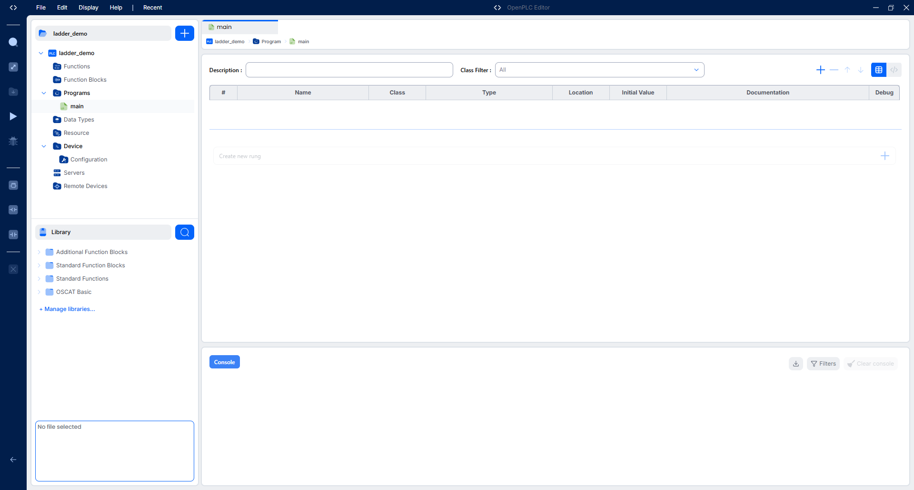
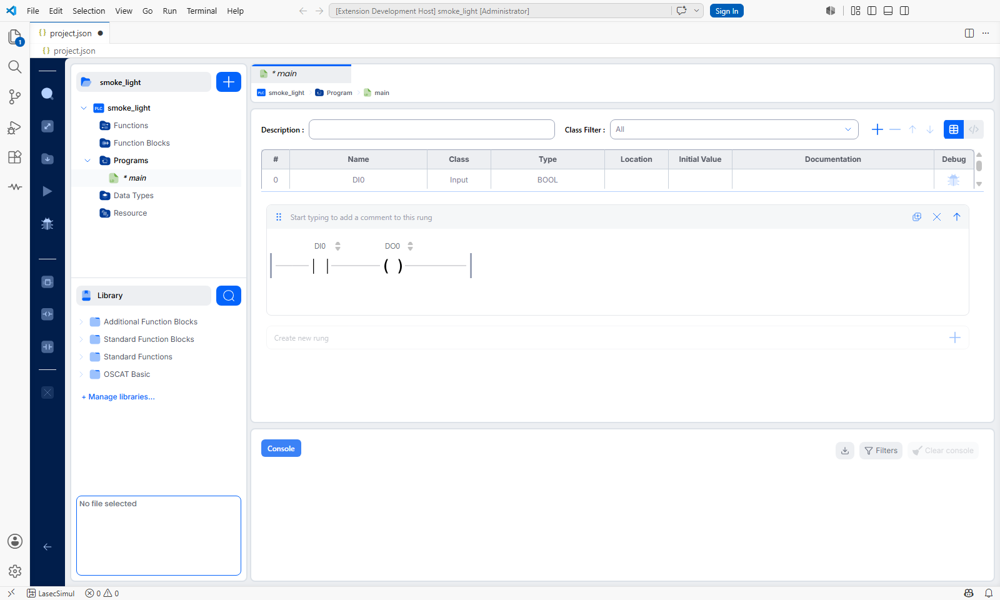

## 2. O arquivo `.lsplc`

Um projeto PLC do LasecSimul é **um arquivo `.lsplc`**, o mesmo para LD, FBD, ST, IL e SFC (o
duplo clique abre o editor). Dentro dele está um projeto do OpenPLC Editor inteiro, em JSON:

```json
{
  "format": "lasecsimul.plc-project",
  "formatVersion": 1,
  "editor": { "name": "OpenPLC Editor", "version": "4.2.8" },
  "project": { "meta": { ... }, "data": { ... } },
  "devices": { "configuration": { ... }, "pinMapping": [] },
  "files": {
    "pous/programs/main.sfc": "PROGRAM main\n  VAR_INPUT ...\n{ \"steps\": [...] }\nEND_PROGRAM",
    "pous/function-blocks/pisca.st": "FUNCTION_BLOCK pisca ..."
  }
}
```

`project` é o `project.json` do OpenPLC; cada entrada de `files` é o texto que o OpenPLC grava no
arquivo do POU (`.ld`, `.fbd`, `.st`, `.il` e, agora, `.sfc`). O editor trabalha com esses arquivos
como trabalharia numa pasta — os caminhos que ele usa (`meu.lsplc/pous/programs/main.ld`) são
resolvidos dentro do arquivo, que é gravado de uma vez (temporário + troca). Comandos:

- **LasecSimul: New PLC Project (.lsplc)** — escolhe a linguagem do `main` (as cinco) e cria o
  arquivo pelo mesmo serviço do assistente "New Project" do OpenPLC, com `DI0`/`DO0` declarados.
- **LasecSimul: Import OpenPLC Editor Project** — pasta do OpenPLC original → `.lsplc`.
- **LasecSimul: Export PLC Project to OpenPLC Editor** — `.lsplc` → pasta do OpenPLC original (POUs
  SFC só abrem no LasecSimul; o OpenPLC 4.2.8 não tem editor SFC).

- **LasecSimul: Convert IEC Project (.iec.json) to .lsplc** — projeto antigo → `.lsplc` (também no
  menu de contexto do explorer sobre um `*.iec.json` e no título do editor antigo).

### Projetos antigos (`.iec.json`)

Os projetos dos editores próprios das etapas 1 a 4 (`*.iec.json`) continuam abrindo no editor antigo,
mas não são mais criados; o comando acima os converte. O arquivo antigo fica como estava, o `.lsplc`
é gravado ao lado com o mesmo nome e, se algum esquemático do workspace usa o projeto antigo, o
comando oferece passar a usar o novo (os pinos são as mesmas `VAR_INPUT`/`VAR_OUTPUT`, com o mesmo
nome, então os fios continuam ligados). Os exemplos de `trm/plc` já foram convertidos e os
esquemáticos deles apontam para os `.lsplc`.

- **ST e IL** passam como texto; o **SFC** já usa o mesmo modelo e só ganha o desenho (layout
  automático a partir do passo inicial).
- **LD**: o LD antigo é uma grade com ligações verticais; a conversão (`overlay/host/legacy.ts`) a
  transforma numa expressão série-paralelo (fatorando o trecho comum dos ramos) e monta cada degrau
  com as funções do próprio editor do OpenPLC — as mesmas que rodam quando um elemento é solto num
  marcador (`addNewElement`, em série ou no marcador de baixo, que abre um paralelo). O resultado é um
  degrau igual ao desenhado à mão: contatos (NA, NF, bordas), bobinas (normal, negada, set, reset,
  bordas), blocos com as variáveis ligadas e EN/ENO quando o degrau passa por eles. O arquivo
  convertido abre sem marcar modificação e, salvo sem mexer, fica idêntico.
- O que o editor LD do OpenPLC não desenha — salto/retorno, contato de comparação, ramo vazio — e o
  FBD antigo vão como ST, pela mesma tradução que o build do LasecSimul usava, com aviso.
- Bloco ou função do projeto com o nome de um bloco das bibliotecas do OpenPLC (a OSCAT Basic tem
  `TOGGLE`, o mesmo nome do bloco dos exemplos) ganha um sufixo (`TOGGLE_1`), com aviso; as bibliotecas
  entram sempre na compilação e os dois nomes colidiriam.

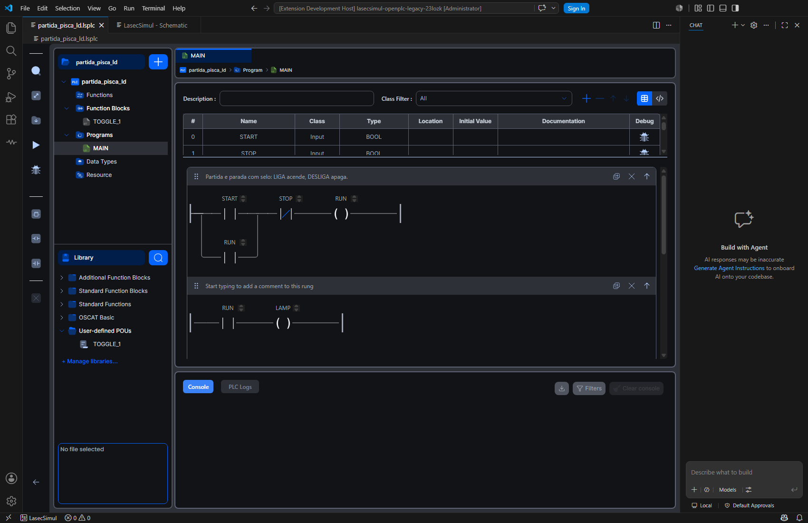
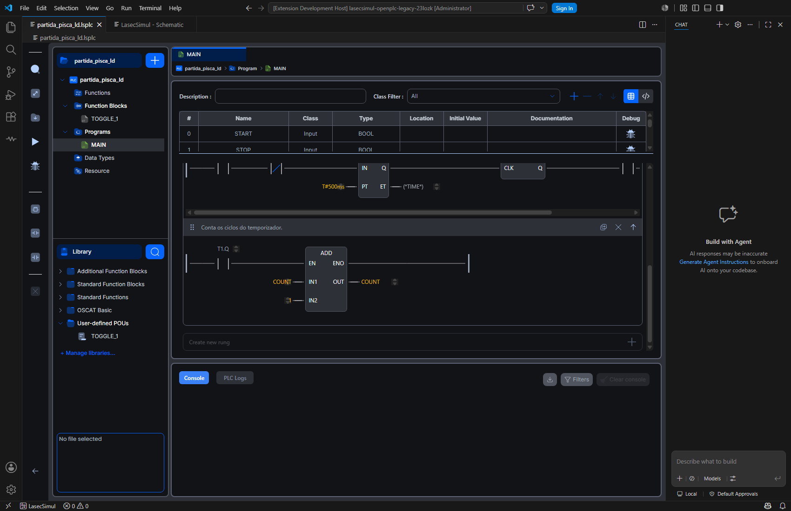
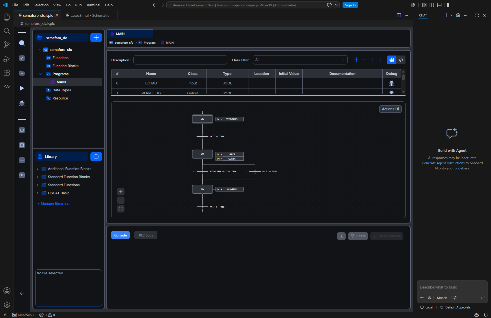

## 3. O que o usuário tem

- **Explorer do projeto** (Functions, Function Blocks, Programs, Data Types, Resource), abas,
  breadcrumbs, botão "+" para POU novo e tipo de dado, igual ao OpenPLC.
- **Ladder (LD)** com React Flow: criar degrau, arrastar contato/bobina/bloco da barra lateral,
  campo de variável com o autocompletar do OpenPLC, comentário do degrau, duplicar e apagar degrau,
  desfazer/refazer (Ctrl+Z / Ctrl+Y).
- **FBD**: variáveis de entrada/saída/entrada-saída, blocos, conectores, continuações, comentários;
  ligações puxadas entre as alças; Delete apaga a seleção.
- **ST e IL** no Monaco com o **servidor de linguagem da STruC++** (autocompletar com as variáveis
  do POU e as funções das bibliotecas, erros sublinhados enquanto digita).
- **SFC** (IEC 61131-3 3ª ed., 6.7), no mesmo canvas, grade, zoom e barra lateral do FBD/LD:
  passo, passo inicial (borda dupla), transição (barra com a condição ST, que pode usar
  `PASSO.X`/`PASSO.T`) e bloco de ação (qualificadores N, R, S, L, D, P, P1, P0, SD, DS, SL, ação
  nomeada ou variável BOOL, duração). Soltar uma transição logo abaixo de um passo, ou um passo logo
  abaixo de uma transição, já os liga; as demais ligações são puxadas entre as alças. Divergência e
  convergência seletivas (várias transições de um passo; prioridade da esquerda para a direita, com o
  número mostrado ao lado) e simultâneas (uma transição com vários passos, linha dupla). Ações
  nomeadas com corpo em ST ou IL no painel "Actions" (Monaco com os temas do OpenPLC). Renomear um
  passo atualiza as referências `PASSO.X`/`.T`. Menu de contexto (passo inicial, novo bloco de ação,
  apagar), Delete, desfazer/refazer pelo histórico do OpenPLC.
- **Tabela de variáveis** (modo tabela e modo texto), classes, tipos, valores iniciais, documentação.
- **Bibliotecas**: as mesmas quatro do OpenPLC 4.2.8 — Additional Function Blocks, Standard
  Function Blocks, Standard Functions e OSCAT Basic — na árvore Library e no *Library Manager*
  (conteúdo de cada uma; instalar uma `.stlib` abre o seletor de arquivos do VS Code).
- **Build** (botão do OpenPLC): gera ST com o transpilador do OpenPLC (SFC pela tradução do
  LasecSimul) e compila no Core do LasecSimul; as mensagens aparecem no console do OpenPLC, e os erros
  de um POU SFC apontam o passo, a transição ou a ação. Com a simulação rodando, o programa novo é
  recarregado no bloco CLP sem parar a simulação.
- **Play / Stop** do OpenPLC rodam e param a simulação do esquemático.
- **Debugger** do OpenPLC sobre o CLP simulado: energia pintada nos degraus, valores na tabela e no
  gráfico do depurador, *Force True / Force False / Release* clicando no contato ou bobina ou na lista
  de variáveis do depurador; no SFC, os passos ativos em verde com o tempo desde a ativação. O mapa
  de variáveis vem da tabela que o Core gera para o build carregado (`driver.cpp`), então também
  aparecem os membros de instâncias de FB (`T1.Q`, `T1.ET`, `FLIP.EDGE.CLK`), campos de struct e
  elementos de vetor — um contato em `T1.Q` é pintado e o `ET` do TON mostra o tempo.
- **Tema**: segue o tema do VS Code (claro/escuro), com as fontes Inter/Poppins do OpenPLC.
- **Salvar / modificado**: Ctrl+S do VS Code salva pelo fluxo do próprio OpenPLC; o ponto de
  "modificado" da aba acompanha o estado do OpenPLC (o VS Code pergunta antes de fechar a aba com
  alterações, como em qualquer editor).

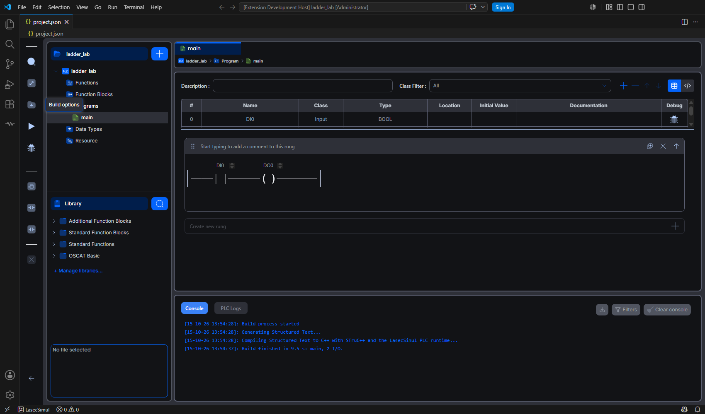
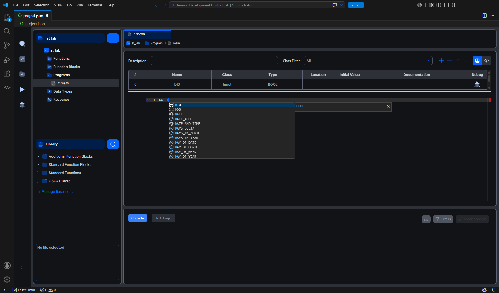
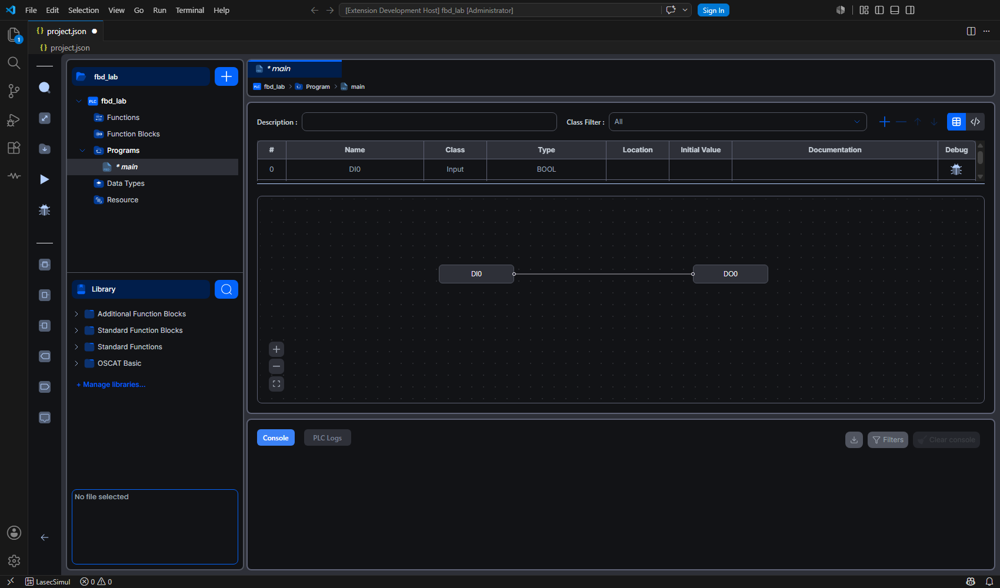
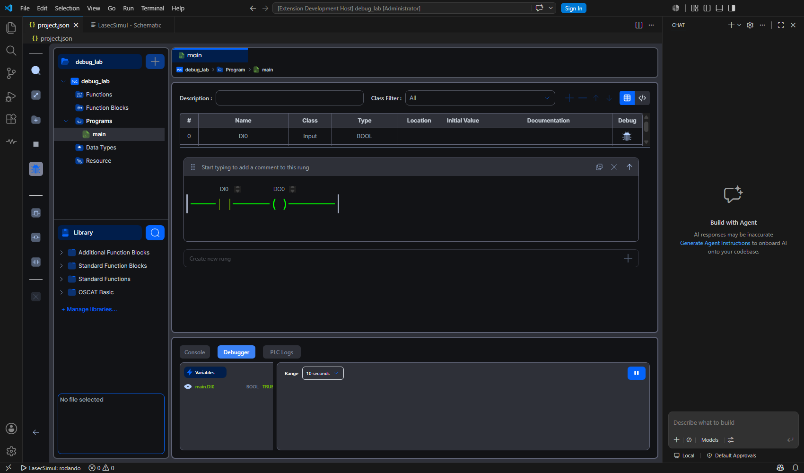
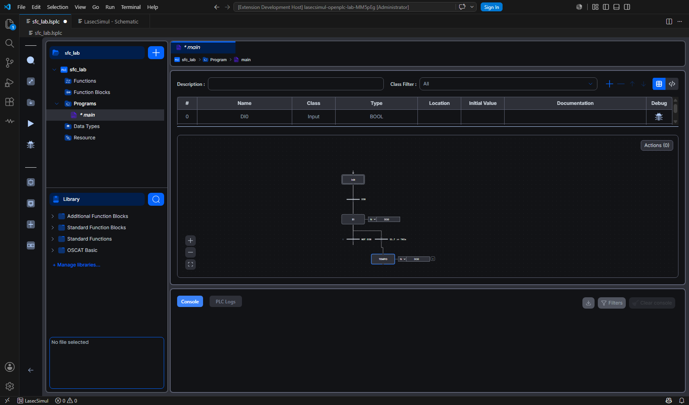
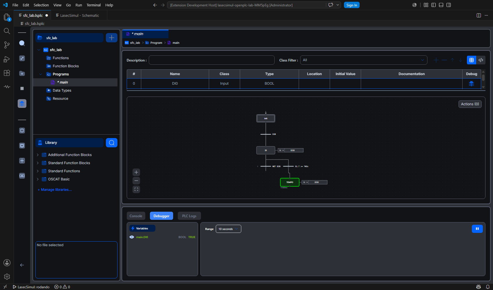
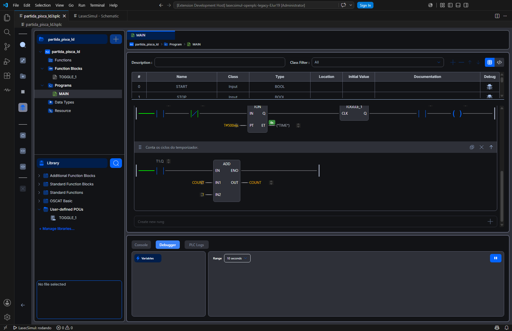

## 4. Integração com o esquemático

- O bloco **"PLC IEC 61131-3"** aceita no campo "Programa IEC" o arquivo `.lsplc` (e ainda o
  `.iec.json` antigo). Os pinos são as `VAR_INPUT`/`VAR_OUTPUT` do programa da primeira instância da
  RESOURCE, lidos sem compilar.
- "Abrir programa" no bloco abre o editor; "Novo projeto PLC" cria um `.lsplc` na linguagem escolhida.
  O SFC novo já vem funcionando: Init → `DI0` → S1 (ação N em `DO0`) → `NOT DI0` → Init.
- Rodar a simulação compila o projeto (cache por hash do ST e das ferramentas) e carrega o módulo no
  bloco.
- O bloco CLP só tem pinos no Core depois de carregar o programa. Ao abrir um esquemático cujo
  projeto ainda não foi compilado nesta máquina, os fios do bloco esperam a reconstrução que o Rodar
  faz depois de compilar (antes, cada fio gerava um aviso "recriar fio … pin inexistente").

## 5. O que ficou de fora (não se aplica ao simulador)

Barra de título e menus nativos do Electron (o VS Code tem os dele), tela inicial e assistente de
projeto (o projeto vem do LasecSimul), configuração de dispositivo/placa, pin mapping, servidores
Modbus/OPC UA/S7, dispositivos remotos, EtherCAT, telas de fabricante, gerenciador de pacotes de
placa, upload para runtime físico, login do runtime, controle de versão, assistente de IA,
exportação PLCopen XML/CODESYS e catálogo público de bibliotecas. POUs em **Python** e **C/C++**
ficam desabilitados no menu "+" (dependem do runtime do OpenPLC), como o OpenPLC 4.2.8 fazia com o
SFC — que agora fica habilitado.

Os ajustes no código do OpenPLC são aplicados no empacotamento por `overlay/patch-loader.cjs` (o build
falha se um trecho esperado sumir ou mudar numa versão nova): `projectCapabilities` (esconde
Device/Servers/Remote Devices/telas de fabricante/controle de versão), os estilos de desabilitado do
formulário de POU (SFC liberado; Python e C/C++ desabilitados), o stub do editor SFC (troca pelo do
LasecSimul), a barra de ferramentas SFC na barra de atividades, a extensão `.sfc`, o SFC nos
caminhos de leitura/gravação de POU gráfico (serializador e leitor de arquivos) e o tipo da saída de
funções genéricas no transpilador (seção 6).

## 6. Detalhes técnicos que precisaram de cuidado

- **Workers dentro da Webview**: os arquivos vêm de `https://file+.vscode-resource...` por um service
  worker; `new Worker(url)` recusa outra origem e um worker Blob com `importScripts` não passa por
  esse service worker. A página busca o texto do script e cria o worker do Blob com o código inteiro
  (Monaco e LSP da STruC++) — `overlay/webview/workers.ts`.
- **Ctrl+A**: na Webview o VS Code repassa a tecla ao workbench, que devolve um "selecionar tudo"
  assíncrono; ele chegava depois da primeira letra digitada e a apagava. Em campos de texto a tecla
  para em `document`, antes do ouvinte do VS Code (`overlay/webview/main.tsx`).
- **Desfazer/refazer**: as teclas que no Electron vinham do menu Edit viram os mesmos eventos de
  acelerador do OpenPLC; Monaco e campos de texto mantêm os seus. Os campos do SFC gravam uma vez, ao
  perder o foco (Enter confirma, Escape cancela), para cada edição ser um passo do histórico.
- **Arquivo alterado no disco**: gravações feitas pelo próprio OpenPLC (salvar antes de compilar ou de
  depurar) não disparam o "reverter" da aba, senão o editor perderia console e sessão de depuração.
- **Segurança**: o host só lê e grava dentro do `.lsplc` aberto; caminhos fora dele (inclusive com
  `..`) são recusados.
- **Diagnóstico de compilação**: cada linha do ST gerado é mapeada de volta ao POU e à linha do editor
  (a linha em branco que o transpilador põe depois do END_VAR e a CONFIGURATION não contam); nos POUs
  SFC, ao passo/transição/ação.
- **SFC na compilação**: o transpilador do OpenPLC não traduz SFC; antes dele, cada POU SFC vira um
  POU ST pela tradução do LasecSimul (`sfcLowering.ts`, sem alteração), com as variáveis internas como
  VAR do POU e o FB `__SFC_ACTION_CONTROL` no início do ST (`extension/src/plc/openplc/openPlcSfc.ts`).
- **Saída de função genérica no LD/FBD**: o transpilador do OpenPLC 4.2.8 declara BOOL a variável
  temporária da saída de funções com saída genérica (`ADD`, `MUL`, `MAX`, `SEL`… com `ANY_NUM`,
  `ANY_BIT`…) — o próprio código diz que um port futuro vai estreitar esses tipos. Um `ADD` que soma
  um contador `INT` num degrau contava só até 1. O tipo passa a vir da variável que recebe a saída
  (`CNT := _TMP_ADD.._OUT`) ou, sem ela, de uma entrada genérica ligada a uma variável declarada
  (`overlay/shared/function-temp-types.ts`, aplicado por um ajuste no emissor do transpilador).

## 7. Como construir e testar

```
node scripts/build-openplc-workspace.js            # ou: npm run build:openplc
node scripts/build-openplc-workspace.js --source <árvore do OpenPLC já clonada> --only webview
npm --prefix extension run test:openplc:e2e
```

Os testes de ponta a ponta abrem o VS Code de teste com a extensão, dirigem o editor pelo CDP (nunca
o mouse/teclado do sistema) e conferem: Ladder (tabela de variáveis, degrau, contato e bobina
arrastados, desfazer/refazer, duplicar/apagar degrau, Library Manager, aba modificada e Ctrl+S,
autocompletar de variáveis, Build no Core), linguagens (LSP de ST, menu "+", IL, FBD com ligação
puxada e Delete), depuração (Play/Stop, Debugger com cores de energia, Force True, PLC Logs) e SFC
(desenho inicial, barra de ferramentas, transição e passo arrastados que se ligam sozinhos, condição,
bloco de ação, desfazer/refazer, renomear, salvar no `.lsplc`, Build, Play, passo inicial ativo e a
evolução Init → S1 → TEMPO no CLP simulado), sem erros no console da Webview, e os exemplos
`trm/plc` convertidos (degraus com o paralelo do selo e os blocos TON/TOGGLE_1/ADD, abrir sem
modificação, passos/transições/ações do semáforo, Build e Play no esquemático do exemplo). Com
`LASECSIMUL_OPENPLC_LAB_MIRROR=1` a extensão de teste roda num espelho do repositório feito só de
junções — útil quando há edições em andamento em `core/src` que deixariam o Core "desatualizado" para
a extensão de desenvolvimento.

Teste unitário: `node out-test/src/plc/openplc/openPlcBuild.test.js` (também em `npm test`): mapa de
linhas, tradução SFC→ST do semáforo, diagnóstico de passo inicial e o arquivo `.lsplc`.

Conversão dos projetos antigos, no Core real: `npm --prefix extension run test:plc:openplc-core`. O
projeto antigo (build do LasecSimul) e o convertido (transpilador do OpenPLC) rodam lado a lado no
mesmo Core, com as mesmas entradas pseudoaleatórias, e as saídas são comparadas a cada passo: os
quatro exemplos de `trm/plc`, degraus em grade com série, selo, ramo no meio, paralelos aninhados,
bobinas em paralelo e ramos com bobinas diferentes, set/reset, bordas, bobina negada, TON e ADD com
EN/ENO, e um LD com salto e comparação (que vai como ST). Quando há edições em andamento em `core/src`,
`node test/run-mirrored.cjs out/plc/openplc/legacyIecProject.realCore.test.js` (dentro de `extension`)
roda o mesmo teste pelo espelho de junções.

## 8. Limitações conhecidas

- O depurador enxerga o programa de entrada (a primeira instância da RESOURCE) e o que está dentro
  dele; com o projeto alterado e ainda não compilado, o mapa volta às variáveis escalares do programa
  até o próximo Build. Os passos ativos aparecem no SFC do programa de entrada (num FB em SFC, não).
- A interface do OpenPLC é em inglês, como no original (o OpenPLC 4.2.8 só tem o idioma inglês).
- Não foram exercitados nos testes automáticos: copiar/colar (na Webview passa pela área de
  transferência do sistema, compartilhada com a sessão do usuário), instalar uma `.stlib` pelo Library
  Manager e os comandos de importar/exportar (diálogos de arquivo).
- Conversão de `.iec.json`: o FBD antigo e o LD com salto, retorno ou contato de comparação viram
  ST; `RETAIN` não existe no OpenPLC Editor e sai das variáveis; tipos apelido (`TYPE A : INT`) não
  existem nele e saem do projeto; várias listas de variáveis globais viram uma só. Tudo isso com aviso.
  O comando em si (diálogos e a pergunta sobre os esquemáticos) não tem teste automático; a conversão
  e a troca de referência no esquemático têm.
- A aba do editor abaixo de ~1000 px de largura fica apertada como o OpenPLC numa janela pequena;
  fechar a barra lateral do VS Code (Ctrl+B) dá mais espaço.
