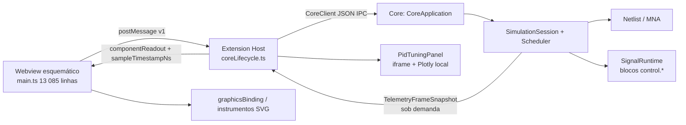

# Laboratório de Cálculo — diagnóstico da arquitetura atual

**Estado:** diagnóstico revisado em 2026-10-16 (2ª rodada). Substitui a versão anterior deste arquivo: várias
afirmações foram corrigidas após verificação no código e em execução. Nenhum código de produção foi alterado.

## Convenções de evidência

| Marca | Significado |
|---|---|
| **[C]** | verificado por leitura de código no commit analisado |
| **[E]** | verificado por execução (PoC isolada em [`docs/poc/laboratorio-calculo-limites/`](poc/laboratorio-calculo-limites/README.md), medições locais) |
| **[I]** | inferência arquitetural ainda não comprovada |
| **[P]** | proposta não implementada |

## Identificação

- Repositório `LASEC-UFU/LasecSimul`, branch `main`, commit `d381b440332bf54b4c0c84d73d87728bf8c20f80`; árvore limpa
  exceto pelos documentos 50–57, pela PoC e pelas imagens `trm/LasecSimul_ tanque.png` e `trm/LasecSimul_ limite.png`.
- Windows Server 2025; `extension/package.json` versão `0.0.52`, `engines.vscode ^1.85.0`, licença
  `GPL-3.0-or-later` (ver [`LICENSE-POLICY.md`](../LICENSE-POLICY.md): há partes PolyForm Noncommercial e AGPL identificadas à parte).
- Instruções de agente: só `orchestrator/AGENTS.md` (fora do escopo); não há `CLAUDE.md`/`AGENTS.md` na raiz, `core`, `extension` ou `docs`.
- Referência externa: GeoGebra `geogebra/geogebra` @ `ae21d67840755a15a3874aa4618c903b110d0d7c` (2026-10-15) e bundle
  offline 5.4.932.1 — análise em [57](57-laboratorio-calculo-geogebra-e-estrategia.md).
- Testes de produção e builds **não** foram executados. Executou-se apenas a PoC isolada (Node + Edge headless).

## Mapa executável

O Core é a autoridade do tempo e do estado físico; a Webview nunca fala com o Core diretamente **[C]**
(`extension/src/ui/panels/SchematicPanel.ts`, `extension/src/core/coreLifecycle.ts`, `core/src/app/CoreApplication.cpp`).

## 1. Signal Engine e blocos matemáticos

- `SignalMathBlock::signalMathTypeIds()` lista 29 typeIds `control.*`; `computeGraph()` materializa cada instância
  como `SignalBlockDefinition`; todas as propriedades recebem `PropertySchemaAffectsTopology` **[C]**
  (`core/src/components/control/SignalMathBlock.hpp`).
- **Período do bloco:** `samplePeriodNs()` vale **100 ms por padrão** e vira `block.rate.periodNs` de todo bloco **[C]**.
  O catálogo (`extension/src/catalog/controlGraphCatalog.ts`) não define `samplePeriodNs` para `control.tank`;
  os `.lssubcircuit` usam 10 ms ou 1 ms. Entradas dos blocos contínuos são lidas no início do passo (retenção de
  ordem zero, ZOH) **[C]** (`SignalRuntime::beginContinuousStep`). Consequência: capturar a 20 ms um bloco de 100 ms
  produz degraus repetidos, não resolução; a captura deve seguir os instantes reais de atualização **[I]**.
- **Integração:** `Integrator` e `Tank` usam Euler explícito com `full == half`, logo o estimador de erro adaptativo
  (`continuousErrorRatio`) nunca rejeita esses passos **[C]**. Com entradas ZOH constantes no passo, Euler é exato para
  esses dois blocos **[I]**; `FirstOrder`, `SecondOrder`, `LeadLag` e `FilteredDerivative` usam RK4 com passo duplo.
- **Sem localização de eventos:** `SignalRuntime::nextEventNs()` só conhece ativações de rate group e vencimentos de
  atraso; não existe detecção de cruzamento de zero **[C]**.
- **Tanque atual:** `Tank` integra `(in − outflow)/area` e aplica `max(0, …)` ao estado (nível); duas entradas, uma saída,
  sem capacidade, transbordamento ou fluxo realizado **[C]**. O recorte em zero descarta volume sem registro **[I]**.
- **`control.tank` é um integrador genérico não negativo:** 10 instâncias em 5 subcircuitos o usam com `area = 1`
  para temperatura (°C) em `process_heated_tank_pt100` e `process_electric_furnace_tc`, posição (mm) e temporizador (s)
  em `hart_smar_fy301`, pressão (bar) e abertura (mm) em `process_control_valve`, e nível (m) em
  `process_pressurized_tank_dp` **[C]**. Também aparece em `ProcessSubcircuitCompiler.cpp`, `SignalDynamicsTest.cpp`
  e em 5 projetos `trm/**`. Mudar sua semântica para "volume com Vmax" quebraria esses modelos.
- **Expressões:** `ExpressionParser` cobre constantes, entradas, `+ − * / ^`, negação e `<`/`>` (0/1); sem funções
  trigonométricas, exponenciais ou logarítmicas **[C]**.
- **Unidades no Core:** `unitInfo()` conhece só V, mV, kV, A, mA, s, ms, us, Hz, kHz, Pa, kPa, K e degC — **nem `m`** **[C]**.
  As portas de `SignalMathBlock` declaram unidade vazia, então conexões entre blocos `control.*` não são verificadas
  dimensionalmente **[C]**.

## 2. Parâmetros durante a execução

- `SimulationSession::setProperty` aplica a mudança pela fila de comandos drenada pelo Scheduler (`runViaCommandQueue`),
  numa fronteira de passo **[C]**. A ordenação pedida pelo plano anterior já existe.
- `setPropertyUnlocked` recusa `AffectsTopology`/`AffectsPinCount` com `requires_stop` enquanto `Scheduler::isRunning()`;
  **pausado conta como rodando** (`pause()` só liga `m_paused`; `m_running` só vira `false` em `stop()`) **[C]**.
- Exceções: `graphics.slider` (`ManualSignalSlider`) e `control.constant` (`SignalConstant`) escrevem via
  `SignalRuntime::setExternalReal` sem recompilar **[C]**. O teste `pressurizedTankParametersChangeWhileRunning`
  (`core/test/core/session/ControlBlockSubcircuitTest.cpp`) verifica justamente isso: a constante muda em run e
  `simulationPlan()->generation` não muda **[C]** (teste não executado aqui).
- Padrão já usado nos modelos: parâmetro de processo = `control.constant` ligada a uma **porta de entrada** (ex.: diâmetro
  `D` em `process_pressurized_tank_dp`) **[C]**.
- Falta: a resposta de `setProperty` não informa o **tempo simulado** em que a mudança valeu **[C]** (`CoreApplication.cpp`,
  handler `"setProperty"`), então hoje não há como marcar o evento numa série.
- Host: `previewPropertyInCore` coalesce arrastos (último valor vence, serializado por `enqueueCoreMutation`); o commit
  no `pointerup` grava o valor no documento **[C]**. Para o modo aluno isso precisa ser transitório.

## 3. Aquisição, tempo e telemetria

- **Caminho contínuo real:** `pollTelemetryFrame` → `CoreClient.getTelemetryFrame` — um IPC por tick, deduplicação por
  `instanceId`, `timestampNs` simulado do passo estável, `planGeneration`/`telemetryGeneration`, um pedido em voo
  (backpressure) **[C]** (`coreLifecycle.ts`, `SimulationSession::getTelemetryFrameSnapshot`).
- **Taxa:** configuração do VS Code `lasecsimul.simulation.telemetryRateHz`, padrão **20 Hz** (1–60) **[C]**
  (`extension/package.json`). Os "~300 ms" citados antes vêm de comentários desatualizados. O campo
  `simulationSettings.telemetryRateHz` do `.lsproj` é lido e salvo, mas o poller não o usa **[C]**.
- **Semântica:** pull com um pedido de defasagem — o Core devolve o snapshot já publicado e agenda outro para o próximo
  passo estável (`requestTelemetrySnapshotRefresh`/`publishTelemetrySnapshotIfRequested`) **[C]**. É "último valor",
  sem histórico: amostras entre ticks são perdidas e o espaçamento depende de IPC e do ritmo real **[I]**.
- `getComponentStates` (usado por `pollInstrumentReadouts`) **não** devolve tempo simulado **[C]**.
- Ponto de encaixe para gravação: `SimulationSession::onStableStepUnlocked` chama `signals.executeUntil(t)` a cada passo
  estável **[C]**; ler slots densos ali não aloca **[I]**.
- Ritmo: `Scheduler::setRealTimeRate` (0 = ilimitado) **[C]**; o plano anterior não tratava o ritmo da aula.
- Timestamps chegam ao TypeScript como `number` via `JSON.parse` (`CoreClient.ts`) **[C]**: precisos até 2⁵³ ns ≈ 104 dias.
  `bigint` no Host não recupera precisão já perdida no parse; para aulas, `number` basta **[I]**.

## 4. Instrumentos, gráficos e painéis

- `Oscope` (`core/src/components/meters/Oscope.hpp`): 4 canais × 512 amostras de **tensão de nó MNA**; não lê sinais
  `control.*`; `postStep()` **sintetiza** amostras retidas para cobrir intervalos sem solução **[C]**. A janela "Expande"
  pede o histórico inteiro a cada quadro via `getComponentState` (`sendInstrumentHistory`) **[C]**.
- Plots existentes são **SVG** (não há `getContext` em `extension/src`) com funções puras reutilizáveis em
  `instrumentViewport.ts`/`instrumentTrigger.ts`: `analogSampleHoldPath` (envelope min/máx por coluna, traço ZOH),
  `zoomInstrumentTimeAt`, `panInstrumentTime`, `visibleSampleWindowByTime` **[C]**.
- `PidTuningPanel` (`extension/src/ui/panels/PidTuningPanel.ts`): iframe com HTML original e **Plotly 2.30.0 local**
  (`media/pid/plotly-2.30.0.min.js`, 3,6 MB); `dt` das amostras vem de `Date.now()` (chegada) **[C]**; o único
  produtor de `pidDialogSnapshot` é `pollInstrumentReadouts`, chamado no início do run e após edições estruturais —
  o tick contínuo (`pollTelemetryFrame`) não alimenta o painel **[C]**, então o gráfico de sintonia provavelmente não
  avança em run **[I, verificar em execução]**.
- CSP da Webview do esquemático e do painel PID inclui `https://cdn.plot.ly` em `script-src`, embora o Plotly seja local;
  não declara `font-src` nem `worker-src` **[C]** (`SchematicPanel.ts`, `PidTuningPanel.ts`).
- `graphicsBinding.ts`: estados `bound/static/missing/disconnected/stale`, escala/offset, `__g_sample_timestamp_ns` do
  frame **[C]**; unidades são rótulos livres (`reviewGraphicalBindingUnit` marca `conversion-unverified`) **[C]**.

## 5. Persistência, build e distribuição

- `LS_PROJ_SCHEMA_VERSION = 2` e o loader exige igualdade estrita (`ProjectSerializer.load`) **[C]**: subir a versão
  invalida os 24 `.lsproj` do repositório. `hmiApplication` é opcional; `auditRuleProfile` tem `schemaVersion` próprio **[C]**.
- Webview compilada por `tsc` para ESM puro em `out-webview/`, **sem bundler**; `scripts/check-webview-modules.js` só
  aceita imports relativos **[C]**. A extensão tem **zero dependências de runtime** **[C]**. Adotar pacotes npm na Webview
  exige vendorizar ESM em `media/` (como o Plotly) ou introduzir bundler.
- Undo/redo do editor: snapshots `structuredClone` de componentes/topologia/HMI com limite `UNDO_HISTORY_LIMIT` **[C]**.
- `stopSimulation()` zera relógio e `signals.reset()`; não há checkpoint/replay de todos os domínios **[C]**.

## 6. LasecPlot

`extension/src/lasecplot/api.ts`: `apiVersion`, pacotes `Uint8Array` com `sequence`, `direction` e `simulationTimeNs` do
lote; `broker.ts` faz poll adaptativo do anel UART **[C]**. Não é API de séries tipadas; o laboratório não deve depender dela.

## Matriz de capacidades

| Capacidade | Estado | Evidência / limite |
|---|---|---|
| Motor de sinais contínuo, plano compilado | Existente | `SignalEngine`, `SimulationPlan` [C] |
| Integrador, primeira ordem, tanque, derivador filtrado | Existente, limitado | período padrão 100 ms; Tank = integrador ≥ 0 genérico [C] |
| Balanço de volume com capacidade e fluxos realizados | Ausente | [C] |
| Localização de eventos de fronteira | Ausente | `nextEventNs` só rate/atraso [C] |
| Parâmetro alterável em run sem recompilar | Existente (constante/slider) | teste de sessão (6) [C]; sem timestamp de aplicação |
| Telemetria deduplicada com tempo simulado | Existente (último valor) | `getTelemetryFrame` 20 Hz [C] |
| Histórico de sinais `control.*` com tempo por amostra | Ausente | só Oscope elétrico 512 amostras [C] |
| Unidades de volume, vazão, comprimento | Ausente | `unitInfo` [C] |
| Avaliador de funções (trig/exp/log/por partes) | Ausente no produto | **PoC [E]**: `engine.mjs` sem eval |
| Quociente exato de polinômios / limite exato polinomial | Ausente no produto | **PoC [E]** |
| Amostragem adaptativa com quebra em assíntota | Ausente no produto | **PoC [E]** |
| Grafo incremental de dependências para a UI | Ausente no produto | **PoC [E]**: arraste não recalcula curva/tabela |
| Equações renderizadas | Ausente | **PoC [E]**: MathML Core nativo no Chromium |
| Editor de equações estruturado, teclado matemático e ícones | Ausente | **PoC [E]**: editor próprio com ∫, d/d□, lim⁺/⁻, Σ, Π |
| Operadores de Cálculo avaliáveis (∫, d/dx, lim, Σ) com proveniência | Ausente | **PoC [E]**: `math.mjs` |
| Tanque conservativo com A ao vivo | Ausente no Core | **PoC [E]** com física de referência em JS (oráculo; no produto, Core) |
| Plot SVG com zoom/pan e envelope min/máx | Existente | `instrumentViewport.ts` [C] |
| Cursor temporal e intervalo didático | Ausente | [C] |
| Painel auxiliar com gráfico | Existente, defeituoso | PID: amostra por chegada, sem feed contínuo [C/I] |
| Atividade persistida no `.lsproj` | Ausente | [C] |
| HMI, bindings, auditoria, undo/redo | Existente | reutilizar mecanismos [C] |
| Checkpoint/replay integral | Ausente | [C] |
| LasecPlot para séries | Ausente (só UART) | [C] |
| Builds/testes de produção neste estado | Não verificado | não executados |

Continuação: [arquitetura e contratos](51-laboratorio-calculo-arquitetura-e-dados.md) · [produto e matemática](52-laboratorio-calculo-produto-e-matematica.md) ·
[experimentos e tanque](53-laboratorio-calculo-experimentos-e-tanque.md) · [plano, testes e riscos](54-laboratorio-calculo-validacao-e-riscos.md) ·
[meta visual do tanque](55-meta-visual-laboratorio-calculo.md) · [meta visual de limites](56-meta-visual-limites.md) ·
[GeoGebra e estratégia](57-laboratorio-calculo-geogebra-e-estrategia.md).
