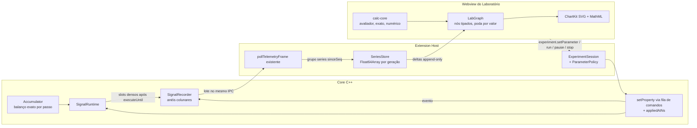

# Laboratório de Cálculo — arquitetura, estruturas compartilhadas e contratos

**Classificação:** proposta **[P]** apoiada no diagnóstico de [50](50-laboratorio-calculo-investigacao.md), na análise do
GeoGebra em [57](57-laboratorio-calculo-geogebra-e-estrategia.md) e na PoC
[`docs/poc/laboratorio-calculo-limites/`](poc/laboratorio-calculo-limites/README.md). Revisão de 2026-10-16: troca a dependência
de Compute Engine/MathLive por núcleo próprio, troca "tanque com Vmax" por acumulador conservativo genérico, e troca o
"SeriesStore alimentado por amostragem paralela" por gravação no Core escoada pelo tick de telemetria que já existe.

## 1. Princípios

1. O Core é a única autoridade de física e de tempo. Gráficos de processo mostram **amostras gravadas pelo Core**.
2. Inspeção (cursor, Q, Δt, intervalo, zoom) é estado da Webview e **não tem caminho de escrita** para o Core.
3. Uma responsabilidade, um caminho: um avaliador de expressões, um plotter, um grafo de dependências, um canal de séries.
4. Nada de dependência nova sem medição que a justifique; a Webview continua sem bundler.
5. O laboratório é um **painel próprio** com módulo de entrada próprio; `main.ts` (13 mil linhas) não cresce.

## 2. Visão geral



Mensagens têm papéis distintos: `experiment.setParameter` muda o modelo; `experiment.run|pause|resume|restart` muda a execução;
inspeção é interna à Webview e nunca vira mensagem para o Core.

## 3. Onde cada responsabilidade roda

| Camada | Faz | Não faz |
|---|---|---|
| Core C++ | física, relógio, ritmo (`setRealTimeRate`), acumulador conservativo, gravação de séries e eventos com tempo exato, aplicação ordenada de parâmetros | desenhar, avaliar fórmulas didáticas, persistir atividade |
| Extension Host | resolver referências do projeto, política de parâmetros, `SeriesStore`, fan-out por painel, persistência `.lsproj`, ciclo de vida | integrar, derivar, desenhar |
| Webview do laboratório | `LabGraph`, `calc-core`, plot, equações, tabela, atividade, acessibilidade | ser autoridade de estado físico ou de tempo |
| Web Worker | **opcional**: só se a medição (M3) mostrar quadro > 16 ms em tabelas de convergência ou quadratura de séries longas | estado persistente, polling |

PoC: entrada→fim do quadro p95 ≈ 2,5 ms no thread principal **[E]**; por isso o Worker deixa de ser requisito. Se vier a ser
necessário, a Webview do VS Code exige criar o Worker a partir de `Blob` (`worker-src blob:`) **[I, verificar]**.

## 4. Estruturas compartilhadas

Cada estrutura lista consumidores reais, o que elimina, o que concentra, o que fica fora e como validar.

### 4.1 `SignalRecorder` (Core) + grupo `series` no frame de telemetria

- **Consumidores:** gráficos/tabelas/cursor do laboratório; `PidTuningPanel` (hoje sem feed contínuo e com `dt` por chegada);
  tendências de HMI futuras. O `Oscope` **não** migra: mede tensão MNA com semântica de instrumento.
- **Elimina:** amostragem paralela por widget, perda de amostras entre ticks, carimbo de tempo por chegada, cópia do histórico
  inteiro a cada quadro (padrão atual do Oscope expandido).
- **Concentra:** inscrição de slots (`SignalSlotHandle`), anel colunar pré-alocado (uma coluna de tempo `uint64` por grupo de
  inscrição + colunas `double`), número de sequência, eventos com tempo exato (fronteira do acumulador, parâmetro aplicado,
  reset), faixa perdida quando o anel transborda antes de ser lido, geração por execução.
- **Regra de gravação:** em `SimulationSession::onStableStepUnlocked`, depois de `signals.executeUntil(t)`, gravar uma linha se
  `t` avançou e algum slot inscrito mudou **ou** se um rate group inscrito ativou; nunca por relógio de tela.
- **Transporte:** sem timer novo. `getTelemetryFrame` aceita `series: [{ subscriptionId, sinceSeq }]` e responde
  `series: [{ subscriptionId, generation, fromSeq, t: number[], columns: number[][], events, lost? }]`, limitado ao orçamento
  `telemetryQueueBytes`; o restante sai no tick seguinte. JSON de números no MVP; base64 de `Float64Array` só se o perfil de
  M0 mostrar custo relevante.
- **Fora:** decimação para desenho, cálculo, persistência.
- **Validação:** bloco de 10 ms por 10 s simulados produz 1 000 linhas com telemetria a 1, 20 ou 60 Hz; endereços de
  armazenamento estáveis após a inscrição (mesmo estilo de `realStorageAddress`); transbordo registra `lost`; `stop`
  incrementa a geração; nenhuma linha com timestamp não monotônico.

### 4.2 `SeriesStore` (Host, TypeScript puro)

- **Consumidores:** painel do laboratório (vários gráficos), painel PID, HMI no futuro; vários painéis compartilham a mesma inscrição.
- **Elimina:** buffers duplicados por gráfico, timestamps de chegada, cópia de histórico.
- **Concentra:** `Float64Array` em blocos por grupo (tempo em segundos relativos ao início da geração), retenção por amostras
  ou duração, lacunas, `interpolation: "linear" | "zoh"` por série, unidade canônica, contagem de referências das inscrições
  (zero consumidores ⇒ cancela no Core).
- **Fan-out:** só **deltas** (`fromSeq`..`toSeq`) para cada painel inscrito; o painel acumula. Nenhuma mensagem reenvia o histórico.
- **Validação:** dois painéis sobre a mesma fonte geram uma inscrição no Core; fechar o último cancela; troca de geração
  inicia série nova sem concatenar.

### 4.3 `Accumulator` (Core) substitui `Tank`

- **Consumidores:** tanque do laboratório (volume), os 10 usos atuais de `control.tank` (temperatura, posição, pressão,
  temporizador, nível), qualquer estoque futuro (energia, carga).
- **Elimina:** recorte silencioso em zero, semântica "nível" embutida num integrador genérico, ausência de capacidade.
- **Contrato:** `control.accumulator` (substitui o typeId `control.tank`), entradas `in` e `out` (demandas) e entradas
  **opcionais** `lower`/`upper` (quando ligadas, sobrepõem os parâmetros de mesmo nome e podem mudar em execução — é assim que
  `Vmax = A·h_max` acompanha A ao vivo); parâmetros `initial`, `lower` (padrão 0), `upper` (padrão +∞). Saída principal `out` =
  estado `x`; saídas nomeadas `inActual`, `outActual`, `overflow`, `unmet` e os acumulados `cumIn`, `cumOut`, `cumOverflow`, `cumUnmet`,
  `cumSpill`. **Implementado** com as propriedades `initial`, `lowerLimitEnabled`/`lowerLimit`, `upperLimitEnabled`/`upperLimit` e
  `lowerInput`/`upperInput` (portas de fronteira) — [54 §0](54-laboratorio-calculo-validacao-e-riscos.md).
- **Limite que encolhe abaixo do estado:** o excesso vira **derramamento discreto** (`cumSpill += x − upper`) na mesma ativação em
  que a nova fronteira é lida; o evento `spill` é derivado do salto de `cumSpill`. Referência executável:
  [`accumulator.mjs`](poc/laboratorio-calculo-limites/accumulator.mjs) **[E]**.
- **Implementação recomendada:** saída vetorial (`SignalDataType.width = 9`) mais um bloco novo mínimo `Element` (extrai o
  índice i) materializado por `SignalMathBlock` para cada porta nomeada em `signalPortBlockId(index, porta)`. Reaproveita o
  suporte a largura do compilador em vez de criar blocos com várias saídas.
- **Algoritmo exato com entradas ZOH no passo `[t, t+Δt]`** (ver [53 §2](53-laboratorio-calculo-experimentos-e-tanque.md)): o
  estado é linear por partes; o instante de contato com a fronteira é calculado analiticamente (`t* = t + (limite − x)/líquida`);
  depois do contato o estado fica na fronteira e o excesso vira `overflow` ou `unmet`. Os acumulados fecham o balanço
  `x − x0 = cumIn − cumOut − cumOverflow` com erro de arredondamento. O contato vira evento do `SignalRecorder` com `t*`
  exato. Sem localizador de eventos genérico e sem rejeição de passo (o erro estimado continua 0, como hoje).
- **Fora:** geometria (h = V/A), leis de saída (válvula, Torricelli) — são blocos ligados por fora.
- **Validação:** ver [54 §3](54-laboratorio-calculo-validacao-e-riscos.md); os testes de sessão dos 5 subcircuitos migrados
  continuam passando com os mesmos valores enquanto o estado não toca a fronteira.

### 4.4 `ParameterPolicy` (Host) sobre o mecanismo existente

- **Consumidores:** sliders e entradas numéricas do laboratório, `graphics.slider` da HMI, constantes de modelo dos subcircuitos.
- **Não cria API nova de Core para valores:** parâmetro ajustável é uma `control.constant` (ou `graphics.slider`) ligada a uma
  porta, como o diâmetro de `process_pressurized_tank_dp` **[C]**.
- **Mudança mínima no Core:** a resposta de `setProperty` passa a devolver `appliedAtNs`, e o `SignalRecorder` registra
  um evento `parameter` com esse tempo.
- **Concentra:** faixa, passo, unidade, política `live | stop-required`, valor aceito; no modo aluno usa o caminho de
  pré-visualização (`previewPropertyInCore`) **sem** gravar no documento.
- **Validação:** valor fora da faixa é rejeitado no Host e no Core sem mutar; evento aparece na série com `appliedAtNs`;
  propriedade estrutural mostra "pare a simulação" (pausado também é bloqueado, [50 §2](50-laboratorio-calculo-investigacao.md)).

### 4.5 `calc-core` — serviço matemático próprio (TypeScript puro, sem DOM)

- **Consumidores:** gráficos de função, tabelas, secante, tangente, Riemann, integral acumulada, equações, validação de autoria.
- **Concentra (todas as peças existem na PoC [E] salvo indicação):** parser com allowlist de funções e símbolos declarados;
  AST JSON compatível com o subconjunto MathJSON (`["Add", a, b]`); compilação para árvore de closures, **sem `eval`**;
  classificação `finite | undefined(motivo) | precision-limit`; caminho exato para polinômios (quociente e derivada); quociente
  numérico com aviso de cancelamento; amostrador adaptativo com quebra em descontinuidade; serialização AST→MathML;
  **operadores de Cálculo com variável ligada** — `["Integrate", f, ["Limits", v, a, b]]` (antiderivada exata para polinômios,
  senão Simpson adaptativo), `["D", f, v]` (regras simbólicas, inclusive TFC/Leibniz e canto de |u|), `["Limit", f, v, alvo, lado]`
  (substituição por continuidade, cancelamento de fator comum em racionais, graus em ∞, senão sequência lateral rotulada como
  evidência), `["Sum"|"Product", f, ["Limits", k, m, n]]`; funções do usuário (`h(4+Δt)`) expandidas por substituição para a
  avaliação e mantidas como chamada para exibição. A completar em M1: `If` por partes com verificação de fronteira,
  estimativa de erro da quadratura, quadratura de séries com segmentação em lacunas, álgebra de unidades.
- **Resultado sempre etiquetado:** `{ kind: "exact" | "numeric" | "measured" | "undefined", value?, unit, method, errorBound?, reason? }`.
- **Fora:** CAS geral, prova de limite, física.
- **Validação:** oráculos de [54 §3](54-laboratorio-calculo-validacao-e-riscos.md); `verify.mjs` da PoC vira a semente da suíte.

### 4.6 `LabGraph` — grafo incremental de dependências (Webview)

- Origem: `DependencyGraph` da PoC, inspirado no `algoUpdateSet` do GeoGebra, com **poda por valor** e **lote** [E].
- Tipos de nó: `authoring` (definição da atividade), `parameter-mirror` (valor **aceito** pelo Host; somente leitura),
  `series` (revisão do `SeriesStore`, não o array), `inspection`, `view`, `derived`.
- Regras: nó derivado só depende de nós já definidos (ordem topológica pela definição); recalcula só se um insumo mudou de
  valor; propaga só se o próprio valor mudou; `onChange` entrega o conjunto alterado para invalidar só os desenháveis afetados;
  desenho coalescido por `requestAnimationFrame`.
- Remoção de fonte: dependentes passam a `{ kind: "undefined", reason: "referência removida" }` e entram na auditoria; nunca
  são apagados em cascata (diferente do GeoGebra).
- Validação (PoC [E]): 60 arrastos de Q recalculam Q/Δh/quociente 60 vezes e curva/tabela/P zero vezes.

### 4.7 `ChartKit` (Webview)

- SVG em camadas; transformação mundo↔tela única por vista; reaproveita `analogSampleHoldPath`, `zoomInstrumentTimeAt`,
  `panInstrumentTime` e `visibleSampleWindowByTime` de `instrumentViewport.ts`/`instrumentTrigger.ts` **[C]** (passam a um módulo
  compartilhado importado pelas duas Webviews).
- Objetos: curva de função, série (`linear` ou degrau ZOH conforme `interpolation`), pontos arrastáveis restritos por
  parâmetro, secante, tangente, retângulos de Riemann, área assinada, cursor, rótulos, faixas de lacuna.
- Canvas 2D só para séries muito densas **se** o perfil mostrar SVG acima do orçamento de quadro.
- Equações: **MathML Core** gerado do AST (nativo no Chromium; [E] na PoC; no VS Code 1.85/Electron 25 **[I, verificar]**).

### 4.8 Editor de equações, teclado matemático e ícones (Webview, implementação própria)

- **Consumidores:** expressões do professor (modelo, funções, objetos), calculadora do aluno, editor de atividades (M6) e, depois,
  o campo `expression` de `control.calc_expression` no inspetor de propriedades (hoje texto puro).
- **Elimina:** dependência de MathLive (≈ 844 KB + fontes) e do Compute Engine que ele exige para MathJSON (≈ 4,2 MB); texto
  linear digitado pelo aluno; ícones de terceiros com licença não comercial.
- **Concentra:** árvore `sequência → {caractere, template}` com cursor por campo e placeholders; comportamentos estudados no
  `editor-base` do GeoGebra (EUPL; nada copiado): `/` leva o operando à esquerda ao numerador, `^` abre expoente, `|` abre módulo,
  `sin`/`sqrt`/`int`/`lim`/`sum` digitados viram template, setas e Tab percorrem campos, Backspace desfaz template mantendo o
  conteúdo, Ctrl+A substitui tudo; templates de fração, potência, raiz, módulo, função, **∫ definida, d/d□, lim (bilateral, ⁺, ⁻),
  Σ e Π**; serialização para o parser do `calc-core`; renderização em MathML com cursor; teclado com abas 123, f(x) e Cálculo;
  conjunto de ícones SVG próprios (ferramentas, execução, lados).
- **Fora:** avaliação (é do `calc-core`), persistência (é da atividade).
- **Validação:** PoC — 12 testes de editor em Node e e2e com digitação real e paleta (`e2e.mjs`) **[E]**.

### 4.9 Registro único de unidades

- Uma tabela (`units.json`): símbolo, vetor dimensional SI, escala, deslocamento. Gera o mapa de `unitInfo` do Core e é importada
  pelo `calc-core`. Acrescenta `m`, `cm`, `mm`, `m²`, `cm²`, `m³`, `L`, `m³/s`, `L/s`, `L/min`, `m/s`, `cm/s`, `rad`.
- **Elimina** a divergência entre o Core (sem `m`) e rótulos livres da Webview.

## 5. Contratos

```ts
// Identidade estável = ids do projeto (não ids de instância do Core, que mudam a cada rebuild).
interface SourceRef { componentId: string; port: string; element?: number }
type UnitSymbol = string; // validado contra units.json

interface ResultValue {
  kind: "exact" | "numeric" | "measured" | "undefined" | "precision-limit";
  value?: number; unit: UnitSymbol; method: string; errorBound?: number; reason?: string;
}

interface SeriesDescriptor {
  id: string; source: SourceRef; unit: UnitSymbol; label: string;
  // linear: estado integrado (V, h); zoh: entrada mantida; step-average: média realizada no passo (tᵢ₋₁, tᵢ] (vazões)
  interpolation: "linear" | "zoh" | "step-average";
}
interface SeriesEvent { tNs: number; kind: "parameter" | "boundary" | "spill" | "reset" | "lost"; ref?: string; volume?: number; detail?: string }
// Descontinuidade (ex.: A ao vivo): duas linhas com o mesmo t; leitores escolhem "antes" ou "depois", desenho quebra o traçado.
interface SeriesDelta {                          // Host -> Webview, append-only
  groupId: string; generation: number; fromSeq: number;
  t: Float64Array;                               // segundos desde o início da geração
  columns: Record<string, Float64Array>;
  events: SeriesEvent[];
}

interface ExpressionSpec {
  id: string; text: string; ast: unknown;        // subconjunto MathJSON
  symbols: Record<string, { unit: UnitSymbol; role: "variable" | "parameter" }>;
  domain?: Array<[number, number]>; version: 1;
}
interface ExperimentParameter {
  id: string; source: SourceRef; label: string; unit: UnitSymbol;
  min: number; max: number; step: number; initial: number; policy: "live" | "stop-required";
}
interface ObservedVariable { id: string; series: SeriesDescriptor; retention: { seconds?: number; samples?: number } }
interface LabPlot {
  id: string; x: { kind: "time" } | { kind: "expression"; variable: string };
  layers: Array<{ seriesId?: string; expressionId?: string; color: string; dash?: string; label: string }>;
  initialView: { xMin: number; xMax: number; yMin: number; yMax: number };
}
interface MathObject {
  id: string; plotId: string;
  kind: "point" | "secant" | "tangent" | "riemann" | "accumulated-area" | "cursor" | "root" | "intersection";
  of: { expressionId?: string; seriesId?: string };
  params: Record<string, number | string>;        // ex.: { a: 4, deltaParam: "dt", method: "left", n: 10 }
}
interface ActivityStep {
  id: string; phase: "predict" | "explore" | "formalize" | "apply";
  prompt: string; hints?: string[]; visibleObjectIds: string[]; unlockedParameterIds: string[];
}
interface CalculusLab {
  schemaVersion: 1; id: string; title: string;
  observed: ObservedVariable[]; expressions: ExpressionSpec[]; parameters: ExperimentParameter[];
  plots: LabPlot[]; objects: MathObject[]; steps: ActivityStep[];
  run: { realTimeRate: number; restart: "from-zero" };
}
// Estado transitório da Webview (não persiste): cursor, intervalo, Δt, lado, vistas correntes, respostas digitadas.
```

## 6. Dependências: decisão revisada

| Candidato | Fatos (2026-10-16) | Decisão |
|---|---|---|
| Núcleo próprio (`calc-core`) | PoC: 44 KB com UI, sem `eval`, CSP atual, tabela/limite/indefinidos corretos [E] | **Adotar** |
| `@cortex-js/compute-engine` 0.154.0 (MIT) | pré-1.0 e com releases frequentes; `dist/esm-min/core.js` ≈ 4,2 MB + chunks; `compile()` gera código em runtime (bloqueado sem `'unsafe-eval'`), com fallback interpretado | **Não** no MVP; reavaliar só para manipulação simbólica além de polinômios/racionais |
| MathLive 0.111.1 (MIT) | ≈ 844 KB + fontes; `getValue('math-json')` **exige** o Compute Engine carregado; requer `style-src 'unsafe-inline'` e `font-src` | **Não**: editor próprio (§4.8) cobre os templates de Cálculo 1 com 0 dependências [E] |
| Editor/teclado/ícones do GeoGebra | editor em Java/GWT dentro do app; ícones e estilos CC BY-NC-SA 4.0 | **Não** usar recursos; comportamento estudado e reimplementado (§4.8) |
| mathjs 15.2.0 (Apache-2.0) | compila sem `eval`; unidades e `derivative`; superfície grande; riscos de DoS documentados | Alternativa de reserva para unidades se o registro próprio não bastar |
| KaTeX 0.19.0 (MIT) | renderização TeX com fontes | **Não**: MathML Core nativo cobre a exibição |
| uPlot 1.6.32 (MIT) | ≈ 51 KB IIFE; último release mar/2025 | Só se o SVG falhar no orçamento de quadro medido |
| Plotly 2.30.0 (já empacotado) | 3,6 MB em `media/pid`; CSP ainda lista `cdn.plot.ly` | Migrar o painel PID para o `ChartKit` em M7 e remover |
| GeoGebra | ver [57](57-laboratorio-calculo-geogebra-e-estrategia.md) | **Não** empacotar |

## 7. Persistência

- Campo opcional `calculusLab?: CalculusLab` no `.lsproj`, ao lado de `hmiApplication`, com `schemaVersion` próprio — **sem**
  incrementar `LS_PROJ_SCHEMA_VERSION` (a igualdade estrita invalidaria os 24 projetos do repositório sem necessidade).
- Validador em `ProjectSerializer` no mesmo estilo de `validateHmiApplication`; referências a `componentId`/porta inexistentes
  não derrubam o projeto: viram achados de auditoria com ação "religar" ou "remover" (reaproveitar o padrão de `hmiAudit`).
- Persistir: definição completa (expressões com texto e AST, parâmetros e faixas, gráficos, objetos, etapas, ritmo).
- Não persistir: séries, cursor, intervalo, Δt, vistas correntes, respostas de alunos, último estado de execução. Preferências
  de layout ficam em `webview.getState()`/estado da extensão. Exportar respostas/dados é ação explícita em formato separado (pós-MVP).
- Reinício: "Reiniciar" = `stopSimulation()` + reaplicar `initial` dos parâmetros + nova geração; "Retomar" continua o estado.

## 8. Ciclo de vida, cache e cancelamento

- Abrir o painel resolve `SourceRef` → instância do Core e cria inscrições com contagem de referências; fechar remove-as.
- Pausa: nada a escoar (o Core não avança); o buffer permanece. Stop/Reiniciar: nova geração; o gráfico começa série nova.
- `calc-core` cacheia AST compilado por `(texto, símbolos, versão)`; `LabGraph` só recalcula por mudança de valor.
- Tarefas longas (tabelas de convergência com n grande) recebem um token de geração; resultado obsoleto é descartado.
- Retenção padrão: 30 min simulados por grupo; ao exceder, descarta o mais antigo e registra `lost` no início visível.
