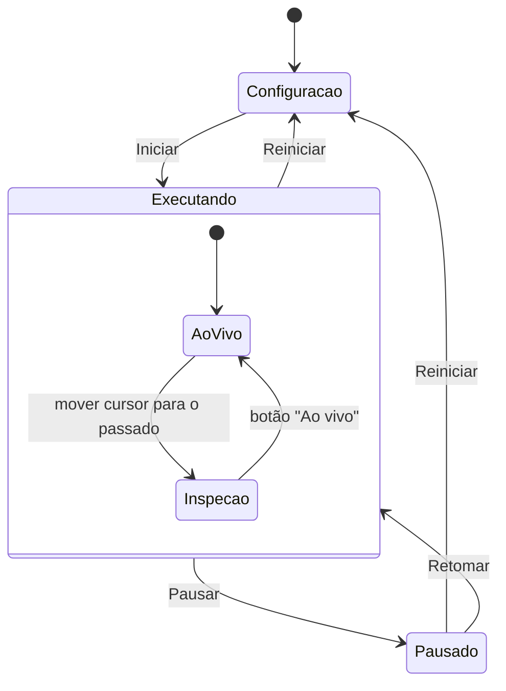

# Laboratório de Cálculo — especificação funcional, interação e regras matemáticas

**Proposta [P].** Arquitetura em [51](51-laboratorio-calculo-arquitetura-e-dados.md); metas visuais em
[55](55-meta-visual-laboratorio-calculo.md) e [56](56-meta-visual-limites.md); evidências da PoC em
[`docs/poc/laboratorio-calculo-limites/`](poc/laboratorio-calculo-limites/README.md).

## 1. Ambiente

- Comando **"LasecSimul: Abrir Laboratório de Cálculo"** abre um `WebviewPanel` próprio, ligado ao projeto aberto
  (`calculusLab` do `.lsproj`). Pode ficar lado a lado com o esquemático; não depende da HMI.
- Regiões redimensionáveis: **Processo** (animação), **Gráficos** (1–3 empilhados), **Equações e valores**, **Atividade**
  (pergunta/etapa) e **Ferramentas** (Δt, n, método, lado). Navegação superior por área: Funções, Limites, Derivadas,
  Integrais (como a meta de limites) e, para o tanque, Processo/Gráficos/Cálculo/Explorar.
- **Modo apresentação:** fonte ≥ 20 px no corpo e ≥ 28 px nos valores-chave, contraste AA, barras laterais recolhidas, sem
  alterar a autoria. Em largura < 900 px os painéis empilham; nenhuma função fica só no gesto de arrastar.
- Identidade visual LasecSimul (azul-marinho/azul); cores das séries sempre acompanhadas de rótulo, traço e unidade.

## 2. Modos

| | Professor (autoria) | Aluno (exploração) |
|---|---|---|
| Processo e fontes | escolhe componentes/portas observadas e parâmetros liberados | só vê |
| Parâmetros | define faixa, passo, unidade, inicial, `live`/`stop-required` | move os liberados na etapa |
| Expressões e objetos | cria/edita no editor estruturado (§5a) | usa os visíveis na etapa e a calculadora de Cálculo |
| Etapas | cria predição/exploração/formalização/aplicação | percorre |
| Persistência | grava no `.lsproj` (com undo/redo do documento) | nada é gravado; respostas ficam na sessão |

Sem contas nem servidor nesta fase. "Travar atividade" esconde a autoria no modo aluno; não é mecanismo de segurança.

## 3. Três operações e máquina de estados

1. **Alterar modelo** — `experiment.setParameter(id, valor)`: só parâmetros liberados; o Host valida, o Core aplica na fronteira
   do passo e devolve `appliedAtNs`; a série recebe um marcador nesse instante. O valor mostrado é o **aceito**, não o pedido.
2. **Executar** — Iniciar, Pausar, Retomar, Reiniciar (`stopSimulation` + parâmetros iniciais + nova geração).
3. **Inspecionar** — cursor, pontos A/B ou P/Q, Δt, n, método, zoom: só lê séries gravadas ou funções; nunca chama setter.

| Ação | Configuração | Executando | Pausado |
|---|---|---|---|
| Parâmetro `live` | sim | sim (marcador na série) | sim — a fila de comandos é drenada em pausa [C] (`Scheduler.cpp`); marcador com o tempo pausado |
| Área A do tanque (`live`, com descontinuidade) | sim | sim — V preservado, h salta, derramamento discreto se preciso ([53 §2.3](53-laboratorio-calculo-experimentos-e-tanque.md)) | sim |
| Parâmetro `stop-required` (ex.: V0, h_max, modo de saída, topologia) | sim | não — "pare para alterar" | **não** — o Core também recusa em pausa [C] |
| Inspeção | sobre funções; séries vazias | sim | sim |

Em **Inspeção**, o processo animado mostra uma **reconstrução** a partir das séries gravadas (nível, vazões) com o selo
"passado — reconstrução"; o Core continua no presente. Retornar ao vivo é sempre uma ação explícita. Não há rewind do simulador.

## 4. Regras matemáticas transversais

### 4.1 Natureza de cada resultado

Todo número mostrado vem de um `ResultValue` ([51 §5](51-laboratorio-calculo-arquitetura-e-dados.md)) e a UI indica:

| `kind` | Exemplo | Rótulo na UI |
|---|---|---|
| `exact` | quociente `4 + 0,5Δt`; limite 4 cm/s de polinômio | "exato (simplificação algébrica)" |
| `numeric` | quociente com Δt = 0,01 sobre função; Simpson adaptativo | "aproximação numérica — método, passo, erro estimado" |
| `measured` | secante entre duas amostras do Core | "dado do simulador — amostras t₁, t₂" |
| `undefined` | Δt = 0; `ln(−1)`; fora do domínio | motivo explícito |
| `precision-limit` | Δt abaixo da resolução de ponto flutuante | "abaixo da precisão numérica" |

Amostras que parecem convergir não provam limite; "demonstração" não é rótulo do sistema.

### 4.2 Exibição de números (política obrigatória)

- O valor calculado nunca é arredondado; só a exibição. Float64 produz `4,050000000000008` para Δt = 0,1 **[E]**.
- Tabelas de aproximação mostram dígitos suficientes para distinguir linhas consecutivas: `casas = max(2, ⌈−log₁₀ Δt⌉ + 1)`.
  O GeoGebra com arredondamento padrão exibiu `q = 4` para Δt = 0,01 **[E]** — exatamente o defeito a evitar; a PoC exibia
  `10,13` para 10,125 até a correção **[E]**.
- Separador decimal pt-BR na exibição; o parser aceita ponto (vírgula separa argumentos).

### 4.3 Tempo, amostras e interpolação

- Eixos temporais usam tempo simulado do Core; nunca chegada de mensagem ou relógio de parede.
- Cada série declara `interpolation`: `linear` para estados integrados (volume, nível) e `zoh` para entradas de bloco
  (vazões demandadas, saídas de blocos discretos). Cursor e desenho usam a mesma regra; a UI informa "amostra exata" ou
  "interpolado entre t₁ e t₂".
- Nenhuma interpolação atravessa lacuna, reinício, evento de fronteira ou mudança de parâmetro marcada.
- Decimação (envelope min/máx por coluna) só para desenhar; cálculos usam a série bruta.

### 4.4 Derivadas — quatro coisas diferentes

| Origem | Como | Rótulo |
|---|---|---|
| Derivada simbólica de expressão | regras sobre o AST (polinômio, soma, produto, cadeia, trig/exp/log); em `If` por partes, a fronteira só é diferenciável se a função for contínua **e** as derivadas laterais coincidirem; funções escada são não diferenciáveis nos saltos | "exata" |
| Aproximação numérica de função | quociente progressivo/regressivo/central com h escolhido; aviso de cancelamento abaixo de ~1,5·10⁻⁸·max(1,|a|) | "numérica, h = …" |
| Derivada de dados amostrados | diferenças entre amostras gravadas com Δt real; nunca abaixo do espaçamento das amostras | "dos dados, amostras t₁/t₂" |
| `control.filtered_derivative` | saída de um filtro (τ) — é um sinal de controle | "derivador filtrado (τ = …) — não é a derivada exata" |

Tangente só é desenhada quando a derivada é `exact` ou `numeric` com erro estimado declarado; em cantos e saltos mostra
derivadas laterais e o texto "não diferenciável aqui".

### 4.5 Limites e continuidade

- Aproximações laterais com Δt assinado (Δt > 0 direita, Δt < 0 esquerda); tabela com linhas fixas calculadas e a linha atual.
- Limite **exato** apenas quando o quociente/expressão simplifica algebricamente (polinômios e racionais com fator comum).
  Nos demais casos, a UI mostra "tendência numérica observada" e o critério de parada usado.
- Pontos abertos/fechados vêm da definição (`If` com desigualdade estrita/não estrita); descontinuidades removíveis, saltos e
  assíntotas quebram o traçado (amostrador com teste de continuidade [E]).
- Com dados do Core, Δt não pode ser menor que o espaçamento real; abaixo disso a linha mostra "sem dados nessa resolução".
- ε–δ visual entra em M7, com faixas horizontais/verticais ajustáveis e um contraexemplo pronto.

### 4.6 Integrais e Teorema Fundamental

- Retângulos esquerda/direita/ponto médio e trapézios com `n` e intervalo arrastáveis; soma **assinada**, e área geométrica
  (|f|) como opção separada. O resultado é independente do zoom (o GeoGebra subamostra a região visível nas somas
  superior/inferior [C]; aqui não).
- Integral de função: Simpson adaptativo/Gauss-Kronrod com erro estimado; antiderivada simbólica apenas para polinômios no MVP.
- Integral de série: trapézio sobre os Δt reais; segmentos separados por lacunas; resultado com unidade `unit(y)·unit(t)`.
- Acumulada `A(t) = V0 + ∫ q`: deixa explícito que `V0` não é área.
- TFC: gráfico de `A(t)` com a tangente em t, ao lado de `q(t)`; o aluno compara a inclinação de A com o valor de q.

### 4.7 Pré-cálculo

Constante, afim, quadrática, polinomial, racional, exponencial, logaritmo, trigonométricas, por partes, composição e inversa
(com restrição de domínio declarada), transformações por parâmetros, raízes e interseções numéricas com tolerância, tabela
ligada ao gráfico, unidades. Sensor 4–20 mA em [53](53-laboratorio-calculo-experimentos-e-tanque.md).

## 5a. Entrada de expressões: editor, teclado, símbolos e ícones

Implementação própria ([51 §4.8](51-laboratorio-calculo-arquitetura-e-dados.md)), com o comportamento do editor do GeoGebra
como referência e PoC funcional **[E]**:

- **Edição estruturada**, não texto: digitar `0.5t^2` produz `0,5t²`; `/` cria fração levando o operando à esquerda ao numerador;
  `^` abre expoente; `|` abre módulo; `(` abre grupo; `sin`, `cos`, `tan` (também `sen`, `tg`), `ln`, `log`, `exp`, `sqrt`, `pi`,
  `int`, `lim`, `sum`, `prod` viram template ao serem digitados; vírgula é separador decimal.
- **Templates de Cálculo:** integral definida `∫ₐᵇ □ d□`, derivada `d/d□ (□)`, limite `lim □→□` bilateral, pela direita (⁺) e pela
  esquerda (⁻), somatório `Σ k=□..□` e produtório; campos vazios mostram placeholder tracejado; a mensagem de erro diz quantos campos faltam.
- **Navegação:** setas entram e saem dos campos, Tab/Shift+Tab percorrem campos, ↑/↓ alternam numerador/denominador e limites,
  Home/End, Backspace desfaz template mantendo o conteúdo, Ctrl+A seleciona tudo, clique posiciona o cursor.
- **Teclado na tela** (projeção e toque): abas **123**, **f(x)** (x², xⁿ, √, |x|, π, e, Δ, funções) e **Cálculo** (∫, d/dx, lim, lim⁺,
  lim⁻, Σ, Π, ∞, fração, próximo campo); teclas ≥ 48 px com faces em MathML; as teclas não roubam o foco do editor.
- **Ícones** SVG próprios: arrastar, ponto na curva, secante, tangente, Riemann, área, cursor, zoom +/−, restaurar vista, Δt = 0, lados,
  teclado, executar/pausar/reiniciar, ao vivo. Os ícones do GeoGebra não são usados (CC BY-NC-SA 4.0).
- **Calculadora:** avalia qualquer expressão fechada com as funções da atividade (`h(4+Δt)`), mostra o resultado com selo **exato** ou
  **aproximação numérica** e o método; uma derivada no topo mostra a função derivada em MathML e o valor no ponto da atividade; é
  recalculada sozinha quando o modelo muda.
- **Leitura acessível:** o editor expõe `role="textbox"` com a forma linear lida ("integral(…)", "limite(…)"); resultados em região viva.

## 5. Interação, acessibilidade e precisão

- Pontos arrastáveis são `role="slider"` com `aria-valuetext` contendo coordenadas e unidades; setas movem um passo, Shift+setas
  um passo fino, Home/End os extremos; o foco não se perde durante atualização (pontos atualizados no lugar [E]).
- Todo slider tem entrada numérica equivalente; Δt tem escala logarítmica.
- Restrição a curva por **parâmetro** (t do ponteiro, y = f(t), domínio limitado), não por ponto euclidiano mais próximo
  (o GeoGebra projeta (4,5; 0) em (1,76; 1,55) [E]).
- Alvo de toque ≥ 44 px; limiar de captura maior para toque, como `getCapturingThreshold` do GeoGebra [C].
- Equações em MathML (lidas por leitores de tela); valores dinâmicos em região `aria-live="polite"` com limitação de frequência.
- Zoom com o ponto sob o cursor invariável; "Restaurar vista" volta à vista do professor.

## 6. Aceite funcional compartilhado

1. Processo, gráficos, equações, objetos e etapa visíveis ao mesmo tempo no modo apresentação 1920×1080 e 1366×768.
2. Mudar parâmetro altera só amostras futuras; o marcador aparece no instante `appliedAtNs`.
3. Mover cursor/pontos/Δt/n não envia mensagem ao Host (contador de mensagens = 0 durante a inspeção).
4. Todo número exibido tem natureza (`kind`), unidade e, quando numérico, método.
5. Nenhuma linha atravessa lacuna, assíntota, reinício ou evento.
6. CSP da Webview sem `'unsafe-eval'`, sem `'unsafe-inline'` em scripts, sem CDN; zero requisições externas.
7. Teclado alcança e opera todos os controles; leitor de tela anuncia valores e equações.
