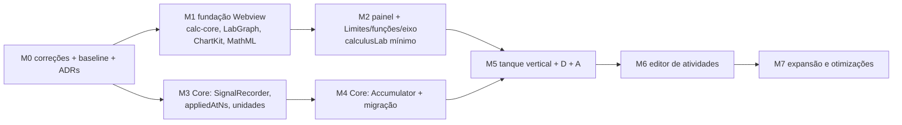

# Laboratório de Cálculo — plano de implementação, validação, otimização e riscos

**Proposta [P].** Reordenado em 2026-10-16 em **duas trilhas paralelas**: a Webview entrega atividades analíticas (Limites,
funções, eixo) sem esperar o Core; o Core entrega gravação de séries e acumulador conservativo; as trilhas se juntam no
tanque. Cada marco deixa o produto utilizável.

## 0. Estado da implementação (2026-10-17)

Entregue e verificado por execução **[E]**; o resto do documento continua sendo o plano.

| Marco | Entregue | Verificação |
|---|---|---|
| M0 | painel PID com tempo simulado (`sampleTimestampNs`), CDN fora dos CSP, campo morto `telemetryRateHz` removido | `npm test` |
| M1 | `extension/src/ui/webview/lab/{calc,graph,editor}`: parser/AST, derivada simbólica, compilação sem `eval`, limites/∫/Σ/Π com proveniência, `LabGraph`, modelo do editor com templates de Cálculo | 15 + 5 + 12 testes |
| M2 | `CalculusLabPanel` + comando `lasecsimul.openCalculusLab`, atividade Limites, editor MathML, teclado (123/f(x)/Cálculo), calculadora, modo professor, `calculusLab` no `.lsproj` | `npm run test:lab:e2e` (11 checks no VS Code real) |
| M3 | `core/src/simulation/SignalRecorder.hpp` (anéis, grade por assinatura, linha extra no mesmo t, eventos `start`/`parameter`, gerações, `lost`); `subscribeSeries`/`unsubscribeSeries`; grupo `series` no `getTelemetryFrame`; `appliedAtNs` em `setProperty`/`setSubcircuitChildProperty`; unidades de comprimento/área/volume/vazão/velocidade no Core espelhadas em `lab/units.ts` | `signal_recorder_test`; `units.test`; `seriesRecorder.realCore.test` |
| M4 | `SignalBlockKind::Accumulator` + `Element`; `control.accumulator` (10 saídas nomeadas); `Tank`/`control.tank` removidos; 10 instâncias, 5 geradores, 5 projetos `trm/` e o bloco `control_accumulator.lssubcircuit` migrados | `signal_dynamics_test` (oráculo da PoC); `process_subcircuit`, `control_block_subcircuit`, `signal_graph_*`; 26 testes de Core real dos modelos migrados com os mesmos valores |
| M5 (vertical do tanque) | `subcircuits/process_hydraulic_tank.lssubcircuit` (gerador `scripts/generate-hydraulic-tank.py`); Host `SeriesStore`, `TankExperiment` (papel de `ExperimentSession` + `ParameterPolicy`), drenos de série no tick, ganchos de estado/reconstrução; Webview `SeriesBuffer` e `TankView` (processo, h(t), q(t), cursor, A/B, Riemann, equações, eventos, A ao vivo); `examples/calculo/laboratorio-calculo.lsproj` | `hydraulicTank.realCore.test` (aceites 1, 2, A ao vivo, válvula, esvaziamento); `SeriesStore.test`, `SeriesBuffer.test`; `npm run test:lab:tank:e2e` (19 checks) |

**Decisões refinadas na implementação (substituem o texto anterior onde divergirem):**

1. **Parâmetro vale na próxima amostra do bloco que o lê.** `appliedAtNs` é o instante em que o Core aplicou o valor; um bloco a
   10 ms passa a vê-lo na ativação seguinte (≤ 10 ms depois). Medido: bomba desligada em 10 s ⇒ efeito a partir de 10,01 s.
2. **Fronteiras do acumulador são amostradas e o estado é projetado nelas na própria ativação** (aresta instantânea no compilador).
   Com A ao vivo, quem lê V na mesma ativação (h = V/A) nunca vê o tanque acima da borda.
3. **Derramamento em `cumSpill`, separado de `cumOverflow`** (transbordo contínuo). Identidade:
   `x − x0 = cumIn − cumOut − cumOverflow − cumSpill`; a vazão gravada q = Δ(cumIn − cumOut − cumOverflow)/Δt dá ∫q = ΔV + derramamentos.
4. **Demandas com sinal no Core** (paridade com o `Tank`: os modelos térmicos usam "saída" negativa abaixo do ambiente);
   não negatividade de vazão física é política do Host (`checkTankParameter`).
5. **Grade de gravação por assinatura** (`periodNs`; 10 ms no tanque) em vez de "uma linha por ativação": o passo máximo do
   Scheduler é 100 µs e gravar todo passo estável inundaria o IPC.
6. Unidades no Core em ASCII (`m2`, `m3/s`, `L/s`); `displayUnit` converte para exibição.

**Pendente:** experimentos D (primeira ordem) e A (sensor) de M5; painel PID lendo séries do gravador; eventos de contato com
tempo exato `t*` (hoje o contato aparece na amostra seguinte, via `overflow`/`unmet`); M6 (editor de atividades) e M7.

## 1. Marcos

### M0 — Correções, baseline e decisões registradas
- **Problema:** defeitos atuais na mesma área do laboratório e ausência de números de referência.
- **Escopo:** (a) `PidTuningPanel` alimentado pelo frame de telemetria contínuo e com `dt` por `sampleTimestampNs`, não `Date.now()`;
  (b) remover `https://cdn.plot.ly` do CSP de `SchematicPanel.ts` e `PidTuningPanel.ts` (o Plotly é local); (c) uma única fonte para a
  taxa de telemetria (configuração do VS Code **ou** `simulationSettings.telemetryRateHz`, removendo a outra); (d) corrigir comentários
  "~300 ms"; (e) harness de baseline: bytes e duração de `getTelemetryFrame` a 20 Hz com 10/100 componentes, bytes por quadro da janela
  expandida do Oscope; (f) ADR-0012 séries no Core, ADR-0013 acumulador, ADR-0014 núcleo matemático próprio, ADR-0015 `calculusLab`.
- **Arquivos:** `extension/src/core/coreLifecycle.ts`, `extension/src/ui/panels/PidTuningPanel.ts`, `extension/src/ui/panels/SchematicPanel.ts`,
  `extension/package.json`, `extension/src/project/*`, `docs/adr/0012…0015`.
- **Beneficiados:** sintonia PID, todos os painéis com CSP, medições de M3/M5.
- **Dependências:** nenhuma.
- **Aceite:** gráfico PID avança em run com dt em tempo simulado (teste com `CoreClient` simulado); CSP sem domínio externo;
  baseline registrado em `docs/`.
- **Validação:** testes unitários de `coreLifecycle`; inspeção do HTML gerado; script de medição repetível.
- **Riscos:** o HTML do PID original espera `dt` em segundos — manter a unidade. **Complexidade:** baixa. **Incerteza:** baixa.

### M1 — Fundação matemática e gráfica da Webview (trilha W)
- **Problema:** não existe avaliador, grafo incremental, plot de funções nem equações.
- **Escopo:** portar a PoC para módulos TypeScript testados: `calc-core` (parser, compilação por closures, indefinidos, exato
  polinomial/racional, operadores ∫/d/dx/lim/Σ/Π com proveniência, derivada por regras com fronteiras de `If`, quocientes,
  quadratura adaptativa, amostrador Gillam, AST→MathML, unidades); `LabGraph`; `ChartKit` SVG **em camadas** (fundo/série/marcadores);
  **editor de equações, teclado matemático e ícones** ([51 §4.8](51-laboratorio-calculo-arquitetura-e-dados.md)). Mover
  `instrumentViewport.ts`/`instrumentTrigger.ts` para um módulo de plot compartilhado e atualizar `main.ts` (sem reexportação de compatibilidade).
- **Arquivos propostos:** `extension/src/lab/calc/{parse,compile,operators,exact,derivative,numeric,quadrature,sampler,mathml,units}.ts`,
  `extension/src/lab/graph/LabGraph.ts`, `extension/src/lab/chart/*.ts`, `extension/src/lab/editor/{MathEditor,palette}.ts`,
  `extension/src/ui/shared/{icons.ts,plot/*.ts}`, testes `*.test.ts` no mesmo padrão dos existentes (`tsconfig.test.json`, `pretest`).
- **Beneficiados:** todos os experimentos; instrumentos (plot compartilhado).
- **Dependências:** ADR-0014.
- **Aceite:** oráculos de §3.1 passam; as 74 verificações de `verify.mjs` e as 25 de `e2e.mjs` da PoC reescritas como testes do
  produto; nenhum `eval`/`new Function` (verificação estática no `pretest`); mover cursor não redesenha a camada da série.
- **Validação:** testes Node; e2e Playwright no padrão da PoC.
- **Riscos:** escopo da derivada simbólica crescer — limitar às regras do Cálculo 1 listadas em [52 §4.4](52-laboratorio-calculo-produto-e-matematica.md).
  **Complexidade:** média. **Incerteza:** baixa (PoC).

### M2 — Painel do laboratório e atividades analíticas (trilha W)
- **Problema:** nada utilizável em aula ainda.
- **Escopo:** `CalculusLabPanel` (WebviewPanel próprio, CSP igual à do esquemático sem CDN) com entrada `extension/src/ui/lab/main.ts`;
  layout/apresentação de [52 §1](52-laboratorio-calculo-produto-e-matematica.md); atividade **Limites — velocidade aos 4 s**
  ([56](56-meta-visual-limites.md)), explorador de funções (pré-cálculo), experimento C (eixo); `calculusLab` mínimo no `.lsproj`
  (tipos + validador + 3 modelos prontos em `examples/calculo/`); formulário simples de parâmetros da atividade (sem editor completo).
- **Arquivos:** `extension/src/ui/panels/CalculusLabPanel.ts`, `extension/src/ui/lab/*`, `extension/src/project/ProjectTypes.ts`,
  `extension/src/project/ProjectSerializer.ts`, `extension/package.json` (comando), `examples/calculo/*.lsproj`.
- **Dependências:** M1.
- **Aceite:** critérios de [56](56-meta-visual-limites.md) e [52 §6](52-laboratorio-calculo-produto-e-matematica.md) em Webview real do VS Code;
  MathML renderiza no VS Code mínimo suportado (ou fallback textual documentado).
- **Validação:** e2e com `@vscode/test-electron` (já é devDependency) + Playwright para a página isolada.
- **Riscos:** MathML no Electron mínimo **[I]**; foco/teclado em SVG. **Complexidade:** média. **Incerteza:** baixa.

### M3 — Core: gravação de séries, tempo de aplicação de parâmetros e unidades (trilha C)
- **Problema:** não há histórico de sinais `control.*` com tempo por amostra; parâmetros não informam quando valeram; não há `m`.
- **Escopo:** `SignalRecorder` ([51 §4.1](51-laboratorio-calculo-arquitetura-e-dados.md)) com gancho em `onStableStepUnlocked`; grupo `series`
  em `getTelemetryFrame` (requisição `sinceSeq`, resposta limitada ao orçamento); comandos `subscribeSeries`/`unsubscribeSeries`;
  `appliedAtNs` na resposta de `setProperty` + evento `parameter`; `units.json` gerando `unitInfo`; tipos em `CoreClient.ts`/`ipc/protocol.ts`.
- **Arquivos:** `core/src/simulation/SignalRecorder.{hpp,cpp}`, `core/src/session/SimulationSession.{hpp,cpp}`,
  `core/src/app/CoreApplication.cpp`, `core/src/simulation/SignalEngine.cpp` (`unitInfo`), `core/src/simulation/units.json` + gerador,
  `extension/src/ipc/{CoreClient,protocol}.ts`, testes em `core/test/core/simulation` e `core/test/core/session`.
- **Beneficiados:** laboratório, PID, HMI (tendências futuras).
- **Dependências:** ADR-0012.
- **Aceite:** 1 000 linhas para bloco de 10 ms em 10 s independentemente da taxa de telemetria (1/20/60 Hz); zero alocação por passo após
  a inscrição; `lost` ao transbordar; geração nova em `stop`; `appliedAtNs` igual ao tempo do passo em que o comando foi drenado.
- **Validação:** testes C++ (estilo `SignalEngineTest`/`ControlBlockSubcircuitTest`), medição de sobrecarga do passo antes/depois.
- **Riscos:** orçamento de frame com muitas séries; concorrência entre leitura do anel e worker (o escoamento usa a fila de comandos, como
  `requestTelemetrySnapshotRefresh`). **Complexidade:** média-alta. **Incerteza:** média.

### M4 — Core: acumulador conservativo e migração de `control.tank` (trilha C)
- **Problema:** recorte silencioso em zero; sem capacidade, fluxos realizados nem eventos; um único bloco serve semânticas diferentes.
- **Escopo:** `SignalBlockKind::Accumulator` (substitui `Tank`) com o algoritmo de [53 §2.2](53-laboratorio-calculo-experimentos-e-tanque.md),
  inclusive entradas opcionais `lower`/`upper` (A ao vivo), derramamento discreto e linha dupla no gravador em descontinuidades —
  `accumulator.mjs` da PoC é o oráculo dos testes C++; bloco `Element`; `control.accumulator` em `SignalMathBlock` com portas nomeadas; migrar as 10 instâncias dos 5 subcircuitos, os projetos
  `trm/**` afetados, `ProcessSubcircuitCompiler.cpp`, `controlGraphCatalog.ts`, testes; reconstruir `subcircuits/control_tank.lssubcircuit`
  como **tanque hidráulico** (acumulador V + A + h = V/A + Vmax + modo de saída) e atualizar `library.json`.
- **Beneficiados:** tanque do laboratório; aquecedor, forno, válvula, FY301 e tanque pressurizado ganham contabilidade na fronteira.
- **Dependências:** M3 (eventos de fronteira no gravador).
- **Aceite:** tabela de [53 §2.6](53-laboratorio-calculo-experimentos-e-tanque.md) itens 1–5 e 11.
- **Validação:** testes de bloco (casos de borda), de sessão (5 subcircuitos), regressão HART LD301/TT301/FY301.
- **Riscos:** algum modelo depender do recorte "sem contabilidade" de forma não documentada — comparar séries antes/depois em cenários que tocam
  zero. **Complexidade:** média. **Incerteza:** média.

### M5 — Tanque vertical, primeira ordem e sensor (junção)
- **Escopo:** `SeriesStore`, `ExperimentSession`, `ParameterPolicy` no Host; painel do laboratório consumindo séries; experimentos B, D e A;
  **área A ao vivo** com descontinuidade e derramamento; cursor/inspeção com reconstrução; reiniciar; persistência completa da definição.
  A interface de `tanque.html` da PoC é o protótipo de referência.
- **Arquivos:** `extension/src/lab/session/{SeriesStore,ExperimentSession,ParameterPolicy}.ts`, painel e Webview do laboratório,
  `examples/calculo/tanque.lsproj`, `primeira-ordem.lsproj`, `sensor.lsproj`.
- **Dependências:** M2, M4.
- **Aceite:** [53 §2.6](53-laboratorio-calculo-experimentos-e-tanque.md) completo; aceites de A e D em [53 §1](53-laboratorio-calculo-experimentos-e-tanque.md).
- **Riscos:** latência visual com ritmo 1× e telemetria 20 Hz. **Complexidade:** alta. **Incerteza:** média.

### M6 — Editor de atividades
- **Escopo:** autoria sem programação: escolher componente/porta (seleção no esquemático), expressões com prévia MathML, parâmetros com faixa,
  gráficos/objetos, etapas; auditoria de referências (padrão `hmiAudit`), relink/remover; undo/redo pelo documento; renomear/remover componente
  propaga achados, nunca falha silenciosa.
- **Dependências:** M5. **Complexidade:** alta. **Incerteza:** média.

### M7 — Expansão e otimizações
- Integrais/TFC completos, por partes e ε–δ, Torricelli, racionais e assíntotas (avaliar porte do plotter
  intervalar do GeoGebra só se casos de teste falharem — [57 §4](57-laboratorio-calculo-geogebra-e-estrategia.md)), painel PID no `ChartKit` e
  remoção do Plotly (3,6 MB), histórico do Oscope por deltas, polimento de acessibilidade e projeção, documentação de distribuição.

## 2. Reutilização, refatoração e criação

| Categoria | Itens |
|---|---|
| **Reaproveitar diretamente** | Scheduler e fila de comandos; `SignalRuntime`/compilador; `control.constant` e `graphics.slider` como parâmetros; `previewPropertyInCore` (coalescência); `getTelemetryFrame` (tick, deduplicação, geração, backpressure); `graphicsBinding` (estados de qualidade); padrão de `hmiAudit`; undo por snapshot do documento; `instrumentViewport.ts`/`instrumentTrigger.ts` |
| **Generalizar / refatorar** | `getTelemetryFrame` ganha grupo `series`; resposta de `setProperty` ganha `appliedAtNs`; `unitInfo` passa a ser gerado de `units.json`; helpers de plot viram módulo compartilhado; `PidTuningPanel` consome o frame |
| **Substituir** | `SignalBlockKind::Tank`/`control.tank` → `Accumulator`/`control.accumulator`; `subcircuits.control.tank` passa a ser o tanque hidráulico; CSP com CDN → CSP local |
| **Remover por redundância** | `Date.now()` como tempo de amostra no PID; fonte duplicada de `telemetryRateHz`; Plotly (M7, após migração); chamadas avulsas de `getComponentStates` após edição quando o próximo frame já cobre (medir) |
| **Criar** | `SignalRecorder`, `Element`, `units.json`; `calc-core`, `LabGraph`, `ChartKit`; `SeriesStore`, `ExperimentSession`, `ParameterPolicy`; `CalculusLabPanel` e Webview do laboratório; `calculusLab` |

## 3. Validação

### 3.1 Matemática (`calc-core`)
- Valores e derivadas conhecidos: `x²`/`2x`, `sin`/`cos`, `exp`, `ln` (domínio), polinômios até grau 6; quociente exato `4 + 0,5Δt`.
- Limites: `(x²−1)/(x−1)` em 1 (exato 2, removível), `1/x` em 0 (laterais divergem), salto `If(x<1, x, x+1)` (laterais 1 e 2),
  `sin(1/x)` em 0 (sem limite; a UI não declara convergência).
- Derivada de por partes: `If(x<1, x², 2x−1)` diferenciável em 1 (contínua, laterais 2 = 2); `If(x<1, x², 2x+5)` **não** (salto);
  `|x|` em 0 não diferenciável; `floor` não diferenciável nos inteiros.
- Integrais: `∫₀¹ x² = 1/3`, `∫₀^π sin = 2`, `∫₋₁¹ x = 0` (assinada) × área 1; ordens de convergência das somas.
- Indefinidos e precisão: Δt = 0, Δt = 10⁻¹⁷, cancelamento em 10⁻⁹; `ln(−1)`, `1/0`, `sqrt(−1)`.
- Amostrador: `1/x`, `tan`, `1/(x−1)²`, `floor` sem ligar ramos; número de pontos limitado.
- Exibição: tabela de aproximação mostra dígitos suficientes (regra de [52 §4.2](52-laboratorio-calculo-produto-e-matematica.md)).
- Operadores: `lim` exato (continuidade, fator comum, graus) × evidência numérica; laterais diferentes; divergência ±∞; ∫ exato × Simpson;
  TFC (`d/dx ∫ₐˣ f = f(x)`); Σ/Π finitos; canto de |x| (todos já cobertos pela PoC [E]).
- Editor: sequências de teclas → texto/AST esperados (fração que puxa operando, funções digitadas, templates ∫/lim⁺/Σ/d/dt, Backspace
  em template, Ctrl+A, recarga de AST mantendo `h(...)`); e2e com digitação real, paleta e foco.

### 3.2 Física e séries (Core)
- Acumulador: casos de [53 §2.6](53-laboratorio-calculo-experimentos-e-tanque.md); demandas negativas; já na fronteira; `net = 0`; passos
  adaptativos com componentes elétricos reativos presentes; `upper` reduzido abaixo do estado (derramamento) e aumentado (sem efeito);
  A em pausa aplicado na hora.
- Riemann sobre dados gravados: ordem de convergência por método e o piso de amostragem medido ([53 §2.4](53-laboratorio-calculo-experimentos-e-tanque.md)).
- Gravador: amostragem irregular (eventos no meio do período), transbordo, reinício, várias inscrições do mesmo slot, inscrição removida em run.
- Regressão: testes existentes de `SignalEngineTest`, `SignalDynamicsTest`, `ControlBlockSubcircuitTest`, HART; e2e de HMI.

### 3.3 Integração, UI e ciclo de vida
- Inspeção envia 0 mensagens; parâmetro fora da faixa rejeitado sem mutação; pausado bloqueia estruturais.
- Salvar/reabrir; componente referenciado removido → achado de auditoria, atividade abre.
- Fechar painel cancela inscrições; dois painéis compartilham uma inscrição; sem timers/listeners órfãos (contadores em teste).
- Cache: mudar expressão recompila uma vez; arrastar Q não recalcula curva/tabela (já [E] na PoC).

## 4. Desempenho — metas a validar (não são resultados)

| Cenário | Métrica | Meta inicial | Referência medida |
|---|---|---|---|
| Arrastar ponto/slider com 3 gráficos | entrada→fim do quadro p95 | ≤ 16 ms no VS Code | PoC Limites p95 ≈ 2 ms (Edge headless) [E] |
| Mover cursor no tanque com histórico | entrada→fim do quadro p95 | ≤ 16 ms | PoC: 13,5 ms com redesenho total → 8,4 ms com camadas [E] |
| Tanque, ritmo 1×, telemetria 20 Hz | atraso Core→pixel p95 | ≤ 150 ms | — |
| Gravador, 13 colunas a 100 Hz | sobrecarga no passo do Core | ≤ 2 % do tempo de passo; 0 alocações | — |
| Ingestão no Host | custo por tick | ≤ 1 ms | — |
| Retenção 30 min do tanque | memória Host + Webview | ≤ 2 × 19 MB | estimativa [53 §2.4](53-laboratorio-calculo-experimentos-e-tanque.md) |
| Partida do painel | até o 1º quadro | ≤ 500 ms | PoC ≈ 135 ms [E] |

Antes/depois: mesmo projeto, build, duração simulada, ritmo e taxa; registrar mensagens IPC, bytes, linhas gravadas e desenhadas, CPU,
heap, p50/p95/p99, lacunas e residual de balanço. Decimação mede só pixels; contagem e checksum das séries brutas não mudam.
Otimização sem ganho medido é revertida.

## 5. Otimizações de recursos existentes (registradas à parte; aplicar só com medição)

1. Janela expandida do Oscope pede o histórico inteiro a cada quadro (até 4 × 512 × 16 B em hex) — trocar por deltas com sequência (M7).
2. Estados no frame trafegam em hex (2× o tamanho) — base64 ou binário se M0 mostrar relevância.
3. `publishTelemetrySnapshotIfRequested` aloca `shared_ptr` e vetores a cada publicação — pool se aparecer no perfil.
4. `getComponentTelemetryStates` só insere inscrições (nunca limpa), diferente de `getTelemetryFrameSnapshot` — confirmar efeito e alinhar.
5. Undo do editor clona projeto e HMI inteiros por edição — medir com projetos grandes antes de mudar.
6. Plotly (3,6 MB) só para o painel PID — remover após migração (M7).

## 6. Riscos

| Risco | Mitigação |
|---|---|
| Migração de `control.tank` alterar modelos HART/processo | comparar séries antes/depois; testes de sessão por subcircuito; fronteira é o único ponto de mudança |
| Orçamento de IPC com muitas séries | limite por frame + continuação; medir em M3; binário só se necessário |
| MathML ausente no Electron mínimo | verificar em M2; fallback textual; ou subir `engines.vscode` |
| Escopo simbólico crescer até virar CAS | regras fechadas de Cálculo 1; o resto é numérico rotulado |
| Monólito `main.ts` | laboratório em painel e entrada próprios |
| Licenças | nenhum código do GeoGebra; nenhuma dependência nova no MVP |
| Pedagogia: q constante não ensina convergência | cenários com válvula e mudança de q em run ([53 §2.5](53-laboratorio-calculo-experimentos-e-tanque.md)) |
| Expectativa de "voltar no tempo" | selo "reconstrução" e botão "Ao vivo"; sem rewind |
| A ao vivo cria descontinuidades que cada consumidor precisa respeitar | regra única: linha dupla no mesmo t + evento; leitores escolhem antes/depois; desenho quebra; Riemann e ΔV incluem derramamentos (PoC [E]) |
| Editor próprio ficar aquém do GeoGebra em casos raros (matrizes, texto misto) | escopo fechado nos templates de Cálculo 1; casos fora viram texto linear validado |

## 7. Decisões

Tomadas pela investigação: estratégia A (núcleo próprio, GeoGebra só como referência); nenhuma dependência nova no MVP; gravação no Core
escoada pelo tick existente; acumulador genérico no lugar de `control.tank`; `calculusLab` sem subir a versão do `.lsproj`; painel próprio;
Limites antes do tanque; gráficos em camadas.

Decididas pelo usuário em 2026-10-16:
1. **Área A ajustável durante a execução já na primeira entrega** — semântica em [53 §2.3](53-laboratorio-calculo-experimentos-e-tanque.md), validada na PoC.
2. **Estratégia A também para a parte visual:** editor de equações, símbolos (∫, d/dx, lim, Σ, Π…), teclado e ícones com implementação
   própria inspirada no GeoGebra, sem recursos dele ([51 §4.8](51-laboratorio-calculo-arquitetura-e-dados.md)).

Ainda dependem do usuário (padrão recomendado para seguir sem resposta):
1. **Ordem pedagógica dos primeiros encontros?** Padrão: Limites (M2) antes do tanque (M5), refletindo a disponibilidade técnica.
