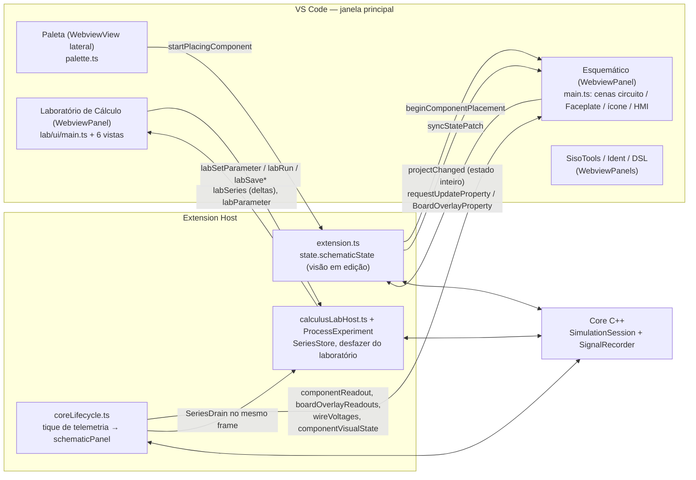

# Unificação HMI + Laboratório de Cálculo + Faceplate — diagnóstico e inventário

**Estado:** investigação concluída em 2026-10-19 (diagnóstico do código de então). Implementação em 2026-10-20: [doc 65](65-unificacao-visual-implementacao.md). Documento 1 de 5:

| Doc | Conteúdo |
|---|---|
| **60** (este) | diagnóstico da arquitetura atual, inventários, matriz compartilhado × específico, limitações |
| [61](61-unificacao-visual-janelas-dock-tela-cheia.md) | APIs de janela do VS Code, alternativas, Dock/Undock, edição em janela flutuante, tela cheia real, múltiplos monitores |
| [62](62-unificacao-visual-arquitetura-e-documento.md) | arquitetura unificada, modelo de documento, integração matemática, Faceplate, exposição, sincronização, persistência |
| [63](63-unificacao-visual-plano-testes-riscos.md) | plano faseado, desempenho e métricas, testes e cenários, riscos, decisões |
| [64](64-unificacao-visual-refazer-exemplos-calculo.md) | as telas de `examples/calculo` refeitas na nova modalidade, página a página |

Decisões propostas: [ADR 0016](adr/0016-tela-hmi-em-janela-auxiliar-do-vscode.md),
[ADR 0017](adr/0017-documento-visual-unico.md), [ADR 0018](adr/0018-autoridade-do-documento-no-host.md).
Evidência executável das janelas: [`docs/poc/janelas-auxiliares-vscode/`](poc/janelas-auxiliares-vscode/README.md).

## Convenções de evidência

| Marca | Significado |
|---|---|
| **[C]** | verificado por leitura de código no commit analisado (ou do VS Code instalado, quando indicado) |
| **[E]** | verificado por execução (PoC de janelas, medições locais) |
| **[I]** | inferência ainda não comprovada; o plano diz como comprovar |
| **[P]** | proposta |

## Identificação

- Repositório `LASEC-UFU/LasecSimul`, branch `main`, commit `b026c407e`; árvore com alterações não relacionadas em
  `extension/src/ui/webview/controlDesigner/*`.
- `extension/package.json`: versão `0.0.97`, `engines.vscode ^1.85.0`; `@types/vscode` instalado 1.125.0.
- VS Code instalado no servidor: **1.141.0** (`2a59476c9b`). E2E do repositório: **1.128.0** por padrão
  (`VSCODE_E2E_VERSION`, `extension/test/e2e/run-calculus-lab-e2e.cjs`).
- Tamanhos: `extension/src/ui/webview/main.ts` 13 256 linhas; `extension/src/extension.ts` 3 473;
  `extension/src/core/coreLifecycle.ts` 1 529; Webview do laboratório ≈ 6,4 mil linhas em 37 arquivos;
  `out-webview/main.js` 725 KB; `project/schema/component-catalog.json` 1,5 MB.
- Catálogo estático medido em 2026-10-19: 315 entradas; **243 `graphics.*`** (192 `graphics.pid.*`, 10 `graphics.hmi.*`),
  7 com `actionTarget`, 30 com `bindSource`. (O inventário de [auditoria-hmi-isa101](auditoria-hmi-isa101/03-inventario-catalogo.md)
  registrou 244/193 em 10/10; a diferença é de uma entrada P&ID.)

## 1. Resumo executivo

1. **HMI e Faceplate já compartilham o motor de edição.** São *modos de cena* do mesmo editor do esquemático
   (`SubcircuitEditorMode = "circuit" | "symbol" | "icon" | "hmi"`, `main.ts:173`), e `activeSceneComponents()`
   (`main.ts:921`) entrega ao motor genérico (seleção, arraste, alças, z-order, copiar/colar, desfazer, Inspector) o array
   da cena ativa **[C]**. A unificação HMI ↔ Faceplate é, portanto, consolidação de dados e de contexto, não fusão de dois editores.
2. **O Laboratório de Cálculo é outro mundo.** Painel próprio (`CalculusLabPanel`), Webview própria
   (`out-webview/lab/ui/main.js`), seis *vistas monolíticas* por tipo de atividade (`TankView`, `LimitsView`…), layout em
   CSS grid responsivo, tema escuro próprio, desfazer no Host **[C]**. O que é reaproveitável já está modular: `calc/*`
   (núcleo matemático sem `eval`), `LabGraph`, `SeriesBuffer`, `XYChart`, `EditorModel` **[C]**.
3. **"Faceplate" é o símbolo do subsistema** (renomeado na UI pelo commit `41b48d70a`): desenho estático compilado para
   `PackageDescriptor` ao salvar, mais projeções *vivas* de componentes internos (`exposedComponents`) **[C]**.
   O Faceplate tem pinos; a HMI não.
4. **Já existem dois mecanismos de "exibir sem duplicar"**, com formas diferentes: `HmiPageElement.componentId` (HMI) e
   `ExposedComponentEntry` (Faceplate). Ambos só apresentam; o estado funcional fica no componente real **[C]**.
5. **A telemetria tem um único destino:** todo `postMessage` do tique vai para `state.schematicPanel`, e o tique nem roda
   sem ele (`coreLifecycle.ts:1003`) **[C]**. Uma HMI em outra janela, com o esquemático fechado, não receberia nada.
6. **O estado do Host é "o que o esquemático está editando".** Abrir um subsistema troca `state.schematicState` pelo
   documento interno e **reconstrói o Core com ele** (`extension.ts:2705-2753`) **[C]**. Uma HMI flutuante perderia a
   simulação do projeto sempre que alguém editasse um Faceplate.
7. **O desfazer da HMI vive na memória da Webview** (instantâneos de até 200 estados, `main.ts:2407`) **[C]**. Toda troca de
   janela recria a Webview **[E]**, então esse histórico se perderia num Dock/Undock.
8. **A inserção pela paleta não é arrastar-e-soltar.** Clicar num item da paleta envia `startPlacingComponent`; o Host
   responde `beginComponentPlacement` **só** para o esquemático; o próximo clique no canvas posiciona (`palette.ts:224`,
   `extension.ts:3318`, `main.ts:12596`) **[C]**. Por ser roteado por mensagem, o mesmo fluxo pode servir uma janela flutuante.
9. **O menu de contexto "Entrar em modo de edição" não existe no código.** A HMI alterna edição/operação por botões da
   barra ("Editar HMI no canvas", "Operar HMI", "Voltar à edição HMI") e pela tecla Esc; em operação o menu de contexto do
   canvas é suprimido (`main.ts:4662`) **[C]**. O plano cria o menu pedido (doc 61 §9).
10. **Janela flutuante e tela cheia real são viáveis com a API pública + comandos do workbench**, confirmados por execução
    no 1.128 e no 1.141 **[E]** (doc 61). A tela cheia do HTML dentro da Webview é bloqueada pela política de permissões **[E]**.

## 2. Arquitetura atual

Pontos estruturais **[C]**:

- Uma Webview por ferramenta, cada uma com seu HTML, CSP, aperto de mão (`webviewReady`/`labReady`) e protocolo.
- `SchematicPanel` é *singleton* (`SchematicPanel.current`), `CalculusLabPanel` também. Nenhum painel registra
  `registerWebviewPanelSerializer`, então nenhum volta depois de recarregar a janela do VS Code.
- `retainContextWhenHidden: true` em todos os painéis (`SchematicPanel.ts:83`, `CalculusLabPanel.ts:48`, …).
- A Webview do esquemático é a autora das edições: manda `projectChanged` com o `WebviewProjectState` inteiro e o Host o
  adota, preservando só `calculusLab`, `controlDesignProject` e `identProject`, que pertencem a outros painéis
  (`extension.ts:1374-1410`).

## 3. Tela HMI hoje

### 3.1 Onde está e como abre

| Item | Implementação | Evidência |
|---|---|---|
| Modelo | `HmiApplication { startPageId, pages[], staleAfterMs?, auditExceptions?, auditRuleProfile? }`; `HmiPage { id, name, width, height, elements[], navigation? }`; `HmiPageElement { id, componentId? \| typeId?, label?, properties?, visual{x,y,width,height,rotation?} }` | `ui/webview/model.ts:1141-1187` **[C]** |
| Persistência | campo opcional `hmiApplication` no `.lsproj` (`ProjectTypes.ts:163`) e no `.lssubcircuit` (`subcircuitDocument.ts:106`), validado por `validateHmiApplication` | **[C]** |
| Uso no repositório | **nenhum** `.lsproj`/`.lssubcircuit` do repositório contém `hmiApplication` | `grep` em 2026-10-19 **[C]** |
| Como abre | botão "Criar página HMI com a seleção" (`createHmiPageFromSelection`, `main.ts:2749`, página 1920×1080) ou "Editar HMI no canvas" (`openHmiDesigner`, `main.ts:2786`) | **[C]** |
| Onde aparece | **dentro** da Webview do esquemático: `setSubcircuitEditorMode("hmi")` troca a cena; o esquemático some enquanto a HMI está aberta | `main.ts:1027` **[C]** |
| Tecnologia | DOM + SVG: cada elemento é um `
` com SVG gerado por `componentSymbols.ts` + `simulidePaint.ts` (IR declarativo `PackageDescriptor`), sob `transform` CSS de zoom/pan | **[C]** |

### 3.2 Edição e operação

- **Edição (autoria):** padrão ao entrar no modo HMI. Barra: seletor de página, definir inicial, renomear, atalho de
  navegação, excluir página, dimensões, configurar STALE, **Verificar HMI** (26 regras, `hmiAudit.ts:44`), "Operar HMI",
  "Voltar ao esquemático" (`main.ts:4383-4451`) **[C]**.
- **Operação:** `setHmiPresentationMode(true)` (`main.ts:3177`) esconde a autoria, vai para a página inicial e enquadra.
  `pointerdown` em componentes é engolido, o menu de contexto do canvas é suprimido (`main.ts:4662`) e **Esc volta à
  edição** (`main.ts:4592-4596`). Ações de operador só agem com a simulação rodando **[C]**.
- **Elementos permitidos:** projeções de *qualquer* componente do esquemático (`componentId`) e elementos independentes
  `graphics.*`; a colocação pela paleta em modo HMI recusa o que não for `graphics.*` (`enterPlacementMode`, `main.ts:12596`) **[C]**.
- **Geometria por página:** o elemento guarda a própria caixa; propriedades locais são gravadas como diferença em relação
  ao componente de origem; o esquemático nunca se move (`commitHmiSceneToPage`, `main.ts:985`) **[C]**.
- **Leitura ao vivo de projeções:** `runtimeComponentIdForSceneItem` mapeia o id do elemento para o id da origem antes de
  ler `readoutsByComponentId` (`main.ts:7191`) **[C]**.
- **Desfazer:** o instantâneo de desfazer inclui `hmiApplication` e a página selecionada (`snapshotOfProjectState`,
  `main.ts:2417`) **[C]**.
- **Copiar/colar:** área de transferência **em memória** da Webview (`clipboardItems`, `main.ts:736`), com mapa
  elemento→origem para manter a projeção; não usa a área de transferência do sistema **[C]**.

### 3.3 Paleta e inserção ("aba Miscelâneos")

| Etapa | O que acontece | Evidência |
|---|---|---|
| Paleta | `WebviewView` na barra lateral (`lasecsimul.componentPalette`, `retainContextWhenHidden`) | `extension.ts:3334` **[C]** |
| Árvore | abas `analog/digital/control/misc`; `Miscelâneos → Gráfico → <subpastas>` vem de `folderPath` | `paletteTree.ts`, `workspace.ts` **[C]** |
| Clique no item | `postMessage({type:"startPlacingComponent", typeId})` — **não há `dragstart`/`dataTransfer`** em `palette.ts` | `palette.ts:224-226` **[C]** |
| Host | `addPaletteComponent` abre o esquemático se preciso e envia `beginComponentPlacement` **só** para `state.schematicPanel` | `extension.ts:3318-3321` **[C]** |
| Canvas | `enterPlacementMode` arma o "fantasma" e o cursor em cruz; o próximo clique cria o componente | `main.ts:12596-12614` **[C]** |

O que o usuário descreve como "arrastar elementos da aba Miscelâneos" é, no código, **clicar para armar e clicar para
posicionar**. Essa distinção é favorável à janela flutuante (doc 61 §8).

### 3.4 Controle → Ferramentas (onde a Tela HMI passará a ser inserida)

Hoje a subseção contém **[C]**:

| Item | Natureza | Origem |
|---|---|---|
| Sintonia (`control.pid_station`) | componente colocado no esquemático, com pinos, abre o diálogo de sintonia | `controlGraphCatalog.ts:92` |
| SisoTools (`action.controlDesigner`) | *ação de paleta*: abre o painel de projeto de controladores | `ComponentPaletteViewProvider.ts:104-109` |
| Ident (`action.ident`) | *ação de paleta*: abre o painel de identificação | `ComponentPaletteViewProvider.ts:110-115` |

A ordem das subseções de Controle é fixa em `paletteTree.ts:127-135` (PLC, Protocolos Industriais, **Ferramentas**,
Blocos Funcionais). O doc 62 §5 decide que a Tela HMI entra ali como **componente colocável** ("botão HMI").

### 3.5 Telemetria e escrita

- Tique único por frame lógico: `pollTelemetryFrame` monta *um* `getTelemetryFrame` com estados, sondas e séries
  (`coreLifecycle.ts:1002-1110`), taxa `lasecsimul.simulation.telemetryRateHz` (padrão 20 Hz) **[C]**.
- Saídas do tique: `componentReadout`, `componentVisualState`, `boardOverlayReadouts`, `wireVoltages`, `simulationRate`,
  todas para `state.schematicPanel` **[C]**.
- Binding gráfico: `graphicalRuntimeProperties` produz `__g_value/__g_pct/__g_text/__g_on/__g_bind/__g_quality/
  __g_sample_timestamp_ns` (+ sinais `B` e `C`) consumidos pelo IR de pintura (`graphicsBinding.ts`) **[C]**.
- Escrita: `requestUpdateProperty` (persistente) e `requestPreviewProperty` (arraste) para o circuito principal;
  `requestUpdateBoardOverlayProperty` para filhos de subsistema; ações gráficas resolvidas por `graphicsAction.ts` **[C]**.

## 4. Laboratório de Cálculo hoje — inventário real

### 4.1 Painel, protocolo e Host

| Item | Implementação | Evidência |
|---|---|---|
| Abertura | comando `lasecsimul.openCalculusLab` ("LasecSimul: Laboratório de Cálculo"), `ViewColumn.Active`, singleton | `CalculusLabPanel.ts:42-53` **[C]** |
| CSP | `style-src` **sem** `'unsafe-inline'`, `script-src` com nonce, sem `eval` (`noEval.test.ts`) | `CalculusLabPanel.ts:136-143` **[C]** |
| Protocolo | `labReady/labInit/labProject/labHistory/labSaveActivity/labSaveLab/labUndo/labRedo/labSetMode/labActivate/labRun/labPause/labRestart/labSetParameter/labInsertPlant/labSeries/labParameter/labParameterRejected/labPlant/labRunState` | `lab/messages.ts` **[C]** |
| Desfazer | **no Host**, pilha de 100 definições (`calculusLabHost.ts:20-90`) | **[C]** |
| Experimento | um `ProcessExperiment` por vez: resolve a planta (subsistema interno de origem conhecida), assina séries no Core (`subscribeSeries`), aplica parâmetros por `setSubcircuitChildProperty` com `appliedAtNs`, religa após reconstrução | `lab/processExperiment.ts` **[C]** |
| Séries | `SignalRecorder` (Core) → `SeriesDrain` no mesmo frame do tique → `SeriesStore` (Host, `Float64Array`) → deltas *append-only* → `SeriesBuffer` (Webview) | `coreLifecycle.ts:953-975`, `lab/SeriesStore.ts`, `lab/series/SeriesBuffer.ts` **[C]** |
| Persistência | `calculusLab { schemaVersion: 1, activities[] }` no `.lsproj` (ADR 0015); exemplos em `examples/calculo/*.lsproj` (5 arquivos) | **[C]** |

### 4.2 Atividades (o que a tela mostra)

| Tipo | Vista | Composição visual | Precisa do Core |
|---|---|---|---|
| `functions` | `FunctionsView` | editores de f e g, sliders de parâmetros, gráfico com f′, F = ∫f, raízes, interseções, assíntotas, ponto arrastável, tabela | não |
| `sensor` | `SensorView` | processo + gráfico P→I, saturação 3,8–20,5 mA, inversa | sim |
| `limits` | `LimitsView` | pergunta, tanque, gráfico com P, Q, Δt, secante/tangente, tabela bilateral, valor-limite, ε–δ, calculadora | não |
| `axis` | `AxisView` | x(t), v(t), a(t), tangente em t₀ | não |
| `firstOrder` | `FirstOrderView` | degrau, 63,2 %, tangente, u ao vivo | sim |
| `tank` | `TankView` | processo animado (SVG) com sliders e Executar/Pausar/Reiniciar, gráfico h/V/TFC, gráfico de vazão com Riemann (4 métodos, n, a/b), equações, Riemann, eventos | sim |

Cada vista monta o próprio HTML (`renderLayout`), o próprio `LabGraph` e a lista de *drawables* redesenhados por
`requestAnimationFrame` (ex.: `TankView.ts:40-120`) **[C]**. Etapas guiadas (`StepsPanel`), modo professor (edição e
gravação), editor de atividades (`ActivityEditor`), modo **Apresentação** (classe `body.presentation`, fontes maiores,
lembrado por `vscode.setState`) **[C]**.

### 4.3 Núcleo matemático e componentes reutilizáveis (exportados)

- Expressões: `parseExpression`, `compileExpression` (árvore de *closures*, sem `eval`), `simplify`, `substitute`,
  `toPolynomial`, `rationalParts`, `polyEval`, `formatPolynomial`, `astToMathML` **[C]**.
- Cálculo: `differentiate`, `antiderivative`, `adaptiveSimpson`, `differenceQuotient`/`…Polynomial`, `findRoots`,
  `findIntersections`, `asymptotes`, `piecewisePoints`, `epsilonDelta`, `riemannOnSteps`, `sampleFunction` **[C]**.
- Unidades: `UNITS`, `convertUnit`, `displayUnit` (espelho das unidades do Core) **[C]**.
- Interação/visualização: `XYChart` (SVG em camadas `under/base/over`), `ChartHandle` (marcador `role="slider"`),
  `EditorModel`/`EditorView` (editor estruturado com modelos ∫, d/d□, lim, Σ, Π), `mountPalette` (teclado 123/f(x)/Cálculo),
  `StepsPanel`, `ICONS` **[C]**.
- Dependências: `LabGraph` (fontes/derivados tipados, poda por valor, lote) **[C]**.

### 4.4 Aparência a preservar

`media/lab/lab.css` (178 linhas) **[C]**: tokens `--bg #0b1f3a`, `--dark #10294d`, `--panel #f7f9fc`, `--accent #2563eb`;
cabeçalho `LasecSimul | Laboratório de Cálculo` com abas de atividade e ferramentas; painéis claros sobre fundo escuro;
grades `lim-grid`, `fn-grid`, `tank-layout`, `tank-bottom`, `calc`; colapso para uma coluna abaixo de 900–1000 px;
`body.presentation` com corpo 20 px, títulos 34 px, valores-chave 34 px, botões 48 px.

## 5. Faceplate hoje — inventário real

| Capacidade | Implementação | Evidência |
|---|---|---|
| Entrada | "Editar Painel" (subsistema interno) / "Abrir Subcircuito" → modo `symbol`; rótulo "Faceplate" na UI | `extension.ts:2607`, commit `41b48d70a` **[C]** |
| Cena | `state.symbolElements`: elementos `graphics.*` e pinos `symbol.pin`; tela do símbolo com tamanho, borda e fundo (inclusive imagem) em `symbolCanvas` | `model.ts:1100-1109` **[C]** |
| Políticas | `symbolMode: "generic" \| "custom"`; regenerar o genérico; criar pino (com túnel interno) | `main.ts:1053-1090` **[C]** |
| Persistência | compilado para `symbol: PackageDescriptor` (desenho **estático**) ao salvar, ida e volta por `subcircuitSymbolScene.ts` | **[C]** |
| Exposição visual | `exposedComponents[] { componentId, x, y, rotation, flipH, flipV, scale, layer }`: componentes internos desenhados **ao vivo** sobre a instância | `subcircuitDocument.ts:49-58` **[C]** |
| Propriedades exportadas | `exportedPropertyComponentIds[]`: por componente, independente da exposição; valor por instância em `@<filho>.<prop>` | `model.ts:1134`, doc 59 **[C]** |
| Instância no esquemático | `package` do símbolo + `renderBoardOverlaysFor` (`main.ts:1944`) com leituras em `boardOverlayReadoutsByKey["<instância>:<filho>"]` | **[C]** |
| Operação na instância | só itens operáveis recebem ponteiro; escrita por `requestUpdateBoardOverlayProperty` → `setSubcircuitChildProperty` | `main.ts:1902`, doc 45 §7f **[C]** |
| Ícone | cena separada `iconElements` (sem pinos) | **[C]** |
| Uso | 61 dos 62 `.lssubcircuit` da biblioteca têm `exposedComponents` não vazio (inclui as 24 telas TDPS) | `grep` **[C]** |

Limites observados **[C]**: só filhos **diretos** são resolvidos (`resolveSubcircuitChildCoreId(outer, item)`), não há
lista explícita de *variáveis* expostas (a exposição de variável é implícita, via `bindSource` de gráficos internos
expostos), e o desenho estático do Faceplate não tem binding (só o que é exposto é vivo).

## 6. Subsistemas, instâncias e o efeito da edição

- Definição × instância (doc 59): `typeId` estável `subsystem.*`; cada instância é expandida separadamente no Core,
  com parâmetros próprios **[C]**. Duas instâncias nunca compartilham estado de simulação.
- **Sessão de edição** (`openSubcircuitForEditingCommand`, `extension.ts:2607-2753`) **[C]**:
  1. empilha `outerSchematicState` em `state.subcircuitEditingStack`;
  2. substitui `state.schematicState` pelo circuito interno, Faceplate e ícone do documento;
  3. chama `rebuildCoreFromSchematicState()` — **o Core passa a simular o subsistema isolado**.
- Consequência para o pedido: enquanto um Faceplate ou modelo interno estiver aberto, qualquer superfície ligada ao
  projeto raiz (HMI flutuante, laboratório) perde a simulação. O doc 62 §8 separa edição de Faceplate (visual, sem
  reconstrução) da edição do modelo interno.

## 7. Componentes compartilhados e implementações duplicadas

| Conceito | Hoje | Situação |
|---|---|---|
| Motor de cena (seleção, alças, z-order, grupos, alinhar, teclado, copiar/colar, desfazer, Inspector) | `main.ts` para circuito, Faceplate, ícone e HMI | **compartilhado** (dentro de um arquivo de 13 mil linhas) |
| Renderização de símbolos | `componentSymbols.ts` + `simulidePaint.ts` | **compartilhado** por esquemático, Faceplate, HMI e paleta |
| Binding de leitura | `graphicsBinding.ts` (resolvedor único) | **compartilhado** por HMI e overlay de Faceplate; o laboratório não usa |
| Projeção de componente | `HmiPageElement.componentId` × `ExposedComponentEntry` | **duplicado** (duas formas para a mesma ideia) |
| Caminho de escrita | `requestUpdateProperty`, `requestPreviewProperty`, `requestUpdateBoardOverlayProperty`, `labSetParameter`, `pidPropertyChanged` | **5 caminhos** |
| Canal de leitura | `componentReadout`, `boardOverlayReadouts`, `labSeries`, `pidDialogSeries`, `instrumentHistory` | **5 canais** |
| Desfazer | instantâneos na Webview (esquemático/HMI/Faceplate) × pilha no Host (laboratório) | **2 mecanismos** |
| Gráficos XY | `instrumentViewport.ts` (Oscope), `XYChart` (laboratório), `media/pid/miniplot.js` (PID) | **3 plotadores** |
| Auditoria de referências | `hmiAudit.ts` × `lab/audit.ts` | **2 auditorias** de mesmo propósito |
| Unidades | `bindUnit` livre (HMI) × `lab/units.ts` (registro) | **2 tratamentos** |
| Casca de painel (HTML, CSP, aperto de mão, cache-busting) | `SchematicPanel`, `CalculusLabPanel`, `ControlDesignerPanel`, `IdentPanel`, `DslPanel` | **repetida** por painel |

## 8. Matriz de funcionalidades — compartilhadas e específicas

Legenda: ● existe; ◐ parcial; ○ ausente.

| Funcionalidade | HMI | Laboratório | Faceplate | Destino na arquitetura unificada |
|---|:-:|:-:|:-:|---|
| Elementos `graphics.*` (243) | ● | ○ | ● | comum |
| Projeção de componente real | ● | ○ | ● | comum (`ref`) |
| Pinos externos | ○ | ○ | ● | **específico do Faceplate** (página símbolo) |
| Páginas e navegação | ● | ◐ (abas de atividade) | ○ | comum |
| Layout absoluto (canvas) | ● | ○ | ● | comum |
| Layout em grade responsiva | ○ | ● | ○ | comum (novo para HMI/Faceplate) |
| Binding de leitura por id estável | ● | ◐ (planta por tipo) | ● | comum (`SignalRef` com caminho de instância) |
| Séries gravadas no Core (histórico) | ○ | ● | ○ | comum (tendências na HMI) |
| Escrita de operador (botão, slider, setpoint) | ● | ● (parâmetros com política) | ● | comum (`CommandGateway`) |
| Política de parâmetro `live`/`stop-required` + `appliedAtNs` | ○ | ● | ○ | comum |
| Expressões, gráficos de função, ∫, d/dx, lim, Σ | ○ | ● | ○ | comum (elementos matemáticos) |
| Equações MathML / editor estruturado / teclado | ○ | ● | ○ | comum |
| Inspeção sem escrita (cursor, Δt, n) | ○ | ● | ○ | comum |
| Etapas pedagógicas e pergunta | ○ | ● | ○ | comum (elementos) |
| Auditoria | ● (26 regras) | ● (planta) | ◐ (validação de pinos) | comum |
| Modo operação/apresentação | ● | ● | ◐ (overlay só opera) | comum (Editing Mode) |
| Desfazer/refazer | ● (Webview) | ● (Host) | ● (Webview) | comum, no Host |
| Instâncias múltiplas com estado próprio | — | ◐ (uma planta) | ● | comum (contexto de execução por instância) |
| Exposição explícita de variáveis/propriedades | ○ | ○ | ◐ | **específico do Faceplate** (com consumo comum) |
| Janela independente / tela cheia real | ○ | ○ | ○ | comum (gerenciador de janelas) |

## 9. APIs do VS Code usadas hoje

| API | Uso | Evidência |
|---|---|---|
| `window.createWebviewPanel` | esquemático, laboratório, SisoTools, Ident, DSL, PID (*iframe* dentro do esquemático) | **[C]** |
| `window.registerWebviewViewProvider` | paleta lateral | `extension.ts:3334` **[C]** |
| `CustomReadonlyEditorProvider` | só como gatilho para abrir `.lsproj` (fecha a aba e abre o esquemático) | `ProjectCustomEditorProvider.ts` **[C]** |
| `window.tabGroups` | fechar a aba-gatilho | idem **[C]** |
| `registerWebviewPanelSerializer` | **não usado** | **[C]** |
| `WebviewPanel.onDidChangeViewState` / `.active` | **não usados** | **[C]** |
| Comandos de janela do workbench | **não usados** | **[C]** |

## 10. Testes existentes relevantes

| Suíte | Cobre | Observação |
|---|---|---|
| `npm test` (unidades) | binding, ações, auditoria HMI, z-order, alinhamento, geometria, catálogo gráfico, subcircuito, round-trip `.lsproj`/`.lssubcircuit`/DSL, `calc`, `LabGraph`, `EditorModel`, `SeriesBuffer`, `SeriesStore`, `noEval` | sem janelas |
| `test:lab:e2e`, `test:lab:tank:e2e`, `test:pid:e2e` | laboratório e PID no VS Code real (Playwright via CDP) | precedente para E2E de janelas |
| `test:subsystems:e2e` | criar/aninhar/navegar/"Editar Painel"/desfazer/exportar/colar | entra no Faceplate (`run-subsystems-e2e.cjs:397-404`) |
| `test:wires:e2e`, `test:connections:e2e` | interação do canvas | regressão do motor de cena |
| `test:hmi:visual` | folha dos widgets HMI 1:1 | não exercita autoria HMI no VS Code real |
| `test:lab:core`, `test:telemetry:baseline` | Core real, séries, bytes/latência de telemetria | base para métricas |

**Lacuna:** não existe E2E de autoria/operação HMI no VS Code real, nem de janelas auxiliares.

## 11. Limitações arquiteturais a resolver

Classificação: **API** = limite da API pública do VS Code; **Impl.** = limite da implementação atual;
**Arq.** = possível com outra arquitetura.

| # | Limitação | Tipo | Onde | Tratamento |
|---|---|---|---|---|
| L1 | Telemetria só para o esquemático e só com ele aberto | Impl. | `coreLifecycle.ts:1003` | `TelemetryHub` (doc 62 §3.3) |
| L2 | Host = visão em edição; abrir subsistema troca o estado e reconstrói o Core | Impl. | `extension.ts:2705-2753` | `ProjectDocumentStore`; Faceplate sem reconstrução (doc 62 §3.1, §8) |
| L3 | `projectChanged` com o estado inteiro, último a escrever vence | Impl. | `extension.ts:1374` | operações por documento com revisão (doc 62 §3.2) |
| L4 | Desfazer da HMI/Faceplate na memória da Webview | Impl. | `main.ts:2398-2480` | desfazer no Host (ADR 0018) |
| L5 | Webview é recriada a cada troca de janela; o painel não reenvia estado no `ready` | API + Impl. | spike **[E]**; `SchematicPanel.ts:35-39` | Webviews idempotentes no `ready` |
| L6 | Colocação pela paleta só vai para o esquemático | Impl. | `extension.ts:3318` | roteamento pela superfície ativa + gaveta de paleta (doc 61 §8) |
| L7 | Modo HMI ocupa a Webview do esquemático (não dá para ver os dois) | Impl. | `main.ts:1027` | HMI em painel próprio |
| L8 | `requestFullscreen()` proibido dentro de Webview | API (política do *iframe*) | spike **[E]** | tela cheia da janela auxiliar |
| L9 | Sem API para criar/posicionar/maximizar janelas | API | `index.d.ts` 1.125 **[C]** | comandos do workbench + SO |
| L10 | Faixa de 30 px em tela cheia compacta | Configuração do VS Code | spike **[E]** | `window.customTitleBarVisibility: "windowed"` com consentimento |
| L11 | Faceplate estático (compilado) × vivo (exposto) | Impl. | `subcircuitSymbolScene.ts` | Faceplate renderizado pelo motor visual |
| L12 | Exposição de 1 nível e sem lista explícita de variáveis | Impl. | `coreLifecycle.ts:1036-1053` | tabela `exposures` + caminhos de instância |
| L13 | Laboratório em vistas monolíticas, uma atividade/experimento por vez | Impl. | `lab/ui/*View.ts` | decomposição em elementos |
| L14 | Painéis não voltam após recarregar | Impl. | sem *serializer* | `registerWebviewPanelSerializer` + `onWebviewPanel:` |
| L15 | Catálogo (1,5 MB) embutido no HTML de cada Webview | Impl. | `SchematicPanel.ts:198` | catálogo por versão + pacotes sob demanda |
| L16 | Operação suprime o menu de contexto; edição/operação só pela barra | Impl. | `main.ts:4662` | menu por estado (doc 61 §9) |
| L17 | CSPs diferentes (laboratório sem `unsafe-inline` em estilos; esquemático com) | Impl. | `CalculusLabPanel.ts`, `SchematicPanel.ts:192` | política única da Webview visual (doc 62 §11) |
| L18 | Rotação em passos de 90°; DSL sem geometria | Impl. (conhecida) | doc 45 §8 | fora do escopo; registrado |
