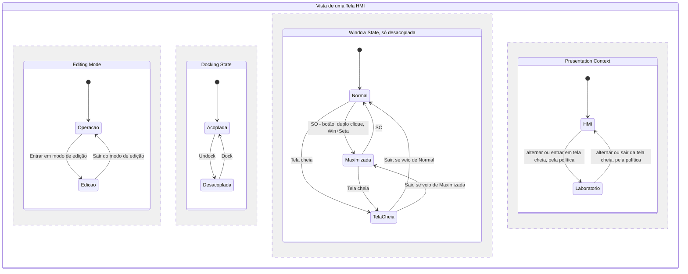
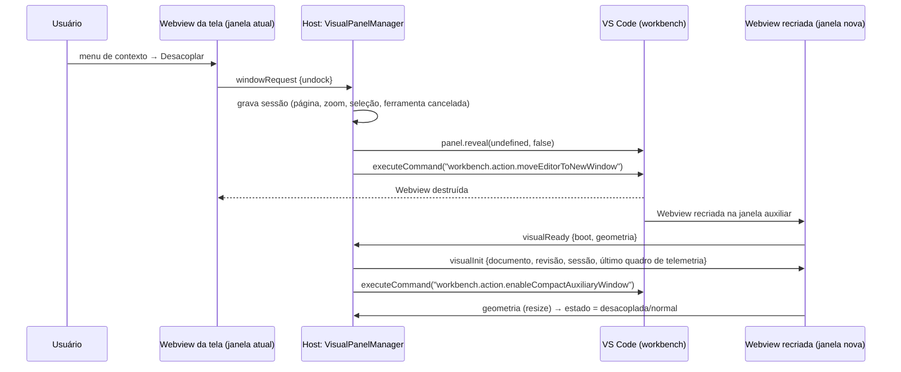
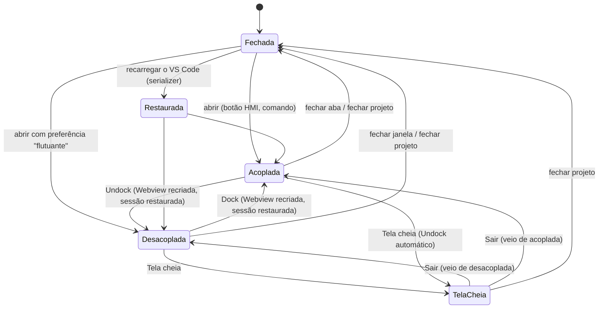
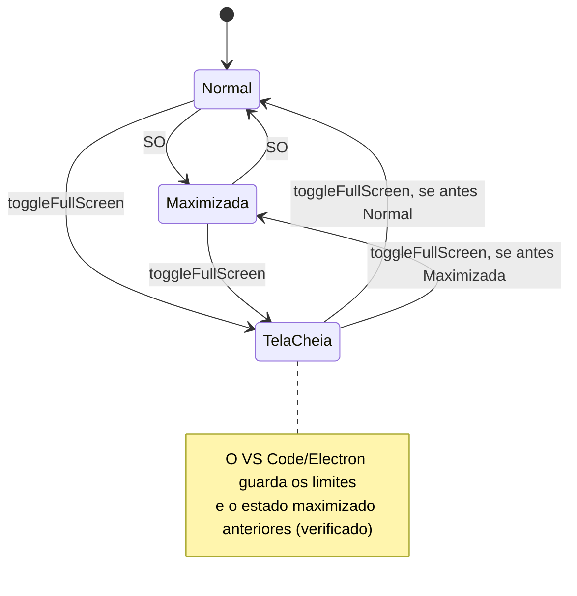

# Unificação visual — janelas independentes, Dock/Undock e tela cheia real

**Estado:** investigação concluída em 2026-10-19, com experimento executado no VS Code 1.128.0 e 1.141.0
([PoC](poc/janelas-auxiliares-vscode/README.md)). Marcas de evidência como no [doc 60](60-unificacao-visual-diagnostico-e-inventario.md).
Decisão correspondente: [ADR 0016](adr/0016-tela-hmi-em-janela-auxiliar-do-vscode.md). **Implementado em 2026-10-20** — o que
mudou na prática e as medições estão no [doc 65](65-unificacao-visual-implementacao.md).

## 1. Requisitos consolidados

Dos dois pedidos (missão principal e requisito adicional de *Dockable HMI Windows*):

1. A Tela HMI pode estar **acoplada** (aba na área de editores do VS Code) ou **desacoplada** (janela do SO, movível,
   redimensionável, maximizável, levável a outro monitor), e alternar entre os dois sem perda de estado.
2. **Tela cheia verdadeira** na janela da HMI, no monitor onde ela está, sem maximizar a janela principal; volta ao estado anterior.
3. Edição preferencialmente **nos dois** estados; Redocking automático só se for tecnicamente necessário.
4. Quatro dimensões independentes: **Editing Mode** (edição/operação), **Docking State** (acoplada/desacoplada),
   **Window State** (normal/maximizada/tela cheia), **Presentation Context** (HMI/Laboratório de Cálculo).
5. Várias telas, cada uma com estado de janela próprio; mesmo projeto, mesmo documento, um único motor de simulação.
6. Menu de contexto por estado, sem itens indisponíveis.

## 2. O que o VS Code oferece — API pública, comandos do workbench e internos

### 2.1 Superfícies disponíveis para extensões

| Mecanismo | Pode virar janela do SO? | Observação | Evidência |
|---|---|---|---|
| `WebviewPanel` (`createWebviewPanel`) | **sim, indo para uma janela auxiliar** | é um editor; janela auxiliar só por comando do workbench ou gesto do usuário | **[E]** |
| `CustomEditor` / `CustomReadonlyEditor` | sim, pelo mesmo caminho (é editor) | exige um recurso (URI); traria *dirty*/salvar/restaurar nativos | **[C]** |
| `WebviewView` (barra lateral/painel) | **não** | vive em contêineres de vista da janela principal | **[C]** |
| Nova janela de workbench (`workbench.action.newWindow`, *Agents Window*) | é janela do SO, mas **outro Extension Host** | a extensão seria outra instância, com outro Core: duplicaria a simulação | **[C]** |
| `window.open` dentro da Webview | **não** | o *iframe* da Webview não tem `allow-popups` (`sandbox`: `allow-scripts allow-same-origin allow-forms allow-pointer-lock allow-downloads`) | **[C]** VS Code 1.141 |
| Fullscreen API do HTML (`element.requestFullscreen`) | **não** | `allow` do *iframe* = `cross-origin-isolated; autoplay; local-network-access; clipboard-read; clipboard-write` (sem `fullscreen`) → `TypeError: Disallowed by permissions policy` | **[C]** + **[E]** |

A API pública (`@types/vscode` 1.125) não tem opção "abrir em nova janela", nem leitura/escrita de limites, estado ou
monitor de janela. `WindowState` só expõe `focused` e `active` **[C]**.

### 2.2 Comandos do workbench usados por esta proposta

São comandos de usuário do workbench, acessíveis por `vscode.commands.executeCommand`, mas **não** fazem parte do
contrato da API de extensões. Todos presentes no 1.128 e no 1.141 (`getCommands(true)`) **[E]**. A versão em que cada um
apareceu não foi verificada; por isso a disponibilidade é testada em tempo de execução (§12).

| Comando | Efeito verificado | Evidência |
|---|---|---|
| `workbench.action.moveEditorToNewWindow` | move o editor ativo para uma **janela auxiliar** nova (`createAuxiliaryEditorPart()` sem limites); a janela é uma página `about:blank` aberta por `window.open` do renderer principal, portanto **mesmo Extension Host** | **[C]** bundle 1.141 + **[E]** |
| `workbench.action.toggleFullScreen` | alterna tela cheia **nativa** da janela **focada**, inclusive auxiliar (`toggleFullScreen({targetWindowId})` → `BrowserWindow.setFullScreen`) | **[C]** `mainImpl.js` + **[E]** |
| `workbench.action.enableCompactAuxiliaryWindow` / `disable…` / `toggle…` | modo compacto da janela auxiliar: esconde barra de status e abas, título mínimo; desliga sozinho se a janela ganhar outro editor ou grupo | **[C]** + **[E]** |
| `workbench.action.restoreEditorsToMainWindow` | devolve **todos** os editores da janela auxiliar focada à principal | **[C]** + **[E]** |
| `workbench.action.copyEditorToNewWindow`, `newEmptyEditorWindow`, `toggleWindowAlwaysOnTop` | disponíveis; não necessários ao plano mínimo | **[E]** presença |

E pela **API pública**:

| Chamada | Efeito verificado | Evidência |
|---|---|---|
| `panel.reveal(ViewColumn.One, false)` com o painel numa janela auxiliar | traz o painel de volta à janela principal; a janela auxiliar **fecha sozinha** ao ficar vazia | **[E]** |
| `createWebviewPanel(…, ViewColumn.Active)` com a janela auxiliar ativa | abre o painel **dentro** da janela auxiliar | **[E]** |
| `panel.viewColumn` / `window.tabGroups.all` | enxergam o grupo da janela auxiliar (ex.: `viewColumn: 2`) | **[E]** |
| `panel.onDidChangeViewState` | dispara nas trocas de janela e de foco | **[E]** |

### 2.3 Persistência que o próprio VS Code faz

Ao salvar o estado da área de trabalho, cada janela auxiliar grava `bounds` (posição e tamanho no desktop virtual),
`zoomLevel`, `compact`, `mode` (normal/maximizada/tela cheia) e `alwaysOnTop`, e as recria ao reabrir a pasta
(`createState`/`restoreState` em `workbench.desktop.main.js` 1.141) **[C]**. Isso só traz de volta editores que saibam ser
**restaurados**: um `WebviewPanel` precisa de `registerWebviewPanelSerializer` e do evento de ativação
`onWebviewPanel:<viewType>`. Hoje nenhum painel do LasecSimul tem isso **[C]**.

### 2.4 "Try Agent Window" — o que é de fato

`workbench.action.openAgentsWindow` → `nativeHostService.openAgentsWindow` → `windowsMainService.openAgentsWindow`
abre uma **nova janela de workbench de nível superior** (`CodeWindow`), com renderer e Extension Host próprios
(`mainImpl.js` 1.141) **[C]**. Não é janela auxiliar e não é oferecida a extensões para hospedar uma Webview que
compartilhe estado com a janela principal. Serve de referência de **experiência**, não de mecanismo: o mecanismo que
entrega essa experiência sem duplicar o motor é a **janela auxiliar de editor**.

## 3. Resultados do experimento (resumo)

Detalhes, scripts e capturas em [`docs/poc/janelas-auxiliares-vscode/`](poc/janelas-auxiliares-vscode/README.md).
Máquina com **dois monitores**, ambos 96 DPI: `DISPLAY2` principal 1920×1080 em (0,0) e `DISPLAY1` 1366×768 em
(−1366,0), à esquerda (`System.Windows.Forms.Screen.AllScreens`). A primeira rodada mediu só no monitor principal; a
rodada de múltiplos monitores (§3.1) levou a janela ao monitor da esquerda.

| Medição | 1.128 | 1.141 |
|---|---|---|
| Undock por código | ok, Webview recriada | ok, Webview recriada |
| Tela cheia da janela auxiliar | 1920×1080 em (0,0) | idem |
| Moldura restante em tela cheia: normal / compacta / compacta + `customTitleBarVisibility: "windowed"` | 92 / 30 / **0 px** | 90 / 30 / **0 px** |
| `requestFullscreen()` na Webview | recusado (permissions policy) | idem |
| Sair da tela cheia → limites anteriores | sim | sim |
| Maximizada → tela cheia → sair | volta **maximizada** | idem |
| Principal minimizada: Webview auxiliar | `visible`, 50/50 mensagens | idem |
| Dock por `reveal(ViewColumn.One)` / por `restoreEditorsToMainWindow` | ok / ok | ok / ok |
| Painel criado com `ViewColumn.Active` na auxiliar | nasce na auxiliar | idem |
| Do comando de troca ao `ready` da Webview recriada (página trivial) | ≈ 0,2 s | ≈ 0,3 s |

### 3.1 Dois monitores (VS Code 1.141, com `customTitleBarVisibility: "windowed"`)

A janela auxiliar foi levada ao monitor da esquerda por `SetWindowPos` (Win32), sem mouse nem teclado **[E]**:

| Situação | Resultado |
|---|---|
| Janela inteira no monitor 1366×768 → tela cheia | Webview **1366×768 em (−1366,0)**: cobre exatamente o monitor secundário; janela principal intacta (352,140 1216×808) |
| Sair da tela cheia | volta à posição anterior **no monitor secundário** |
| Maximizada no secundário (1366×720 úteis) → tela cheia → sair | volta **maximizada no secundário** (`IsZoomed=True`) |
| Janela atravessando os dois monitores (700 px à esquerda, 300 px à direita) → tela cheia | vai para o monitor que contém **a maior parte** da janela (o da esquerda) |
| Dock e depois Undock de novo | a janela auxiliar nova nasce na posição padrão **do monitor principal** (440,160): a posição no secundário se perde |
| `screen.*` dentro da Webview | acompanha o monitor da janela (1920×1080 → 1366×768, `availLeft −1366`): é assim que a Webview sabe em que monitor está |

Artefato do experimento: mover a janela com `SetWindowPos` de outro processo deixou a altura em 65535 enquanto ela não
estava em tela cheia; não afeta as conclusões (as medições em tela cheia e maximizada são exatas) e não ocorre com o
arraste normal pelo usuário.

## 4. Alternativas

| Critério | **A** — Janela auxiliar por comando (Undock programático de `WebviewPanel`) | **B** — Destacar editor pelo usuário (arrastar aba / "Mover para nova janela") | **C1** — Aplicativo Electron externo | **C2** — Janela de navegador (`msedge --app`) + servidor local | **C3** — Nova janela do VS Code (estilo *Agents Window*) | **D** — Zen/maximizar grupo na principal |
|---|---|---|---|---|---|---|
| Compatível com extensões | sim (comandos do workbench) | sim (nativo) | sim, processo à parte | sim, processo à parte | sim, mas outra instância da extensão | sim |
| Mover entre monitores | sim **[E]** (usuário arrasta) | sim | sim | sim | sim | **não** |
| Tela cheia verdadeira | sim **[E]**, 0 px com configuração | sim (mesmo mecanismo) | sim | sim, inclusive escolhendo o monitor (Window Management API) | sim | **não** (tela cheia seria do VS Code inteiro) |
| Comunicação com o motor | mesma do painel (`postMessage` via Host) | idem | IPC próprio (socket) | HTTP/WebSocket local | **outro Host → outro Core** | mesma |
| Desempenho/memória | 1 Webview por tela | idem | +1 runtime Chromium (~100–200 MB) | +1 navegador | +1 workbench inteiro | nenhum extra |
| Segurança | CSP da Webview, sem porta aberta | idem | superfície nova | porta local, token, firewall, CSRF | — | — |
| Persistência de posição | VS Code grava limites/estado da janela auxiliar **[C]** | idem | própria | própria | própria | — |
| Complexidade | média (estado reconstruível) | baixa (vem junto de A) | alta | alta | inviável (duplica simulação) | baixa |
| Manutenção | depende de IDs de comandos do workbench | nenhuma extra | alta (empacotar Electron) | média | — | baixa |
| Remoto (SSH/WSL) | funciona (Webview é local) | idem | exige ponte | exige `asExternalUri`/encaminhamento de porta | — | funciona |
| Experiência | integrada; Dock/Undock em um clique | integrada | separada do VS Code | separada do VS Code | duas janelas de VS Code | não atende |

### Recomendação

**A + B**, no mesmo mecanismo: a Tela HMI é um `WebviewPanel`; Undock por `moveEditorToNewWindow`, Dock por
`panel.reveal(coluna)`, tela cheia por `toggleFullScreen` na janela focada, modo compacto por
`enableCompactAuxiliaryWindow`. O gesto manual do usuário (arrastar a aba para fora) é tratado como o mesmo estado,
detectado pela geometria (§6.3). **C2** fica registrada como evolução futura e opcional para "estação de operação"
(quiosque com escolha programática de monitor), reaproveitando o mesmo *bundle* da Webview visual com outro transporte;
não entra neste plano. **C3** é descartada porque criaria um segundo Core para o mesmo projeto. **D** não atende ao requisito.

## 5. Modelo de estado em quatro dimensões

Restrições **técnicas** (as únicas acopladas):

| Restrição | Motivo | Tratamento |
|---|---|---|
| Tela cheia ⇒ desacoplada | a tela cheia do VS Code é por janela do SO; acoplada, ela tomaria o VS Code inteiro (o cenário B proíbe) | pedir tela cheia acoplada faz **Undock + tela cheia**; ao sair, **Dock** de volta (estado anterior) |
| Maximizar/restaurar é do SO | não há comando de maximizar janela auxiliar para extensões | botões nativos da janela, duplo clique no título, atalhos do Windows; o estado é **detectado**, não comandado |
| Modo compacto ⇒ um editor na janela | o VS Code desliga o compacto se outro editor entrar | a janela de uma tela abriga só aquela tela; outra tela abre outra janela |

Edição é permitida em **todas** as combinações (§8). O contexto de apresentação muda só a casca e o tema (doc 62 §7); a
política padrão segue o pedido — **entrar em tela cheia adota o contexto Laboratório; sair restaura o contexto anterior** —
e é configurável por tela (`presentation.fullscreenContext: "lab" | "hmi" | "keep"`).

## 6. Dock, Undock e Redock

### 6.1 Sequências

- **Undock:** `panel.reveal(undefined, false)` (garante que o painel é o editor ativo) → `moveEditorToNewWindow` →
  aguarda o `visualReady` da Webview recriada → `enableCompactAuxiliaryWindow` (a janela auxiliar está focada nesse instante).
- **Dock:** `panel.reveal(colunaAcoplada, false)` — API pública, verificada **[E]**. A coluna é a última em que a tela
  esteve acoplada (padrão: `ViewColumn.Beside` do esquemático). `restoreEditorsToMainWindow` fica como alternativa só
  quando a janela contém apenas essa tela (ele leva todos os editores da janela).
- **Redock para editar:** **não é necessário** (§8). Continua disponível como ação explícita do usuário.

### 6.2 Por que nada se perde

A troca de janela **recria** a Webview **[E]**. Portanto a Webview visual é tratada como *vista reconstruível*:

| Estado | Onde vive | Restaurado no `visualReady` |
|---|---|---|
| Documento, revisão, alterações não salvas | Host (`VisualDocumentService`, doc 62 §3.2) | sim |
| Desfazer/refazer | Host, por documento | sim (a Webview só pede `undo`/`redo`) |
| Modo de edição, página, zoom/pan, seleção, contexto de apresentação | Host (sessão da vista) + `vscode.setState` como reserva | sim |
| Ferramenta armada (colocação, fio) | cancelada antes da troca | não (intencional) |
| Simulação, séries, parâmetros aceitos | Core + `TelemetryHub`/`SeriesStore` (Host) | sim: último quadro e *snapshot* das séries |
| Inspeção (cursor, Δt, n) | Webview (transitório por definição) | reenviado na sessão quando ativo |

Regras de implementação derivadas do experimento: não "ajustar à janela" antes do primeiro `resize` com tamanho não
nulo (a primeira medição pode vir com `innerHeight = 0` **[E]**); a Webview nunca decide o estado a partir do HTML
inicial — sempre do `visualInit` do Host.

### 6.3 Detecção de estado da janela

Não há API de estado de janela. A Webview reporta, no `visualReady` e a cada `resize` (com atraso de 250 ms):
`screenX/Y`, `outer*`, `inner*`, `screen.*`, `devicePixelRatio`. O Host conhece a geometria da janela principal pela
paleta lateral (uma `WebviewView` que **sempre** está na janela principal) e pelo esquemático.

| Estado | Regra (verificada nas medições **[E]**) |
|---|---|
| Desacoplada | `screenX/Y/outer*` diferentes dos da janela principal **ou** `panel.viewColumn` num grupo de janela auxiliar após Undock |
| Tela cheia | `innerWidth == screen.width && innerHeight >= screen.height - 32` (o resto é a faixa de título quando não configurada) |
| Maximizada | não tela cheia e `outer*` ≈ área útil (`screen.avail*`) |
| Normal | demais casos |

Usa-se `inner*` contra `screen.*` porque, em tela cheia vinda de maximizada, o Windows reporta `outer = 1904×1064` em (8,8) **[E]**.
`toggleFullScreen` é só alternância: o Host decide alternar a partir do estado detectado e confirma pelo `resize` seguinte.

## 7. Tela cheia real

### 7.1 Algoritmo

1. Pedido (botão no canto superior direito da tela, menu, F11 ou atalho próprio).
2. Se **acoplada** → Undock (§6.1) e marca `voltarAcoplada = true`.
3. Garante foco na janela da tela (`panel.reveal(undefined, false)`); `toggleFullScreen` age na janela **focada** **[C]**.
4. Garante modo compacto (`enableCompactAuxiliaryWindow`).
5. Executa `workbench.action.toggleFullScreen`; confirma pelo `resize` (≤ 3 s; senão mostra erro e não marca o estado).
6. Aplica a política de contexto (Laboratório por padrão); o documento, a simulação e o desfazer não mudam (só *layout*).
7. **Sair:** Esc (na Webview), F11, botão ou menu → `toggleFullScreen`; o VS Code devolve os limites anteriores e o
   estado maximizado anterior **[E]**; se `voltarAcoplada`, faz Dock; restaura o contexto anterior.

### 7.2 Sem moldura nenhuma

Em modo compacto, a tela cheia ainda deixa **30 px** de faixa de título **[E]**. Com a configuração de usuário
`window.customTitleBarVisibility: "windowed"`, a faixa some e a Webview ocupa **1920×1080** **[E]**. Por ser uma
configuração global do VS Code, a extensão **não** a altera sozinha: na primeira tela cheia mostra uma notificação
"Para tela cheia sem bordas, o VS Code precisa ocultar a barra de título em tela cheia. Aplicar?" e grava a escolha;
recusada, a tela cheia funciona com a faixa de 30 px. (`window.titleBarStyle: "native"` não foi testado e não é
recomendado: exige reiniciar o VS Code.)

### 7.3 Teclas

| Tecla | Comportamento |
|---|---|
| Esc | edição: cancela ferramenta/seleção (como hoje); operação em tela cheia: sai da tela cheia; operação fora de tela cheia: nada |
| F11 | atalho nativo do workbench (`toggleFullScreen`, *keybinding* `F11`) **[C]**; a Webview repassa teclas não tratadas ao workbench **[I]** (validar no E2E da Fase 3); se não repassar, a Webview trata F11 e envia `windowRequest` |
| Ctrl+Shift+F11 (proposta) | alterna contexto HMI/Laboratório |

### 7.4 Escala e proporção na troca de tamanho

Entrar/sair de tela cheia só dispara *relayout*: página em canvas com escala uniforme `min(W/w, H/h)` e faixas
laterais (nunca estica); página em grade refaz o `grid` CSS; plotadores recalculam marcas para o novo tamanho em pixels.
Nenhuma reconstrução de documento ou de simulação (métrica M2, doc 63). Regras completas no doc 62 §7.3.

## 8. Edição na janela flutuante — viabilidade

| # | Ponto investigado | Achado | Conclusão |
|---|---|---|---|
| 1 | Arrastar-e-soltar entre janelas do VS Code | o produto **não usa** DnD para inserir (clique para armar + clique para posicionar) **[C]**; DnD HTML5 entre Webviews de janelas diferentes não foi testado e não é necessário | não depender de DnD entre janelas |
| 2 | Transferir elementos entre Webviews | hoje a área de transferência é **memória da Webview** (`main.ts:736`) **[C]** | área de transferência visual **no Host** (doc 62 §13) |
| 3 | APIs públicas | Webview na janela auxiliar continua `WebviewPanel` normal: `postMessage`, `onDidReceiveMessage`, `setState` **[E]** | sem restrição para edição |
| 4 | Janelas auxiliares | mesmo Extension Host, mesmo `state`, mesmo `CoreClient` **[C]** | o editor roda igual |
| 5 | Compartilhar a paleta "Miscelâneos" | a paleta lateral fica na janela principal; o clique já é uma mensagem ao Host **[C]** | (a) o Host roteia `beginComponentPlacement` para a **última superfície visual ativa em edição** (via `onDidChangeViewState`/`active` **[E]**); (b) **gaveta de paleta** dentro da própria janela da tela, com o **mesmo** módulo `palette.ts`/`paletteTree.ts` |
| 6 | Comunicação editor principal ↔ janela flutuante | tudo passa pelo Host (não há canal direto Webview↔Webview) | um protocolo, um dono do estado |
| 7 | Dados e eventos entre contextos de janela | geometria, foco e visibilidade chegam à Webview **[E]**; seleção, Inspector e menus são internos à Webview | nada depende da janela principal |
| 8 | Ferramentas de edição na janela flutuante | barra, Inspector (`property-dock`, `main.ts:1348`) e menus de contexto já são **da Webview**, não do VS Code **[C]** | aparecem iguais na janela flutuante |
| 9 | Segurança e isolamento | Webviews são *iframes* isolados por origem; nada novo é exposto; nenhuma porta é aberta | mesma CSP dos painéis atuais |
| 10 | Desempenho e manutenção | uma Webview por tela; recriação ≈ 0,2–0,3 s numa página trivial **[E]**; o *bundle* real (725 KB + catálogo de 1,5 MB) ainda não foi medido | medir na Fase 1; catálogo sob demanda (L15) |

**Conclusão:** edição em janela flutuante é **viável sem duplicar código** e passa a ser o caminho preferencial. O
Redocking automático **não** é imposto. O fluxo é o mesmo nos dois estados:

1. clique direito → **Entrar em modo de edição**;
2. inserir: pela gaveta de paleta da própria janela (clique para armar ou arrastar **dentro** da mesma Webview) ou pela
   paleta lateral do VS Code (clique para armar; o Host envia o pedido à tela ativa em edição; o clique seguinte na tela posiciona);
3. Inspector, alças, menus e atalhos idênticos;
4. clique direito → **Sair do modo de edição**.

Ressalva **[I]**: no Windows, o primeiro clique numa janela inativa costuma ativar a janela **e** ser entregue ao
conteúdo; isso vale para o clique de posicionamento vindo da paleta lateral. Validar com entrada real no E2E manual da
Fase 6 (com aviso prévio ao usuário da máquina); se falhar, o clique de ativação apenas mantém o modo armado e o
segundo clique posiciona.

Um único editor por documento: se a mesma tela estiver aberta em duas vistas (por exemplo, uma tela de instância de
Faceplate em duas janelas), só uma pode estar em edição; pedir edição na outra transfere a edição com confirmação.

## 9. Menu de contexto por estado

Itens **ocultos** quando não se aplicam (não desabilitados), conforme o pedido.

| Item (pt-BR / en) | Aparece quando |
|---|---|
| Entrar em modo de edição / Enter Edit Mode | operação |
| Sair do modo de edição / Exit Edit Mode | edição |
| Desacoplar janela / Undock Window | acoplada |
| Acoplar ao VS Code / Dock Window | desacoplada **e** fora de tela cheia |
| Tela cheia / Enter Full Screen | não está em tela cheia |
| Sair da tela cheia / Exit Full Screen | em tela cheia |
| Contexto: Laboratório de Cálculo / HMI | sempre (mostra o outro contexto) |
| Ir para página… | operação, com mais de uma página |
| (itens atuais de edição: colar, desfazer, refazer, selecionar tudo, ajustar zoom…) | edição, como hoje (`main.ts:4677-4687`) |

Hoje a operação suprime o menu do canvas (`main.ts:4662`); a mudança é mostrar este menu reduzido em operação.
Os mesmos comandos existem na paleta de comandos com `when` por contexto (`lasecsimul.visual.*`), e o botão de tela
cheia fica no canto superior direito da tela (visível em operação e em edição).

## 10. Várias telas, foco, fechamento e reabertura

- **Uma vista por (documento, contexto de execução):** chave `screenId` para telas do projeto; `screenId@caminhoDaInstância`
  para telas/painéis de subsistema. Abrir de novo **revela** a vista existente; nunca cria outra cópia.
- Cada vista tem estado de janela próprio; Dock/Undock/tela cheia de uma não afetam as outras (o comando age só no painel dela).
- **Foco/ativação:** o Host acompanha `onDidChangeViewState` (`active`/`visible`) e a última superfície visual ativa,
  para rotear a paleta e os atalhos.
- **Fechar a janela flutuante:** o painel é descartado; documento e alterações continuam no Host; a sessão da vista
  (página, zoom, preferência de acoplamento/tela cheia) fica em `workspaceState`; as assinaturas de telemetria da vista são liberadas.
- **Reabrir:** pelo botão HMI no esquemático, pela lista de telas ou pelo comando; volta com a última preferência
  (desacoplada → `moveEditorToNewWindow` após criar o painel). Limite real: a janela auxiliar nova nasce na posição
  padrão do VS Code, no monitor principal, mesmo que antes estivesse no secundário **[E]** (não há API para levá-la a um
  monitor); depois de reaberta com o projeto, o VS Code restaura posição, monitor e estado sozinho **[C]** se o painel
  tiver *serializer*.
- **Recarregar a janela do VS Code:** com `registerWebviewPanelSerializer("lasecsimul.visual")` e ativação
  `onWebviewPanel:lasecsimul.visual`, as telas voltam nas janelas auxiliares em que estavam **[C]** (validar na Fase 2).
- **Fechar o projeto:** fecha todas as vistas visuais do projeto (pergunta antes se houver alterações não salvas, como o esquemático hoje).
- **Parar/interromper a simulação:** vistas continuam abertas; bindings mostram parado/desconectado (estados existentes de `graphicsBinding.ts`).
- **Fechamento inesperado** (janela fechada pelo SO, Webview que trava): `onDidDispose` libera assinaturas; não há
  processo próprio da vista, logo não há processo órfão; o Core é um só.

### 10.1 Ciclo de vida da janela HMI

### 10.2 Normal, maximizada e tela cheia

## 11. Múltiplos monitores

| Pergunta | Resposta |
|---|---|
| A janela pode ir para outro monitor? | sim, é uma janela do SO **[E]** (§3.1) |
| A tela cheia ocorre no monitor da janela? | **sim [E]**: no monitor secundário 1366×768 a Webview cobriu exatamente 1366×768 em (−1366,0); a janela principal não mudou |
| E se a janela estiver entre dois monitores? | vai para o monitor com a maior parte da janela **[E]** |
| Sair da tela cheia no monitor secundário | volta à posição/maximização anterior no mesmo monitor **[E]** |
| Abrir diretamente no monitor 2? | **não há API** (L9); a janela auxiliar nova sempre nasce na posição padrão do monitor principal, inclusive depois de Dock + Undock **[E]**; o VS Code só lembra a posição ao restaurar a área de trabalho (§2.3) |
| Consequência de UX | como a edição funciona na janela flutuante (§8), o fluxo recomendado é desacoplar uma vez, levar a tela ao monitor 2 e **não** reacoplar para editar; "Tela cheia" a partir de uma vista acoplada desacopla no monitor principal, então o botão avisa "leve a janela ao monitor desejado antes" quando há mais de um monitor (`screen` × geometria da janela principal) |
| Webview sabe o monitor atual? | sim: `screen.width/height/availLeft/availTop` mudam com o monitor **[E]** |
| DPI diferente entre monitores | os dois monitores desta máquina são 96 DPI, então **não verificado** **[I]**; a Webview recebe `devicePixelRatio` novo e todo o desenho é SVG/HTML (vetorial) **[C]**; uma camada Canvas futura deve ouvir `matchMedia('(resolution: …)')` |
| Monitor desconectado | o VS Code reposiciona janelas fora da área visível ao restaurar (`validateWindowState`) **[C]** |
| Escolha programática de monitor | só na alternativa C2 (navegador com Window Management API) — fora deste plano |

## 12. Limitações reais e consequências

| Limitação | Origem | Consequência | Mitigação |
|---|---|---|---|
| Comandos de janela não são API contratada | VS Code | podem mudar de ID ou comportamento | detecção por `getCommands`, E2E fixado no 1.128 e na versão estável corrente, *fallback* "somente acoplada" com mensagem |
| Webview recriada a cada troca de janela | VS Code (`OverlayWebview.claim` limpa a Webview quando o `windowId` muda) **[C]** | recarga a cada troca (≈ 0,2–0,3 s numa página trivial; o *bundle* real a medir); estado na Webview se perde | estado no Host; recarga medida e limitada (M1) |
| Sem posicionar/maximizar por código | API | toda janela auxiliar nova nasce na posição padrão do monitor principal, inclusive após Dock + Undock **[E]** | persistência do VS Code na restauração; edição na janela flutuante para evitar ciclos Dock/Undock; aviso antes da tela cheia a partir de vista acoplada |
| Faixa de 30 px em tela cheia | configuração global do VS Code | moldura mínima | consentimento para `customTitleBarVisibility: "windowed"` |
| `requestFullscreen` proibido | política do *iframe* | tela cheia "do HTML" impossível | tela cheia da janela |
| Tela cheia acoplada | tela cheia é por janela | não existe tela cheia de uma aba | Undock automático e Dock ao sair |
| Modo compacto com 1 editor | VS Code | duas telas na mesma janela perdem o compacto | uma janela por tela |
