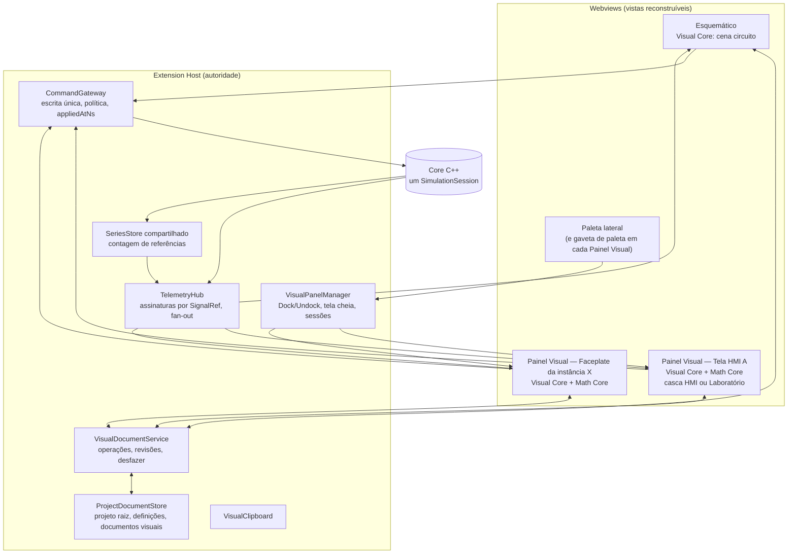
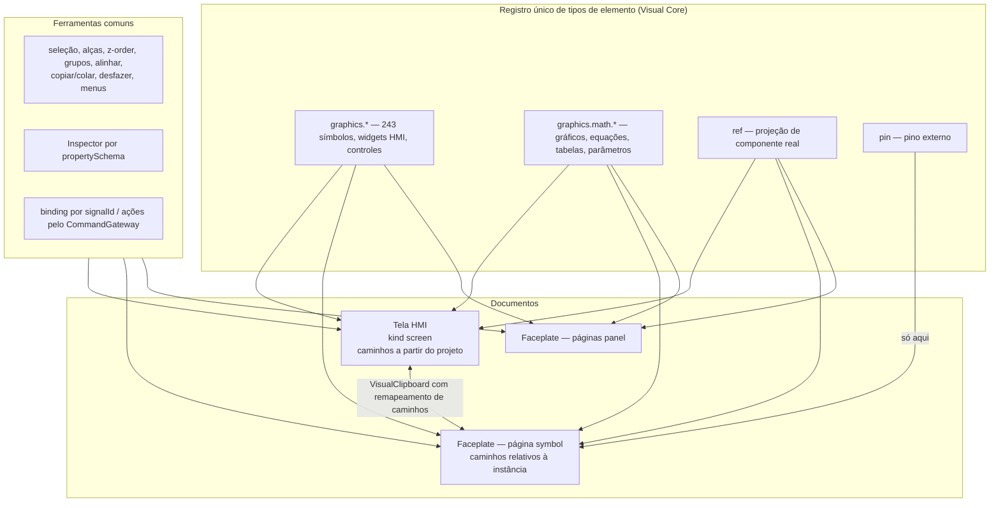
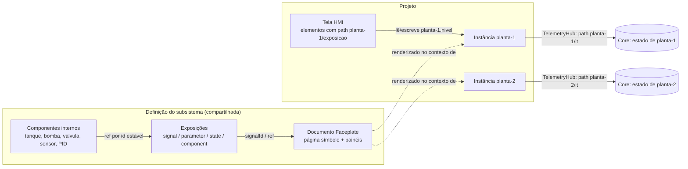
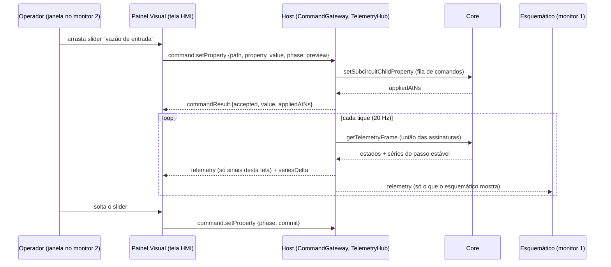

# Unificação visual — arquitetura, documento, matemática, Faceplate e exposição

**Classificação:** proposta **[P]** apoiada no diagnóstico do [doc 60](60-unificacao-visual-diagnostico-e-inventario.md)
e no estudo de janelas do [doc 61](61-unificacao-visual-janelas-dock-tela-cheia.md). Decisões:
[ADR 0017](adr/0017-documento-visual-unico.md) e [ADR 0018](adr/0018-autoridade-do-documento-no-host.md). **Implementado em 2026-10-20
com desvios registrados** (atividade do Laboratório como elemento, escopo matemático por página, Faceplate de operação por
instância, caminhos `<instância>:<interno>`): ver [doc 65](65-unificacao-visual-implementacao.md) §3.

## 1. Princípio e visão

**Um motor visual, um modelo de elementos, vários contextos de uso.** Tela HMI, Laboratório de Cálculo e Faceplate
passam a ser *documentos visuais* do mesmo tipo, editados e operados pelo mesmo motor; o que muda é o **contexto**
(qual documento, ligado a qual instância, apresentado com qual casca) e nunca a implementação.

| Hoje | Depois |
|---|---|
| HMI = modo de cena dentro do esquemático | Tela HMI = documento visual aberto no **Painel Visual** (acoplado ou flutuante) |
| Laboratório = painel próprio com 6 vistas monolíticas | Laboratório = **contexto de apresentação** + **elementos matemáticos** + modelos de página |
| Faceplate = símbolo compilado + componentes expostos | Faceplate = documento visual da definição (página *símbolo* com pinos + páginas *painel*) |
| 5 caminhos de escrita, 5 canais de leitura | 1 `CommandGateway`, 1 `TelemetryHub` |
| desfazer na Webview (HMI/Faceplate) e no Host (laboratório) | desfazer por documento no Host |



## 2. Camadas e de onde vem cada uma

A hipótese de camadas do pedido (Visual Core, Math Core, Simulation Binding, Presentation Contexts, Window Management)
**se confirma**, com uma diferença: a autoridade do documento e do desfazer vai para o Host, não para a Webview.

| Camada | Lado | Reaproveita | Novo |
|---|---|---|---|
| **Visual Core** — modelo de elementos, renderização, seleção/transformação, ferramentas, Inspector, menus, viewport, área de transferência local | Webview | motor genérico de cena de `main.ts` (`activeSceneComponents`, alças, z-order, grupos, `ipdAlignment`, `ipdKeyboardNavigation`, `componentGeometry`, `componentSymbols`, `simulidePaint`, `batchProperties`, `property-dock`) | extração para `ui/webview/visual/core/*`; registro de tipos de elemento com renderizador *widget* |
| **Math Core** — expressões, cálculo, dependências, plotagem, equações | Webview | `lab/calc/*`, `lab/graph/LabGraph`, `lab/editor/*`, `lab/ui/chart.ts`, `lab/ui/palette.ts`, `lab/units.ts` | `LabGraph` passa a ser **por documento** (`DocumentGraph`) |
| **Simulation Binding** — leitura, séries, escrita | Host + Webview | `graphicsBinding.ts`, `graphicsAction.ts`, `SeriesStore`, `SeriesBuffer`, `ProcessExperiment` (política), `SignalRecorder` (Core) | `SignalRef` com caminho de instância, `TelemetryHub`, `CommandGateway` |
| **Presentation Contexts** | Webview | `lab.css` (tema e grades), `body.presentation`, modo operação da HMI | cascas `hmi`, `lab` e `faceplate` |
| **Window Management** | Host | `SchematicPanel` (casca de painel) | `VisualPanelManager` (doc 61) |

## 3. Serviços do Host

### 3.1 `ProjectDocumentStore`

Separa **documento** de **visão em edição** (resolve L2). O projeto raiz, a tabela `subsystems`, os documentos visuais e
as definições externas abertas vivem aqui. A sessão "Abrir Modelo Interno" passa a ser uma *visão* sobre um caminho
do documento, não uma troca de `state.schematicState`. A simulação continua sendo a do **projeto raiz**.

- Fase 4: introduzido por trás de `state.schematicState` (adaptador), sem mudar o comportamento do esquemático.
- Edição de **Faceplate** nunca reconstrói o Core (é só visual, §8.4).
- Edição de **modelo interno** de definição: mantém o comportamento atual (Core passa a simular o subsistema) até a
  Fase 11, quando as alterações passam a ser aplicadas à simulação do projeto (re-registro da definição + reconstrução
  das instâncias) em vez de trocar o circuito simulado. Enquanto isso, as telas abertas mostram "simulação do projeto
  suspensa: editando modelo interno" em vez de valores errados.

### 3.2 `VisualDocumentService`

- Um documento visual por `documentId`; `revision` monotônica.
- A Webview envia **operações** (`add`, `remove`, `update(props)`, `move(frame)`, `reorder`, `group`, `page.*`, `decl.*`)
  com `baseRevision`; o Host aplica, incrementa a revisão, empilha o desfazer e transmite o *patch* às **outras** vistas
  do mesmo documento. Sem eco para a vista de origem (mesma disciplina do `projectChanged` atual, que evita "zoom que volta").
- **Um editor por documento** (doc 61 §8): vistas sem a "trava de edição" só operam, o que elimina conflito de escrita.
- Desfazer/refazer por documento, limite 200 (igual ao atual), com instantâneo do documento afetado — não do projeto.
- Marca o projeto como alterado pelo mesmo indicador de hoje (`refreshDirtyIndicator`).
- Substitui, para documentos visuais, o `projectChanged` de estado inteiro (L3): o esquemático deixa de carregar e
  devolver `hmiApplication`.

### 3.3 `TelemetryHub`

- Assinantes: esquemático, cada Painel Visual, diálogos de instrumento. Cada um registra seus `SignalRef` (leitura
  escalar, estado visual) e suas assinaturas de série.
- A cada tique, o Hub une as assinaturas e faz **um** `getTelemetryFrame` (como hoje); depois distribui só a fatia de cada
  assinante, com `sampleTimestampNs`, `telemetryGeneration` e estado de transporte (`connected/disconnected/stale`).
- Roda sempre que o Core roda, **com ou sem** o esquemático aberto (resolve L1).
- Assinantes ocultos (aba acoplada não visível) recebem só o último valor ao voltarem; séries continuam acumulando no Host.
- Resolve caminhos de instância (§10) com o cache por geração de `boardOverlayChildCoreIdCache`, generalizado para N níveis.

### 3.4 `SeriesStore` compartilhado

O `SeriesStore` atual (uma instância por assinatura) passa a ser indexado por `(caminho, portas, períodoNs)` com contagem
de referências: dois gráficos de duas telas sobre o mesmo sinal geram **uma** assinatura no Core; fechar o último
assinante cancela (`unsubscribeSeries`). Era o objetivo de [51 §4.2](51-laboratorio-calculo-arquitetura-e-dados.md).

### 3.5 `CommandGateway`

Ponto único de escrita para operador, laboratório e Inspector em operação:

| Hoje | Depois |
|---|---|
| `requestUpdateProperty` / `requestPreviewProperty` | `command.setProperty { target: InstancePath, property, value, phase: "preview" \| "commit" }` |
| `requestUpdateBoardOverlayProperty` | idem, com caminho de 2+ níveis |
| `labSetParameter` (`setSubcircuitChildProperty` + `appliedAtNs`) | idem, com `policy` do `ParameterDecl` |
| `labRun/labPause/labRestart` | `command.simulation { run \| pause \| restart(parameters) }` |

Valida faixa e política (`live`/`stop-required`; pausado conta como rodando, [50 §2](50-laboratorio-calculo-investigacao.md)),
devolve `{ accepted, value, appliedAtNs }` ou `{ rejected, reason }`. É o "gateway único" pedido em
[auditoria-hmi-isa101 §Gaps P1](auditoria-hmi-isa101/01-relatorio-e-plano.md); autorização e intertravamentos industriais
continuam fora do escopo, mas passam a ter um lugar único para entrar.

### 3.6 `VisualPanelManager` e `VisualClipboard`

`VisualPanelManager`: cria/revela Painéis Visuais por chave de vista, executa Dock/Undock/tela cheia, guarda sessões,
roteia a paleta (doc 61). `VisualClipboard`: área de transferência de elementos entre vistas e documentos (§13).

## 4. Modelo de documento e de elementos

```ts
/** Caminho estável a partir da raiz do contexto: ids de componentes do projeto (nunca ids do Core, nunca rótulos). */
type InstancePath = string[];

interface SignalRef { path: InstancePath; port?: string; channel?: number }   // path [] = o próprio contexto

interface VisualDocument {
  schemaVersion: 1;
  id: string;                         // estável: screenId, ou "faceplate" dentro da definição
  kind: "screen" | "faceplate";
  title: string;
  startPageId: string;
  pages: VisualPage[];
  /** Tabela de sinais nomeados: N elementos ligados ao mesmo sinal = 1 leitura. */
  signals: Array<{ id: string; label: string; ref: SignalRef; unit?: string;
                   access: "readout" | "series"; interpolation?: "linear" | "zoh" | "step-average"; periodNs?: number }>;
  /** Escopo matemático do documento (substitui expressões espalhadas nas atividades). */
  expressions: Array<{ id: string; name: string; text: string; variable?: string; domain?: [number, number] }>;
  parameters: Array<{ id: string; name: string; unit?: string; min: number; max: number; step: number; initial: number;
                      /** escala do controle (Δt usa logarítmica) */
                      scale?: "linear" | "log";
                      /** valores discretos com rótulo (ex.: saída do tanque: bomba / válvula / Torricelli) */
                      choices?: Array<{ value: number; label: string }>;
                      /** ausente = parâmetro local (só Webview); presente = parâmetro do modelo, escrito pelo CommandGateway */
                      target?: { ref: InstancePath; property: string; policy: "live" | "stop-required" } }>;
  /** Restrições entre parâmetros, verificadas pelo CommandGateway antes de escrever (ex.: "pmax > pmin"). */
  constraints?: Array<{ expression: string; message: string }>;
  presentation: { fullscreenContext: "lab" | "hmi" | "keep"; theme: "hmi-hp" | "lab"; staleAfterMs?: number };
  audit?: { ruleProfile?: unknown; exceptions?: unknown[] };   // de HmiApplication
}

interface VisualPage {
  id: string; name: string;
  role: "screen" | "symbol" | "panel";            // "symbol" só em faceplate (pinos permitidos)
  layout: { kind: "canvas"; width: number; height: number; background?: unknown }
        | { kind: "grid"; designWidth: number; designHeight: number;
            /** grades empilhadas, como as do Laboratório (`tank-layout` seguida de `tank-bottom`) */
            sections: Array<{ id: string; columns: string[]; areas: string[][]; gapPx?: number; collapseBelowPx?: number;
                              tone?: "plain" | "panel" | "dark" }> };
  elements: VisualElement[];                       // ordem = camada
  navigation?: Array<{ id: string; label: string; target: { pageId: string } | { screenId: string }; frame: Frame }>;
}

type Frame = { x: number; y: number; width: number; height: number; rotation: 0 | 90 | 180 | 270; flipH?: boolean; flipV?: boolean };
type Placement = ({ frame: Frame } | { slot: { section: string; area: string; order: number } })   // canvas | grade
  & { visibleWhen?: string };   // expressão sobre parâmetros/sinais (ex.: "outlet == 1" mostra o slider k)

type VisualElement =
  | ({ id: string; kind: "item"; typeId: string; label?: string; properties: Record<string, unknown> } & Placement)
  | ({ id: string; kind: "ref"; ref: InstancePath; label?: string; overrides?: Record<string, unknown> } & Placement)
  | ({ id: string; kind: "pin"; pinId: string; label: string; properties: Record<string, unknown> } & Placement)
  | ({ id: string; kind: "faceplate"; definition: string; instance: InstancePath; pageId: string } & Placement);
```

| Elemento | Substitui | Observação |
|---|---|---|
| `item` | `graphics.*` em HMI e Faceplate; partes das vistas do laboratório | inclui os novos `graphics.math.*` (§6) |
| `ref` | `HmiPageElement.componentId` **e** `ExposedComponentEntry` | uma forma só para "mostrar o objeto real" |
| `pin` | `symbol.pin` | só em página `symbol` |
| `faceplate` | — (novo) | embute o painel de uma instância numa tela |

Persistido: definição completa. **Não** persistido: séries, cursor, Δt, seleção, zoom, estado de janela, respostas de
aluno (sessão da vista em `workspaceState`, quando útil) — mesma regra de [ADR 0015](adr/0015-calculuslab-no-lsproj.md).

Bindings dos elementos passam a referenciar `signalId` (tabela do documento) em vez de `bindSource` solto; ações
referenciam `parameterId` ou `{ref, property}`. O resolvedor `graphicalRuntimeProperties` continua o mesmo, alimentado
por `signalId` em vez de `componentId`.

## 5. A Tela HMI na paleta: Controle → Ferramentas

### 5.1 Decisão: componente colocável ("botão HMI"), não ação de paleta

| Critério | Ação de paleta (como SisoTools/Ident) | **Componente colocável** (como Sintonia) |
|---|---|---|
| Várias telas por projeto | lista separada | **cada botão é uma tela** |
| Identidade e ciclo de vida (copiar, apagar, desfazer) | à parte | herda do esquemático |
| Abrir pelo esquemático (cenário 1 do requisito de Dock) | não | **sim** (duplo clique / clique em execução) |
| Tela dentro de subsistema (por instância) | não | **sim** (botão no modelo interno) |
| Entra no solver | — | não: `pinCount: 0` ⇒ `shouldSyncComponentToCore` falso (`coreLifecycle.ts:1271-1284`) **[C]** |

### 5.2 Especificação

| Campo | Valor |
|---|---|
| `typeId` | `tools.hmi_screen` |
| Rótulo | "Tela HMI" / "HMI Screen" |
| Catálogo | `category: "Ferramentas"`, `folderPath: ["Ferramentas"]`, `workspaceSection: "control"`, `pinCount: 0`, ícone de monitor; publicado junto de Sintonia (`controlGraphCatalog.ts`) ou do catálogo estático |
| Propriedades | `screenId` (oculta, referência ao documento), `title` (visível no botão) |
| Desenho | botão com ícone e título; indicador do estado da vista (fechada/acoplada/flutuante/tela cheia) |
| Duplo clique (edição) / clique (simulação rodando) | abre ou revela a tela com a última preferência de acoplamento |
| Menu de contexto | Abrir · Abrir em janela flutuante · Abrir em tela cheia · Renomear tela · Duplicar tela · Excluir tela |
| Inserir | cria `VisualDocument {kind:"screen"}` vazio (página 1920×1080, canvas) e o botão que o referencia |
| Copiar/colar | cola **cópia independente** do documento (novo `screenId`), como subsistemas internos ("nada é sobrescrito", doc 59) |
| Apagar | apaga o botão **e** o documento, num passo de desfazer; pede confirmação se o documento não estiver vazio |
| Dentro de um subsistema | o documento fica na definição; abre-se por instância (`screenId@caminho`) |
| Onde é proibido | dentro de páginas de tela/Faceplate (não há tela dentro de tela; a navegação entre telas é o item de navegação `target: {screenId}`) |

## 6. Integração do Laboratório de Cálculo

### 6.1 Das vistas aos elementos

Cada vista é decomposta nos elementos que ela já desenha. Todos são `graphics.math.*` (fora do solver, colocáveis pela
paleta em `Miscelâneos → Gráfico → Matemática`), com renderizador *widget* registrado no Visual Core.

| Elemento | Vem de | Consome |
|---|---|---|
| `graphics.math.function_plot` | `FunctionsView`, `LimitsView`, `AxisView` (gráfico com camadas) | `expressions`, `parameters`; objetos de camada: ponto restrito, secante, tangente, Riemann, área, assíntotas, raízes, interseções, ε–δ |
| `graphics.math.series_chart` | `TankView`, `FirstOrderView`, `SensorView` | `signals` (séries), cursor, marcadores a/b, Riemann sobre a série, eventos |
| `graphics.math.equation` | blocos de equação com valores | expressões + valores do grafo (MathML) |
| `graphics.math.table` | tabelas de aproximação e de valores | expressão/série + linhas |
| `graphics.math.expression_input` | editores de f/g, modelo | `EditorModel` + teclado (`mountPalette`) |
| `graphics.math.calculator` | calculadora de Limites | expressões do documento |
| `graphics.math.parameter` | sliders `a, b, c`, Δt (log), `n` | `parameters` (local ou ligado ao modelo) |
| `graphics.math.process_tank` | desenho do tanque de `TankView`/`LimitsView` | séries ou expressão (reconstrução) |
| `graphics.math.run_controls` | Executar/Pausar/Reiniciar | `command.simulation` |
| `graphics.math.steps` / `graphics.math.question` / `graphics.math.events` | `StepsPanel`, pergunta, lista de eventos | texto do documento; eventos da série |
| `graphics.math.keyboard` | teclado 123/f(x)/Cálculo (`mountPalette`) | escreve no `expression_input`/`calculator` com foco |
| `graphics.math.analysis` | painéis "Análise", "Taxa média", resultados com selo exato/numérico | expressões, séries, parâmetros |
| `graphics.math.view_toggles` | chaves f′, F, assíntotas, raízes, tabela | estado de inspeção de um gráfico (não persiste o que o aluno muda) |
| `graphics.math.process_axis` | carro sobre o trilho de `AxisView` | expressão ou série de posição |
| `graphics.math.plant_status` | faixa "planta ligada/ausente/religar" de `ProcessShell` | caminho da instância; ação "Inserir no projeto" |

Os objetos de camada (secante, tangente, Riemann…) **não** viram elementos soltos: são camadas do gráfico, como
`LabPlot.layers`/`MathObject` de [51 §5](51-laboratorio-calculo-arquitetura-e-dados.md). Assim "tanque + gráfico de nível
+ indicador + equação + slider + objeto geométrico" coexistem num documento, compartilhando sinais e parâmetros.

### 6.2 `DocumentGraph`

O `LabGraph` atual (por vista) vira **um grafo por documento aberto**, com os mesmos tipos de nó (`authoring`,
`parameter-mirror`, `series`, `inspection`, `view`, `execution`, `derived`), poda por valor e lote. Fontes:

- `authoring`: expressões e parâmetros do documento (revisão do `VisualDocumentService`);
- `execution`: leituras do `TelemetryHub` **por `signalId`** — uma fonte por sinal, não por elemento;
- `series`: revisão do `SeriesBuffer` por assinatura;
- `inspection`: cursor, Δt, lado, n (nunca saem da Webview — o teste "0 mensagens na inspeção" continua valendo).

Elementos declaram as entradas que desenham; o grafo entrega o conjunto alterado e o Visual Core repinta só esses
elementos no próximo `requestAnimationFrame`. É assim que um sinal que alimenta tanque, gráfico e indicador é lido uma vez
e recalculado uma vez por tique.

### 6.3 Atividades viram páginas-modelo

As seis atividades viram **modelos de página** ("Inserir página do Laboratório › Tanque…"), que criam a página em grade
com os elementos, sinais e parâmetros já ligados à instância escolhida. Professor/aluno vira edição/operação; o editor de
atividades vira Inspector + modelos; a gravação no `.lsproj` passa a ser a do documento; o desfazer do laboratório é o do
documento. `plants.ts` continua como **dados** dos modelos (canais e parâmetros de cada planta).

## 7. Contextos de apresentação e preservação da aparência do Laboratório

### 7.1 Três cascas sobre o mesmo documento

| Casca | Cabeçalho | Navegação | Tema | Uso padrão |
|---|---|---|---|---|
| `hmi` | barra atual do editor HMI (edição) ou só nome da página + botão de tela cheia (operação) | seletor/atalhos de página | `hmi-hp` (paleta ISA-101 já usada nos widgets) | janela normal |
| `lab` | **o cabeçalho do Laboratório atual**: `LasecSimul \| Laboratório de Cálculo`, abas = páginas, ferramentas (Apresentação, edição) | abas | tokens de `lab.css` (`--bg`, `--dark`, `--panel`, `--accent`), `body.presentation` | tela cheia (política padrão) |
| `faceplate` | título da instância (`Planta › Sensor`), página símbolo/painel | abas de painel | do documento | janela de instância |

Em **edição**, a camada de edição (barra de ferramentas, gaveta de paleta, Inspector, alças) é desenhada **sobre** a casca
ativa — por isso editar em tela cheia ou no contexto Laboratório funciona igual (doc 61 §5).

### 7.2 Como "a aparência atual do Laboratório" é preservada

1. `lab.css` vira o tema `lab` do Painel Visual, sem redesenho (mesmas cores, raios, tamanhos, `body.presentation`).
2. As grades atuais (`tank-layout`, `tank-bottom`, `lim-grid`, `fn-grid`, `calc`) viram **layouts de página em grade**
   com as mesmas `grid-template-columns` e o mesmo colapso (< 900–1000 px).
3. Os elementos matemáticos reaproveitam o **mesmo** código de desenho (`XYChart`, `astToMathML`, `EditorView`, `ICONS`).
4. Aceite visual: captura das seis atividades nos exemplos `examples/calculo/*.lsproj`, antes e depois, em 1920×1080 e
   1366×768, comparação por pixel com tolerância (Fase 8).

### 7.3 Escala e proporção

| Aspecto | Regra |
|---|---|
| Resolução lógica | página canvas tem `width×height` de projeto (padrão 1920×1080); página em grade tem `designWidth×designHeight` só para a pré-visualização da edição |
| Viewport | operação: ajustar à janela com escala **uniforme** `min(W/w, H/h)` e faixas laterais na cor do tema; edição: zoom/pan livres como hoje |
| Elementos | a política `aspect: fixed/variable` do catálogo ([GRAPHICAL_ARCHITECTURE](GRAPHICAL_ARCHITECTURE.md)) continua: equipamento nunca deforma |
| Coordenadas matemáticas | cada gráfico mantém sua transformação mundo↔tela própria; o zoom da página não altera a vista matemática |
| Fontes e rótulos | em unidades de projeto (escalam com a página); casca `lab` aplica os mínimos do modo Apresentação |
| Precisão de gráficos | marcas e amostragem adaptativa recalculadas pelo tamanho em pixels após cada `resize`; nada é reamostrado das séries |
| DPI | todo o desenho é SVG/HTML vetorial; ao mudar `devicePixelRatio` (troca de monitor) só se refaz camada raster se existir |
| Redimensionar/tela cheia | só *relayout*; nenhuma reconstrução de documento ou simulação |

## 8. Faceplate no mesmo motor

### 8.1 Documento do Faceplate

`subsystems[].faceplate` (e `faceplate` no `.lssubcircuit`) é um `VisualDocument { kind: "faceplate" }` com:

- **uma página `symbol`**: o que aparece na instância do esquemático; aceita `pin` (os pinos compilam para os
  `PackagePin[]` usados pela fiação, como hoje) e **qualquer** elemento da HMI, inclusive matemático e `ref`;
- **zero ou mais páginas `panel`**: o painel de operação da instância (sem pinos), aberto num Painel Visual por instância,
  acoplado/flutuante/tela cheia, e embutível numa tela por um elemento `faceplate`.

### 8.2 O que muda no esquemático

A instância passa a ser desenhada pelo Visual Core a partir da página `symbol`, no contexto daquela instância. Desaparece a
divisão "desenho estático compilado + overlay exposto" (L11): tudo na página é vivo e ligado à instância. O
`PackageDescriptor` compilado continua existindo só para o que precisa dele: pinos (fiação), ícone de paleta e *fallback*
quando o documento não carrega.

### 8.3 Igual à HMI, com três diferenças de contexto



| Diferença | Motivo |
|---|---|
| pinos na página `symbol` | interface elétrica/sinal do subsistema |
| caminhos relativos à instância (`[]` = a instância) | o mesmo documento serve N instâncias |
| tabela de exposições (§9) | é o que o subsistema oferece para fora |

### 8.4 Editar sem derrubar a simulação

"Editar Faceplate" abre o documento da definição num Painel Visual (não mais uma sessão do esquemático), **sem**
`rebuildCoreFromSchematicState`. Na barra do editor há um seletor "pré-visualizar com a instância…": a edição mostra os
valores vivos daquela instância. Editar o Faceplate altera a definição (todas as instâncias), como hoje (doc 59).

## 9. Exposição de elementos e variáveis

### 9.1 Tabela de exposições da definição

```ts
interface Exposure {
  id: string;            // nome público estável, ex.: "nivel", "valvula", "kp"
  label: string;
  kind: "signal" | "parameter" | "state" | "component";
  ref: InstancePath;     // caminho interno (ids estáveis)
  port?: string; channel?: number; property?: string;     // conforme o tipo
  unit?: string;
  access: "read" | "write" | "readwrite";
  range?: { min: number; max: number; step?: number };
  policy?: "live" | "stop-required";
}
```

| `kind` | Exemplo | Consumo |
|---|---|---|
| `signal` | nível do sensor, saída do PID, estado digital | bindings de qualquer elemento; séries |
| `parameter` | `kp`, área do tanque, faixa do transmissor | sliders/entradas pelo `CommandGateway`; valor por instância em `@<filho>.<prop>` (mecanismo existente) |
| `state` | estado operacional, estado visual (LCD) | estados visuais e alarmes visuais |
| `component` | tanque, válvula (exposição **visual**) | elemento `ref` no Faceplate e em telas de fora |

`exportedPropertyComponentIds` (exportação de propriedades por componente) vira `parameter` com `property: "*"`;
`exposedComponents` vira `component` + elemento `ref` na página `symbol`. As duas ideias continuam **independentes**
(pedido registrado no doc 59): expor visualmente não exporta parâmetros.

### 9.2 Fluxo



### 9.3 Exposição não é duplicação

- `ref` e exposições **nunca** entram no Core (são apresentação); o estado é do componente real, resolvido pelo caminho.
- Escrita (botão, slider) sempre vai ao componente real pelo `CommandGateway`; não existe "cópia" a sincronizar.
- Várias representações do mesmo objeto (símbolo, painel, duas telas) leem a mesma assinatura do `TelemetryHub`.
- Concorrência de operadores: último comando aceito vence; todos veem o valor **aceito** (`appliedAtNs`), não o pedido.

### 9.4 Renomear, remover, modificar

| Evento no subsistema | Efeito |
|---|---|
| Renomear componente interno (rótulo) | nada quebra: referências são por id **[C]** (regra ARCH-006, já seguida pelo binding) |
| Renomear o `id` público de uma exposição | operação de refatoração explícita no editor de exposições, atualiza as referências conhecidas do projeto; referências de projetos externos viram achado de auditoria |
| Remover componente interno exposto | a exposição fica **órfã**: elementos mostram "referência ausente", auditoria `EXPOSURE.REF_MISSING` com "religar"/"remover"; nada é apagado em cascata (política atual da HMI para referências órfãs) |
| Mudar tipo/propriedades do componente | `ref` redesenha pela origem; *overrides* que deixaram de existir viram aviso |
| Remover a definição | recusado se houver instâncias (regra atual do doc 59) |

## 10. Múltiplas instâncias

- O **modelo** do Faceplate e das telas de subsistema é da definição; o **contexto de execução** é o caminho da instância.
- Chaves de leitura viram caminhos completos (`planta-1/sensor/lt`), generalizando `"<instância>:<filho>"` (1 nível) para N níveis.
- Cada vista de instância tem sessão própria (página, zoom, janela); nenhuma estrutura da Webview é compartilhada entre instâncias.
- Resolução no Core por `getSubcircuitChildInstanceId` repetido nível a nível, com cache por geração **[I]** (validar
  aninhamento real na Fase 10: hoje só 1 nível é exercitado).
- Teste obrigatório: três instâncias da mesma definição, valores e parâmetros diferentes, três janelas abertas, nenhum
  valor cruzado (cenário G, doc 63).

## 11. Comunicação entre janelas e simulação

### 11.1 Fonte única da verdade

| Dado | Dono |
|---|---|
| projeto, definições, documentos visuais, alterações não salvas | `ProjectDocumentStore` + `VisualDocumentService` |
| estado físico e tempo | Core (um `SimulationSession`) |
| último quadro, séries | `TelemetryHub` + `SeriesStore` |
| seleção, zoom, inspeção | cada vista (Webview), com cópia de sessão no Host |

### 11.2 Protocolo `visual/1` (Host ↔ Painel Visual)

| Direção | Mensagem |
|---|---|
| W→H | `visualReady { boot, geometry }`, `visualOps { documentId, baseRevision, ops[] }`, `visualUndo/Redo`, `command.*`, `windowRequest { dock \| undock \| fullscreen \| exitFullscreen \| context }`, `geometry`, `sessionState { pageId, viewport, selection, mode }`, `catalogRequest { typeIds[] }`, `subscribe/unsubscribe { signals, series }` |
| H→W | `visualInit { document, revision, session, catalogVersion, lastFrame, seriesSnapshots }`, `visualPatch { revision, ops[] }`, `telemetry { timestampNs, bySignal, transport }`, `seriesDelta`, `simulationStatus`, `commandResult`, `windowState { docking, window, context, editLock }`, `catalogEntries`, `placementArm { typeId }` |

Uma versão de protocolo, uma casca de painel (HTML, CSP, nonce, *cache-busting* e aperto de mão hoje repetidos em cada
painel). CSP única: `script-src` com nonce e sem `unsafe-eval` (o `noEval.test.ts` passa a cobrir o *bundle* visual);
`style-src` com `unsafe-inline` enquanto o código do esquemático gerar estilos em marcação (L17), com meta de remover.



### 11.3 Reconexão e fechamento

- Webview recriada (troca de janela, recarga): `visualReady` → `visualInit` com o último quadro e *snapshots* de série.
- Core reconstruído (Parar/Reiniciar, edição estrutural): `onCoreRebuilt` → Hub reassina; vistas recebem `telemetryGeneration` nova.
- Core caiu: transporte `disconnected` (estado já suportado pelo binding).
- Vista fechada sem aviso: `onDidDispose` libera assinaturas; o documento continua no Host.

## 12. Persistência

### 12.1 Formato novo (ruptura beta, ADR-0005 da `.spec`)

| Arquivo | Antes | Depois |
|---|---|---|
| `.lsproj` (`LS_PROJ_SCHEMA_VERSION` 2 → **3**) | `hmiApplication?`, `calculusLab?` | `visualDocuments: VisualDocument[]` (telas do projeto, inclusive páginas do Laboratório); botões `tools.hmi_screen` em `components[]` |
| `subsystems[]` (dentro do `.lsproj`) | manifesto v3 com `symbol`, `exposedComponents`, `exportedPropertyComponentIds`, `hmiApplication?` | manifesto **v4**: `faceplate: VisualDocument`, `exposures: Exposure[]`, `screens?: VisualDocument[]`; `symbol` só como compilado de pinos/ícone |
| `.lssubcircuit` (`SUBCIRCUIT_SCHEMA_VERSION` 3 → **4**) | idem | idem |

Regras (ADR-0005 da `.spec`): versão incrementada, carga parcial recusada, **conversor explícito** (`LasecSimul: Converter
projeto para o formato visual unificado` + script para o repositório). O conversor:

1. `hmiApplication` → uma tela (`tools.hmi_screen` + documento), páginas, elementos (`componentId` → `ref [id]`), navegação,
   `staleAfterMs`, auditoria — sem mover nada (regra de preservação de layout da [auditoria HMI](auditoria-hmi-isa101/01-relatorio-e-plano.md)).
2. `calculusLab.activities[]` → uma tela "Laboratório de Cálculo" com uma página por atividade (modelo da §6.3), parâmetros
   e etapas; `plantComponentId` → caminho.
3. `symbol` + `exposedComponents` → página `symbol` (formas viram `item`, expostos viram `ref` com a mesma posição/escala/
   camada) + exposições `component`; `exportedPropertyComponentIds` → exposições `parameter`.
4. Grava relatório do que converteu e de cada referência que não conseguiu resolver.

Repositório a converter: 62 `subcircuits/*.lssubcircuit` (61 com exposições, 24 TDPS), os `.lsproj` de `trm/**` e
`examples/**`, e os geradores (`scripts/generate-tdps-process-screens.mjs`…), que passam a emitir o formato novo. Testes de
ida e volta comparam posições, camadas e bindings antes/depois.

**Exceção — `examples/calculo/`:** os cinco projetos do Laboratório **não** passam pelo conversor. São **refeitos** na nova
modalidade (telas com botão HMI, páginas em grade com elementos matemáticos, Faceplates vivos das plantas), a partir dos
mesmos modelos de página que o produto oferece. Especificação tela a tela em
[64](64-unificacao-visual-refazer-exemplos-calculo.md).

### 12.2 Salvamento, histórico e estados

- Salvamento continua **explícito** (Ctrl+S / "Save Project"); alterações não salvas sobrevivem a qualquer troca de janela porque vivem no Host.
- Proteção contra perda (opcional, Fase 11): cópia de segurança periódica do documento sujo em `context.storageUri`,
  oferecida ao reabrir após encerramento anormal.
- Estado de edição × execução: documentos não guardam valores de simulação; sessões de vista guardam só preferências.

## 13. Experiência de edição compartilhada

Todas as ferramentas abaixo saem do Visual Core e valem igualmente para esquemático (onde fizer sentido), telas e Faceplate:

| Ferramenta | Origem atual | Observação |
|---|---|---|
| seleção, multisseleção, *marquee* | `main.ts` | — |
| colocar (clique para armar) e arrastar dentro da mesma Webview | `enterPlacementMode` | + gaveta de paleta |
| mover, alças (8 ou 4 cantos conforme aspecto), rotação 90°, espelhar | `main.ts`, `componentGeometry.ts` | — |
| agrupar/desagrupar | `__ui_group` | — |
| alinhar/distribuir | `ipdAlignment.ts` | — |
| z-order / camadas | `zOrder.ts` | ordem da lista = camada |
| zoom/pan/ajustar | `main.ts` | — |
| copiar/colar/duplicar | `clipboardItems` | passa a usar o `VisualClipboard` do Host entre vistas |
| desfazer/refazer | instantâneos na Webview | Host (§3.2) |
| menus de contexto | `showContextMenu` | + itens de estado (doc 61 §9) |
| Inspector | `property-dock` + `batchProperties.ts` | esquema por tipo; elementos matemáticos declaram `propertySchema` |
| atalhos | `main.ts` | idênticos em todas as superfícies |
| expressões | — | `expression_input` + editor estruturado do laboratório nos campos de expressão do Inspector |
| bindings | seletores de fonte/canal (Fase 2 da auditoria HMI) | seletor de **sinal** do documento, com caminho de instância |

### 13.1 Copiar/colar entre HMI e Faceplate (com remapeamento)

`VisualClipboard` guarda `{ origem: {documentKind, contexto}, elementos, sinais/expressões/parâmetros referenciados }`.
Ao colar:

| Origem → destino | Regra |
|---|---|
| mesma tela | ids novos; referências mantidas |
| tela → outra tela | caminhos absolutos continuam válidos |
| tela → Faceplate da definição D | caminho `[instância de D, …resto]` vira relativo `[…resto]`; caminho fora de D → **diálogo de remapeamento** |
| Faceplate → tela | caminho relativo pede **qual instância** (lista das instâncias de D) |
| item sem binding | cola direto |

Nenhum binding é descartado em silêncio: o que não puder ser mantido aparece no diálogo e, se ignorado, fica marcado como
achado de auditoria.
