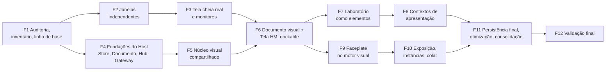

# Unificação visual — plano faseado, desempenho, testes, riscos e decisões

**Classificação:** plano **[P]**. Base: [60](60-unificacao-visual-diagnostico-e-inventario.md) (diagnóstico),
[61](61-unificacao-visual-janelas-dock-tela-cheia.md) (janelas), [62](62-unificacao-visual-arquitetura-e-documento.md)
(arquitetura e documento), [64](64-unificacao-visual-refazer-exemplos-calculo.md) (exemplos do Laboratório refeitos).
**Executado em 2026-10-19/20**: estado de cada fase, medições das métricas e pendências no [doc 65](65-unificacao-visual-implementacao.md).

## 1. Ordem das fases

A ordem do pedido foi mantida no conteúdo, mas reorganizada em dois pontos com justificativa:

1. **Janelas e tela cheia (Fases 2–3) vêm antes do núcleo compartilhado**, com piloto no painel do Laboratório que já
   existe: valida no produto real os mecanismos verificados no experimento e entrega cedo o "Laboratório em tela cheia
   verdadeira", sem esperar a refatoração.
2. **Fundações do Host (Fase 4) antes da extração do motor (Fase 5):** sem autoridade do documento e do desfazer no
   Host, mover a HMI para uma janela que é recriada a cada Dock/Undock perderia estado (L4/L5).

Cada fase deixa o produto utilizável e todas as suítes existentes verdes (`npm test`, `test:lab:e2e`,
`test:lab:tank:e2e`, `test:subsystems:e2e`, `test:wires:e2e`, `test:pid:e2e`).

## 2. Fases

### Fase 1 — Auditoria, inventário e linha de base

| Campo | Conteúdo |
|---|---|
| Objetivo | Fechar o inventário e medir o ponto de partida das métricas do §3 |
| Situação atual | inventário e estudo de janelas **concluídos** (docs 60–61, PoC); métricas de recarga/memória/latência por vista **não medidas** |
| Alterações | `extension/test/performance/visual-baseline.cjs` (novo): tempo de recarga do esquemático e do laboratório numa janela auxiliar, heap JS por Webview (`performance.memory` no *frame*), bytes de `init` (catálogo), mensagens por tique; spec `FEAT-016` em `.spec/features/` com status `planned` e seção Aceitação |
| Arquivos | `extension/test/performance/*`, `docs/poc/janelas-auxiliares-vscode/*` (reuso do *driver* e do `winctl.ps1`), `.spec/features/unified-visual-surfaces.md`, `.spec/STATUS.md` (gerado) |
| Dependências | — |
| Riscos | medição instável em máquina compartilhada → 5 repetições, p50/p95 |
| Estratégia | reaproveitar `test:telemetry:baseline` e o *driver* da PoC |
| Aceitação | relatório com p50/p95 de M1, M5, M6 e M10 para esquemático e laboratório; spec `FEAT-016` aprovada no `check-specs` |
| Testes | o próprio *harness*; `node .spec/governance/check-specs.mjs` |
| Concluída quando | as metas do §3 estão calibradas com números medidos (não estimados) |

### Fase 2 — Janelas independentes (Dock/Undock), piloto no Laboratório

| Campo | Conteúdo |
|---|---|
| Objetivo | `VisualPanelManager` genérico: Undock/Dock/Redock, detecção de estado, sessão, restauração após recarga; primeiro cliente: painel do Laboratório |
| Situação atual | painéis *singleton* sem *serializer*; nenhum uso de comandos de janela; o laboratório já reenvia a definição no `labReady` |
| Alterações | casca de painel comum (HTML/CSP/nonce/*cache-busting*/aperto de mão) extraída de `SchematicPanel`/`CalculusLabPanel`; `VisualPanelManager` (Undock por `moveEditorToNewWindow`, Dock por `reveal(coluna)`, compacto, geometria→estado, sessão em `workspaceState`); `registerWebviewPanelSerializer` + `onWebviewPanel:lasecsimul.calculusLab`; laboratório idempotente no `labReady` (reenvia *snapshot* de séries e estado de execução); comandos `lasecsimul.visual.dock/undock` com `when` |
| Arquivos | `extension/src/ui/panels/{CalculusLabPanel,SchematicPanel}.ts`, novo `extension/src/ui/panels/panelShell.ts` e `extension/src/ui/windows/VisualPanelManager.ts`, `extension/src/lab/calculusLabHost.ts`, `extension/src/lab/processExperiment.ts`, `extension/package.json` (comandos, `activationEvents`) |
| Dependências | F1 |
| Riscos | IDs de comando mudarem (R1); detecção de estado errada (R3) |
| Estratégia | *feature detection* por `getCommands(true)`; sem os comandos, a ação Undock some do menu e uma mensagem explica |
| Aceitação | Undock/Dock do laboratório em ≤ M1; atividade, modo, vista, séries e parâmetros idênticos antes/depois; recarregar o VS Code com o laboratório flutuante o traz de volta na janela auxiliar; nenhuma mensagem de inspeção ao Host durante as trocas |
| Testes | unidade: classificador de geometria com as medições da PoC como *fixtures*; E2E `test:windows:e2e` (VS Code 1.128 e estável corrente): Undock, Dock (`reveal`), recarga, minimizar principal |
| Concluída quando | E2E verde nas duas versões e M1 dentro da meta |

### Fase 3 — Tela cheia real e múltiplos monitores

| Campo | Conteúdo |
|---|---|
| Objetivo | tela cheia verdadeira por janela, retorno ao estado anterior, Esc/F11, botão no canto superior direito, consentimento para remover a faixa de título |
| Situação atual | inexistente; `requestFullscreen` bloqueado **[E]** |
| Alterações | `FullscreenController` (doc 61 §7.1): foco → compacto → `toggleFullScreen` → confirmação por geometria; Undock automático quando acoplada e Dock ao sair; notificação única para `window.customTitleBarVisibility: "windowed"`; Esc/F11 na Webview |
| Arquivos | `extension/src/ui/windows/FullscreenController.ts` (novo), `VisualPanelManager.ts`, Webview do laboratório (botão e teclas) |
| Dependências | F2 |
| Riscos | DPI diferente entre monitores (R4); F11 não repassado (R11) |
| Estratégia | E2E automático **com os dois monitores desta máquina** (principal 1920×1080, secundário 1366×768 à esquerda): a janela é levada ao secundário por `SetWindowPos`, como na PoC (doc 61 §3.1); DPI diferente fica num roteiro manual em outra estação |
| Aceitação | normal→tela cheia→normal e maximizada→tela cheia→maximizada restauram limites e estado; com consentimento, Webview = resolução do monitor (0 px de moldura); sem consentimento, ≤ 30 px; zero reconstrução de documento/simulação (M2) |
| Testes | E2E `test:windows:e2e` (tela cheia, maximizar, janela entre monitores, nos dois monitores, via `winctl.ps1`); manual só para DPI misto |
| Concluída quando | E2E verde nos dois monitores e roteiro de DPI misto assinado |

### Fase 4 — Fundações do Host

| Campo | Conteúdo |
|---|---|
| Objetivo | `ProjectDocumentStore`, `VisualDocumentService`, `TelemetryHub`, `CommandGateway`, `SeriesStore` compartilhado |
| Situação atual | estado do Host = visão em edição; telemetria só para o esquemático; 5 caminhos de escrita; `SeriesStore` por experimento |
| Alterações | §3 do doc 62; o esquemático passa a ser **um assinante** do Hub; `pollTelemetryFrame` deixa de exigir `state.schematicPanel`; `requestUpdateBoardOverlayProperty`/`labSetParameter` passam pelo Gateway (mensagens antigas viram adaptadores) |
| Arquivos | `extension/src/core/coreLifecycle.ts`, `extension/src/state.ts`, `extension/src/extension.ts` (handlers), `extension/src/lab/{SeriesStore,processExperiment}.ts`, novos `extension/src/visual/{ProjectDocumentStore,VisualDocumentService,TelemetryHub,CommandGateway}.ts` |
| Dependências | F1 |
| Riscos | regressão de telemetria/escrita (R6) |
| Estratégia | adaptadores; comportamento externo idêntico; comparação por *golden* das mensagens do tique antes/depois |
| Aceitação | 1 IPC por tique com N assinantes (M3); telemetria chega a um assinante sem o esquemático aberto; `appliedAtNs` preservado; nenhuma suíte existente regride |
| Testes | unidade dos serviços; Core real: Hub com 3 assinantes, 2 vistas na mesma série = 1 assinatura (M12), escrita por caminho de 2 níveis |
| Concluída quando | esquemático, laboratório e PID rodam inteiramente sobre Hub e Gateway |

### Fase 5 — Núcleo visual compartilhado

| Campo | Conteúdo |
|---|---|
| Objetivo | extrair o motor de cena de `main.ts` para `ui/webview/visual/core/*`, instanciável numa Webview que não seja o esquemático |
| Situação atual | motor genérico já compartilhado entre circuito/Faceplate/ícone/HMI, mas preso ao estado global de `main.ts` (13 256 linhas) |
| Alterações | 5a: "papel" de inicialização do *bundle* atual (`role: "schematic" \| "visual"`), injeção do adaptador de cena (o que hoje decide `activeSceneComponents`); 5b: extração por módulos — modelo/operações, seleção e transformação, colocação, área de transferência, viewport, menus, Inspector; 5c: o esquemático passa a importar os módulos extraídos |
| Arquivos | `extension/src/ui/webview/main.ts` → `extension/src/ui/webview/visual/core/*`, `extension/tsconfig.webview.json`, `scripts/check-webview-modules.js` |
| Dependências | F4 (o motor emite operações em vez de `projectChanged`) |
| Riscos | regressões sutis do canvas (R6) |
| Estratégia | *strangler*: um módulo por vez, cada passo com `test:wires:e2e`, `test:connections:e2e`, `test:subsystems:e2e`, `test:e2e` e `test:wires:measure` verdes |
| Aceitação | nenhuma regressão funcional ou de desempenho (M7); `main.ts` reduzido ao *shell* do esquemático |
| Testes | suítes existentes + unidade dos módulos extraídos |
| Concluída quando | o mesmo motor roda no esquemático e num Painel Visual de teste |

### Fase 6 — Documento visual unificado, Tela HMI e HMI *dockable*

| Campo | Conteúdo |
|---|---|
| Objetivo | `VisualDocument` (telas), botão `tools.hmi_screen` em **Controle → Ferramentas**, HMI no Painel Visual acoplado/flutuante, edição nos dois estados, menu de contexto por estado |
| Situação atual | HMI como modo de cena do esquemático; operação sem menu de contexto; paleta só para o esquemático |
| Alterações | tipos do doc 62 §4; item de catálogo do doc 62 §5; Painel Visual (`lasecsimul.visual`) com casca `hmi`; roteamento da paleta para a superfície visual ativa em edição; gaveta de paleta (reuso de `palette.ts`/`paletteTree.ts`); menu de contexto do doc 61 §9; trava de edição por documento; conversor `hmiApplication` → tela |
| Arquivos | `extension/src/ui/webview/model.ts`, `extension/src/project/{ProjectTypes,ProjectSerializer}.ts`, `extension/src/catalog/controlGraphCatalog.ts` (ou `component-catalog.json`), `extension/src/ui/webview/paletteTree.ts`, `extension/src/ui/webview/palette.ts`, `extension/src/extension.ts` (`addPaletteComponent`), novos `extension/src/ui/webview/visual/{main,shells/hmi}.ts` |
| Dependências | F3, F5 |
| Riscos | edição simultânea em duas vistas (R13); primeiro clique entre janelas (R12) |
| Estratégia | o modo HMI antigo do esquemático continua até o conversor e o Painel Visual passarem nos testes; depois é removido (F11) |
| Aceitação | cenários A, B, D, H (parte HMI), I e validações de Dock 1–15 (§4.2) aplicáveis |
| Testes | unidade (operações, conversor, roteamento, menu por estado); E2E `test:visual:hmi:e2e`; manual com entrada real (anunciado) para o primeiro clique entre janelas |
| Concluída quando | uma HMI pode ser inserida, editada acoplada e flutuante, posta em tela cheia e reacoplada sem perda de estado |

### Fase 7 — Laboratório de Cálculo como elementos

| Campo | Conteúdo |
|---|---|
| Objetivo | elementos `graphics.math.*`, `DocumentGraph`, sinais/parâmetros ligados por caminho, modelos de página das seis atividades |
| Situação atual | vistas monolíticas; um experimento por vez; planta resolvida por tipo |
| Alterações | doc 62 §6; `ProcessExperiment` vira serviço de sinais/parâmetros por documento; `calc/*`, `graph/*`, `editor/*`, `ui/chart.ts`, `ui/palette.ts` movidos para `visual/math/*` sem reescrita |
| Arquivos | `extension/src/ui/webview/lab/**`, `extension/src/lab/**`, `scripts/generate-calculus-lab-examples.cjs` |
| Dependências | F6 |
| Riscos | divergência numérica (R9) |
| Estratégia | as asserções de `test:lab:e2e` e `test:lab:tank:e2e` passam a rodar contra as páginas-modelo |
| Aceitação | os 63 *checks* atuais dos dois E2E do laboratório passam nas páginas novas; "0 mensagens na inspeção" mantido; cenário C (sem a casca) e D; páginas de `examples/calculo` refeitas na nova modalidade ([64](64-unificacao-visual-refazer-exemplos-calculo.md) §4, critérios 4–6) |
| Testes | `calc`, `analysis`, `LabGraph`, `EditorModel`, `SeriesBuffer`, `noEval` (agora sobre o *bundle* visual); Core real dos três modelos de planta |
| Concluída quando | as seis atividades existem como páginas e o painel antigo não é mais necessário |

### Fase 8 — Contextos de apresentação

| Campo | Conteúdo |
|---|---|
| Objetivo | cascas `hmi`/`lab`/`faceplate`, tema `lab` (de `lab.css`), layout em grade, política de contexto na tela cheia, regras de escala |
| Situação atual | dois visuais em duas Webviews |
| Alterações | doc 62 §7 |
| Arquivos | `extension/media/lab/lab.css` → tema; `visual/shells/*`; `visual/core/layout/*` |
| Dependências | F7 |
| Riscos | fidelidade visual (R10) |
| Estratégia | regressão visual por captura antes/depois (1920×1080 e 1366×768, tolerância por pixel) |
| Aceitação | cenário C completo; capturas das seis atividades dentro da tolerância; trocar de contexto não altera documento, simulação nem desfazer; exemplos de `examples/calculo` em tela cheia nos dois monitores ([64](64-unificacao-visual-refazer-exemplos-calculo.md) §7, critério 3) |
| Testes | E2E visual + `test:hmi:visual` |
| Concluída quando | tela cheia mostra as telas de cálculo com a aparência atual do Laboratório |

### Fase 9 — Faceplate no motor visual

| Campo | Conteúdo |
|---|---|
| Objetivo | documento Faceplate (página `symbol` + painéis), instância desenhada pelo Visual Core, painéis por instância em janela, edição sem reconstruir o Core, pré-visualização por instância |
| Situação atual | símbolo compilado + overlay exposto; edição troca o estado e reconstrói o Core |
| Alterações | doc 62 §8; "Editar Faceplate" abre Painel Visual; `renderBoardOverlaysFor` substituído pelo render da página `symbol` |
| Arquivos | `extension/src/catalog/{subcircuitDocument,subcircuitSymbolScene,subcircuitExposedComponents}.ts`, `extension/src/ui/webview/subsystemModel.ts`, `extension/src/project/subsystemRuntime.ts`, `extension/src/extension.ts` (`openSubcircuitForEditingCommand`), `extension/src/ui/webview/main.ts` (overlay) |
| Dependências | F6 |
| Riscos | 61 bibliotecas com exposições, 24 TDPS (R8) |
| Estratégia | conversor `symbol`+`exposedComponents` → página `symbol`; galeria TDPS (`render-tdps-process-gallery.cjs`) antes/depois |
| Aceitação | cenário E; abrir/editar o Faceplate com a simulação rodando não altera `simulationPlan.generation` nem interrompe telas abertas; Faceplates das plantas tanque, primeira ordem e sensor refeitos ([64](64-unificacao-visual-refazer-exemplos-calculo.md) §5) |
| Testes | `subcircuitDocument`, `subcircuitSymbolScene`, `tdpsProcessScreens`, `test:subsystems:e2e` adaptado, galeria TDPS |
| Concluída quando | tudo o que se desenha numa tela se desenha no Faceplate, com pinos só na página símbolo |

### Fase 10 — Exposição, múltiplas instâncias e copiar/colar

| Campo | Conteúdo |
|---|---|
| Objetivo | tabela `exposures`, elementos `ref`/`faceplate`, caminhos de N níveis, auditoria de referências, `VisualClipboard` com remapeamento |
| Situação atual | exposição de 1 nível, implícita; área de transferência por Webview |
| Alterações | doc 62 §9, §10, §13.1 |
| Arquivos | novos `visual/exposures.ts`, `visual/clipboard.ts`; `hmiAudit.ts` + `lab/audit.ts` → auditoria visual única |
| Dependências | F9 |
| Riscos | resolução aninhada no Core (R14) |
| Estratégia | testes de Core real com subsistema dentro de subsistema antes de abrir para UI |
| Aceitação | cenários F, G, H |
| Testes | unidade (renomear/remover/religar, remapeamento); Core real com 3 instâncias e aninhamento; E2E de colar entre tela e Faceplate |
| Concluída quando | três instâncias com Faceplates próprios, sem cruzamento de valores, em três janelas |

### Fase 11 — Persistência final, otimização e consolidação

| Campo | Conteúdo |
|---|---|
| Objetivo | formatos `.lsproj` v3 e `.lssubcircuit` v4, conversor de repositório, remoção de legados, metas de desempenho |
| Situação atual | formatos com `hmiApplication`, `calculusLab`, `symbol`/`exposedComponents` |
| Alterações | doc 62 §12; remover: modo `hmi` de `main.ts`, `CalculusLabPanel` e vistas monolíticas, `renderBoardOverlaysFor`, `requestUpdateBoardOverlayProperty`, `labSetParameter`, `media/pid/miniplot.js` (se o PID adotar o gráfico comum), auditoria duplicada; catálogo sob demanda (L15); edição de modelo interno aplicada à simulação do projeto (doc 62 §3.1) |
| Arquivos | `ProjectSerializer.ts`, `subcircuitDocument.ts`, geradores em `scripts/`, todos os `.lsproj`/`.lssubcircuit` do repositório |
| Dependências | F8, F10 |
| Riscos | perda de dados na conversão (R8) |
| Estratégia | conversor com relatório; ida e volta comparando geometria, camadas e bindings; ADR-0005 da `.spec` |
| Aceitação | todos os arquivos do repositório convertidos e reabertos sem diferença semântica; métricas M1–M12 dentro das metas; `scripts/generate-calculus-lab-examples.cjs` reescrito e os cinco exemplos antigos substituídos ([64](64-unificacao-visual-refazer-exemplos-calculo.md) §6) |
| Testes | ida e volta de todos os arquivos; *benchmarks* do §3 |
| Concluída quando | nenhum caminho legado restante e metas atingidas |

### Fase 12 — Validação final

| Campo | Conteúdo |
|---|---|
| Objetivo | cenários A–J, validações de Dock 1–15, roteiro de DPI misto, uso com professores/operadores |
| Situação atual | — |
| Alterações | correções |
| Dependências | F11 |
| Aceitação | todos os itens do §4 verdes; nenhuma duplicação de documento, simulação ou binding (contadores) |
| Concluída quando | relatório de validação publicado em `docs/` |

## 3. Desempenho

### 3.1 Otimizações (itens do pedido)

| # | Item | Como |
|---|---|---|
| 1 | renderização incremental | o Visual Core já repinta por elemento (`updateComponentElement`); o `DocumentGraph` diz **quais** elementos mudaram |
| 2 | cache geométrico | layout de pacote por `typeId` já cacheado (`registerPackage`); caixas por elemento invalidadas só por operação que as toque |
| 3 | cache matemático | AST compilado por `(texto, símbolos, versão)`; resultados por nó do grafo com poda por valor |
| 4 | compartilhar cálculos | `DocumentGraph` por documento (não por elemento/vista) |
| 5 | atualização por dependência | grafo topológico com lote e poda (`LabGraph`) |
| 6 | menos eventos redundantes | uma fonte por `signalId`; *coalescing* por `requestAnimationFrame` |
| 7 | menos serialização | operações e *patches* por documento; fim do `projectChanged` de estado inteiro para documentos visuais |
| 8 | comunicação entre janelas | tudo pelo Host; cada vista recebe só os sinais assinados |
| 9 | frequência de atualização | taxa do tique continua global (`telemetryRateHz`); vistas ocultas não recebem tique; FPS é política da Extension (FEAT-008) |
| 10 | memória | catálogo sob demanda; `retainContextWhenHidden` reavaliado por vista (as vistas são reconstruíveis) |
| 11 | ciclo de vida dos elementos | *widgets* com `dispose`; assinaturas liberadas no `onDidDispose` |
| 12 | reutilização | um *bundle* visual para telas, laboratório e Faceplate |
| 13 | descarte | contagem de referências de séries e sinais |
| 14 | sincronização com o motor | um IPC por tique; séries pelo `SignalRecorder` (sem amostragem paralela) |
| 15 | muitas telas e Faceplates | custo por vista ≈ só os seus sinais; teste com 5 vistas e 3 instâncias |

### 3.2 Métricas verificáveis

| # | Métrica | Meta | Medição |
|---|---|---|---|
| M1 | Dock/Undock: comando → vista restaurada com o primeiro quadro pintado | p95 ≤ 1,5 s (PoC, página trivial: ≈ 0,2–0,3 s do comando ao `ready`) | *harness* da Fase 1 (`visualReady` → marca de pintura) |
| M2 | entrar/sair da tela cheia | 0 operações de documento, 0 reconstruções do Core, *relayout* ≤ 300 ms após o `resize` | contadores (revisão, `simulationPlan.generation`) + tempo |
| M3 | IPC de telemetria por tique | exatamente 1 com N vistas | contador no `CoreClient` |
| M4 | K elementos no mesmo sinal | 1 leitura no Core e 1 atualização de fonte por tique; ≤ 1 pintura por elemento por quadro | contadores do grafo |
| M5 | amostra do Core → pixel | p95 ≤ 1 tique + 33 ms (≤ 83 ms a 20 Hz) com ritmo 1× | `sampleTimestampNs` + `performance.now` da pintura |
| M6 | memória por vista adicional | JS *heap* da Webview ≤ 40 MB (calibrar na F1); crescimento ≤ 2 MB após 20 ciclos Dock/Undock | `performance.memory` por *frame* via CDP |
| M7 | arrastar numa página de 300 elementos | p95 ≤ 16 ms por quadro | estilo `test:wires:measure` |
| M8 | interação matemática | p95 ≤ 2,5 ms entrada→quadro (atual da PoC do laboratório) | `ViewStats` existente |
| M9 | bytes por edição | ≤ elementos tocados + envelope | contador de bytes no Host |
| M10 | bytes do `visualInit` | ≤ 200 KB para uma tela típica (hoje o catálogo inteiro tem 1,5 MB) | *harness* |
| M11 | restauração após troca de janela | 100 % de documento, revisão, profundidade do desfazer, página, zoom, seleção, modo, contexto | E2E |
| M12 | assinaturas de série | 2 vistas no mesmo sinal = 1 assinatura; fechar a última = 0 | contador no Core |

## 4. Testes e validação

### 4.1 Camadas

| Camada | Novo | Base existente |
|---|---|---|
| Unidade (Node) | `VisualDocumentService` (operações, revisão, desfazer), conversores (`hmiApplication`, `calculusLab`, `symbol`/`exposedComponents`), resolução de `InstancePath`, exposições (renomear/remover/religar), remapeamento do `VisualClipboard`, classificador de geometria (dados da PoC), `CommandGateway` (faixa/política), menu por estado | `npm test` |
| Core real | `TelemetryHub` com N assinantes, séries compartilhadas, 3 instâncias isoladas, caminhos aninhados, `appliedAtNs` | `test:lab:core` |
| E2E VS Code real | `test:windows:e2e`, `test:visual:hmi:e2e`, `test:visual:lab:e2e`, `test:visual:faceplate:e2e` (Playwright via CDP + `winctl.ps1`), nas versões 1.128 e estável corrente | `test:lab:e2e`, `test:subsystems:e2e` |
| Visual | capturas das seis atividades e das telas TDPS antes/depois | `test:hmi:visual`, galerias |
| Desempenho | M1–M12 | `test:telemetry:baseline` |
| Manual com entrada real (sempre anunciado ao usuário da máquina) | primeiro clique entre janelas, F11, DPI misto (os dois monitores desta máquina são cobertos pelo E2E automático) | — |

### 4.2 Cenários obrigatórios

| Cenário | Teste | Critério objetivo |
|---|---|---|
| **A** HMI no segundo monitor | E2E (Undock) + manual (arrastar ao monitor 2) | vista desacoplada, editar o esquemático na principal, a tela recebe todo tique (contador de quadros sem lacuna) |
| **B** Tela cheia no segundo monitor | E2E nos dois monitores desta máquina (já verificado na PoC, doc 61 §3.1) | Webview = resolução do monitor 2; janela principal inalterada (limites e estado); sair restaura limites/estado/monitor |
| **C** Laboratório em tela cheia | E2E + visual | casca `lab` em tela cheia; capturas dentro da tolerância; gráficos interativos (inspeção = 0 mensagens); sair volta à casca `hmi` |
| **D** Processo com matemática | Core real + E2E | tanque, gráfico h(t) e indicador no mesmo `signalId`: 1 leitura/tique, mesmo `sampleTimestampNs` nos três |
| **E** Faceplate de subsistema | E2E | criar subsistema (tanque, bomba, válvula, sensor), editar Faceplate com as mesmas ferramentas, sem reconstrução do Core |
| **F** Exposição | unidade + E2E | expor tanque e válvula; `ref` lê o original; escrita vai ao original; nenhuma instância nova no Core (contagem de componentes) |
| **G** Múltiplas instâncias | Core real + E2E | 3 instâncias, parâmetros diferentes, 3 janelas; nenhum valor cruzado |
| **H** Copiar HMI ↔ Faceplate | unidade + E2E | aparência igual; bindings mantidos quando válidos, diálogo de remapeamento quando não |
| **I** Várias janelas e encerramento | E2E | fechar/reabrir janela, fechar projeto, parar simulação: sem perda de dado, sem assinatura pendurada (contadores zerados), sem processo novo (lista de processos) |
| **J** Exemplos do Laboratório refeitos | E2E + visual + ida e volta | os nove critérios de [64 §7](64-unificacao-visual-refazer-exemplos-calculo.md) nos cinco projetos de `examples/calculo` |

Validações do requisito de *Dockable HMI Windows*:

| # | Validação | Teste | Critério |
|---|---|---|---|
| 1 | abrir HMI pelo botão no esquemático | E2E | duplo clique (edição) e clique (simulação) abrem/revelam a vista certa; segunda abertura não cria outra |
| 2 | entrar em edição pelo menu de contexto | E2E | item presente só em operação; barra e Inspector aparecem |
| 3 | inserir de "Miscelâneos" na HMI acoplada | E2E | clique no item da paleta + clique na tela cria o elemento **na tela**, não no esquemático |
| 4 | Undock | E2E | nova janela; revisão, desfazer, seleção e zoom iguais |
| 5 | mover para outro monitor | manual | janela utilizável no monitor 2; posição lembrada ao reabrir o projeto |
| 6 | maximizar/restaurar | E2E (`winctl.ps1`) | estado detectado corretamente; *layout* refeito |
| 7 | tela cheia liga/desliga | E2E | M2; volta ao estado anterior |
| 8 | Dock | E2E | volta à coluna anterior; janela auxiliar fecha |
| 9 | continuar editando sem perda | E2E | desfazer atravessa as trocas (desfazer uma edição feita antes do Undock) |
| 10 | inserir direto na janela flutuante | E2E (gaveta) + manual (paleta lateral, primeiro clique) | elemento criado na tela flutuante |
| 11 | várias HMIs em estados diferentes | E2E | 3 telas: acoplada, flutuante, tela cheia; operar uma não muda as outras |
| 12 | sincronização durante as transições | E2E + Core real | sem lacuna de série; leituras retomam no primeiro tique após `visualReady` |
| 13 | fechar e reabrir janela flutuante | E2E | documento e alterações não salvas intactos |
| 14 | integridade do desfazer e das alterações não salvas | E2E | indicador de alteração correto; salvar grava o que está na tela |
| 15 | sem duplicação | E2E + contadores | 1 documento por `screenId`, 1 sessão de simulação, 1 assinatura por sinal |

## 5. Riscos técnicos

| # | Risco | Prob. | Impacto | Mitigação | Fase |
|---|---|---|---|---|---|
| R1 | comandos do workbench (`moveEditorToNewWindow`, `toggleFullScreen`, `enableCompactAuxiliaryWindow`, `restoreEditorsToMainWindow`) mudarem | baixa | alto | *feature detection*; E2E fixado em 1.128 + estável; *fallback* acoplado; Dock usa API pública (`reveal`) | 2–3 |
| R2 | recarga da Webview lenta com o *bundle* real | média | médio | catálogo sob demanda; M1 | 1, 11 |
| R3 | detecção de estado por geometria errada (DPI, barras do Windows, DPI misto) | média | médio | regra por `inner*`×`screen.*`; *fixtures* reais; confirmação após cada comando | 2–3 |
| R4 | comportamento com DPI diferente entre monitores (monitor certo e geometria já verificados nos dois monitores 96 DPI desta máquina **[E]**) | baixa | médio | roteiro de DPI misto em outra estação | 3 |
| R5 | usuário recusar a configuração de título | média | baixo | tela cheia com faixa de 30 px continua funcional | 3 |
| R6 | regressão ao extrair `main.ts` | alta | alto | *strangler*, suítes E2E a cada passo | 5 |
| R7 | estado do Host trocado durante edição de subsistema | certa hoje | alto | `ProjectDocumentStore`; Faceplate sem reconstrução; aviso na edição de modelo interno | 4, 9, 11 |
| R8 | perda na conversão de formato (62 subcircuitos, 24 TDPS, 5 exemplos) | média | alto | conversor com relatório e ida e volta; regeneração pelos scripts | 6, 9, 11 |
| R9 | divergência numérica ao mover o laboratório | baixa | alto | mesmos módulos `calc/*`; E2E do laboratório como oráculo | 7 |
| R10 | fidelidade visual do Laboratório | média | médio | captura por pixel com tolerância | 8 |
| R11 | F11 não repassado pela Webview | média **[I]** | baixo | tratar F11 na Webview | 3 |
| R12 | primeiro clique numa janela inativa não chega à tela | baixa **[I]** | baixo | modo armado persiste; segundo clique posiciona; gaveta local | 6 |
| R13 | duas vistas editando o mesmo documento | média | médio | trava de edição por documento | 6 |
| R14 | resolução de filhos aninhados no Core | média **[I]** | médio | teste de Core real antes da UI | 10 |
| R15 | memória com muitas vistas `retainContextWhenHidden` | média | médio | vistas reconstruíveis; reter só as visíveis; M6 | 11 |
| R16 | ativos PolyForm Noncommercial (IPD) nos elementos | conhecida | jurídico | nada novo; registro em `docs/third-party/IPD_STUDIO_PROVENANCE.md` continua valendo | — |

## 6. Decisões arquiteturais recomendadas

| # | Decisão | Registro |
|---|---|---|
| D1 | Tela HMI flutuante = `WebviewPanel` em **janela auxiliar** do VS Code (Undock por `moveEditorToNewWindow`, Dock por `reveal`), não aplicativo externo nem nova janela de workbench | [ADR 0016](adr/0016-tela-hmi-em-janela-auxiliar-do-vscode.md) |
| D2 | Tela cheia = `toggleFullScreen` na janela auxiliar focada + modo compacto; sem moldura com `window.customTitleBarVisibility: "windowed"` mediante consentimento | ADR 0016 |
| D3 | Tela cheia de vista acoplada faz Undock automático e Dock ao sair | ADR 0016 |
| D4 | Edição permitida em janela flutuante; Redocking não é imposto; paleta roteada à vista ativa + gaveta local | ADR 0016 |
| D5 | Quatro dimensões de estado independentes, com só as restrições técnicas do doc 61 §5 | ADR 0016 |
| D6 | Um tipo de documento (`VisualDocument`) para telas, Laboratório e Faceplate; Laboratório = contexto + elementos | [ADR 0017](adr/0017-documento-visual-unico.md) |
| D7 | Uma forma de projeção (`ref`) para HMI e Faceplate; exposições explícitas na definição | ADR 0017 |
| D8 | "Tela HMI" é componente colocável `tools.hmi_screen` em Controle → Ferramentas; um botão = um documento | ADR 0017 |
| D9 | Documento, revisão e desfazer no Host; Webviews reconstruíveis | [ADR 0018](adr/0018-autoridade-do-documento-no-host.md) |
| D10 | Telemetria por `TelemetryHub` (um IPC por tique, *fan-out*), escrita por `CommandGateway` | ADR 0018 |
| D11 | Editar Faceplate não reconstrói o Core; a simulação é sempre a do projeto raiz (meta) | ADR 0018 |
| D12 | Ruptura de formato beta (`.lsproj` v3, `.lssubcircuit` v4) com conversor explícito | ADR 0017 + ADR-0005 da `.spec` |
| D13 | `engines.vscode` continua `^1.85.0` (nenhuma API nova é exigida); recursos de janela por *feature detection*; versões testadas: 1.128 e estável corrente | ADR 0016 |
| D14 | Os projetos de `examples/calculo` são **refeitos** como telas e Faceplates na nova modalidade, gerados pelos mesmos modelos de página do produto (não convertidos) | [64](64-unificacao-visual-refazer-exemplos-calculo.md) |

## 7. Escolhas com padrão definido (não bloqueiam o início)

| Escolha | Padrão adotado no plano | Alternativa |
|---|---|---|
| Contexto ao entrar em tela cheia | Laboratório (pedido original), configurável por tela | manter o contexto atual |
| Remover a faixa de título em tela cheia | perguntar uma vez e lembrar | nunca alterar configuração do usuário |
| Colar um botão HMI | cópia independente do documento | referência ao mesmo documento |
| Ordem em Controle → Ferramentas | Sintonia, SisoTools, Ident, **Tela HMI** | Tela HMI primeiro |
| Tela de estação de operação (quiosque, navegador com escolha de monitor) | fora deste plano (alternativa C2) | incluir após F12 |
