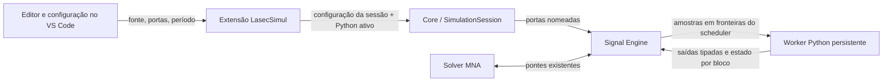

# Python Programável — uso e arquitetura

Decisão detalhada: [ADR-0019](../adr/0019-python-programavel-integracao-core.md).

## Fluxo implementado

O Core mantém a autoridade sobre o tempo simulado. A extensão resolve o ambiente ativo por meio da API pública da extensão Python quando disponível e envia a configuração local à sessão. O worker recebe código apenas quando a configuração muda; os passos transmitem apenas dados tipados, tempo e número do passo.

## Como usar

1. Arraste **Python Programável** da categoria **Controle / Python** para o esquemático.
2. No menu de contexto do bloco, escolha **Configurar pinos Python** para adicionar, renomear, tipar ou remover entradas e saídas.
3. Escolha **Editar código Python**. O documento abre no editor nativo do VS Code em modo Python; use **Validar** e **Aplicar** na barra do editor.
4. Escreva código de nível superior. Entradas são nomes de leitura; atribuições a nomes de saída publicam os valores. Ctrl+Space sugere os pinos e hover mostra tipo, unidade e descrição.
5. Ajuste o período na propriedade do bloco e execute o esquemático. O projeto armazena fonte, portas e período; o interpretador escolhido é local ao workspace.

O comando **LasecSimul: Configurar pinos do bloco Python** também pode ser chamado pela paleta de comandos quando o bloco está selecionado.

## Contrato do bloco

- `typeId`: `python.programmable`.
- Portas escalares `bool`, `int64` e `real`; nome da porta é o identificador usado no programa.
- Entradas são expostas como variáveis nomeadas; quando não estão conectadas usam o valor inicial configurado. Cada saída conserva o último valor até receber uma atribuição válida; antes da primeira atribuição começa no valor inicial configurado para o tipo.
- O programa principal é código Python de nível superior reavaliado como um ciclo. A forma legada `def step(inputs, state, time_ns)` permanece compatível.
- O estado é isolado por instância e só vive durante a sessão de simulação. Pausa mantém estado; reset reinicializa. Não é salvo dentro do `.lsproj`.
- Período é tempo virtual em nanossegundos, alinhado à resolução do scheduler. Execução ocorre fora do solver iterativo MNA.
- A validação do editor analisa sintaxe com `ast` usando o interpretador selecionado. Erros de execução, tipo ou importação aparecem no log da simulação; timeout/crash pausa a sessão, encerra o worker e exige reinício explícito.
- O editor fornece suporte a sintaxe, numeração, indentação, busca/substituição e ferramentas da extensão Python instalada. Completa os pinos e mostra informações de `sim`, `state` e portas ao passar o mouse.
- O Python selecionado pode importar pacotes instalados nesse ambiente. Exemplo: `python -m pip install numpy` no terminal daquele ambiente. Uma biblioteca ausente gera o traceback do interpretador no log.
- O código roda com as permissões do usuário e não é sandbox de segurança. Threads, rede e operações ligadas ao tempo real podem reduzir o determinismo; prefira cálculos e estado local para resultados reproduzíveis.

## Estado da validação

O componente, as portas tipadas com unidade/descrição/valor inicial, worker persistente, integração com a sessão, seleção e troca controlada do interpretador, editor, validação de sintaxe e persistência no projeto estão implementados. A validação automatizada no Windows cobre o scheduler e o Signal Engine, blocos encadeados, tanque em malha fechada, saídas HMI, série do Laboratório de Cálculo, valor inicial antes do primeiro scan, reset do estado em Stop/Run, exceção isolada, além da cadeia sensor elétrico → Python → ponte digital com carga real. Os cinco projetos `.lsproj` passam por carga e save/load. Os seis testes C++/Python e a suíte TypeScript completa passaram; a suíte também valida binding HMI para a saída Python e rejeita canais fora da faixa dinâmica.

A importação e operação com NumPy foram executadas com sucesso no worker usando Python 3.12.5 e NumPy 2.5.4 em ambiente virtual isolado; o interpretador padrão deste workspace continua sem NumPy instalado. O código consulta a API pública `getActiveEnvironmentPath`/`resolveEnvironment` da extensão Python do VS Code e acompanha mudanças do ambiente. Os bindings HMI usam a lista e ordem de saídas configuradas, com testes para canal válido e inválido; a integração automatizada também confirma publicação de telemetria e leitura pelo grafo. Duplicar o componente mantém fonte e definição de portas no modelo serializado; conexões são remapeadas pelo fluxo genérico de duplicação de componentes. Renomear uma porta atualiza referências Python tokenizadas, e remover ou renomear portas reconcilia pinos e conexões. As exceções ficam isoladas por bloco e a propriedade do componente permite manter saídas, voltar aos valores iniciais ou zerar; o timeout é configurável em `lasecsimul.python.stepTimeoutMs` (10–60000 ms). Timeout/crash do worker compartilhado ainda pausa a sessão. Na regressão ampla do Core (125 casos, antes do teste condicional de NumPy), 121 passaram, cinco foram ignorados e quatro falharam em testes não relacionados a Python: `hart_ld301`, `process_subcircuit`, `control_block_subcircuit` e `library_block_session`.

## Referência Wokwi

Reutilizar só os conceitos gerais de manifesto de portas, ciclo de vida por instância e documentação de interface. O formato será nativo do `.lsproj` e do modelo do Core, não o manifesto WASM do Wokwi. Isso mantém uma fonte de verdade para portas, conexões e tipos e evita uma camada de importação sem valor para a execução Python do VS Code.
